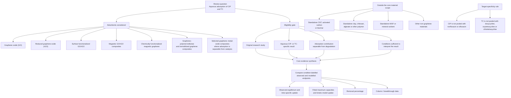

# Figure 1. Scope and adsorbents considered

**Figure caption:** Adsorbents considered and eligibility boundaries for the evidence synthesis of ciprofloxacin (CIP) and tetracycline (TC) adsorption.

**Source and design note:** Author-generated taxonomy based on the approved scope proposal (`docs/SEMESTER_PAPER_SCOPE_PROPOSAL.md`). The eligibility gate is conjunctive: a candidate must satisfy the original-study, material, aqueous target-specificity, adsorption-separation and interpretability requirements. Reviews may support background or citation discovery but do not provide primary-study values in the core comparison.

**Interpretation note:** Each graphene-bearing composite is considered individually. A standalone MOF, mineral or polymer remains outside the core scope unless it contains an eligible graphene-based adsorbent. The figure is a scope map, not a claim that every screened study is included.
