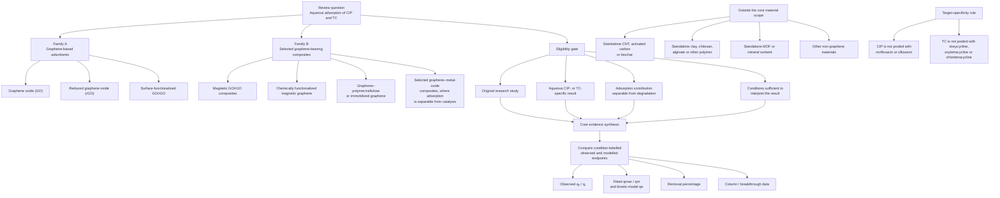

# Figure 1. Scope and material taxonomy

**Figure caption:** Scope and eligibility boundaries for the evidence synthesis of ciprofloxacin (CIP) and tetracycline (TC) adsorption by selected graphene-based adsorbents and graphene-bearing composites.

**Source and design note:** Author-generated taxonomy based on the approved scope proposal (`docs/SEMESTER_PAPER_SCOPE_PROPOSAL.md`). The eligibility gate is conjunctive: a candidate must satisfy the original-study, material, aqueous target-specificity, adsorption-separation and interpretability requirements. Reviews may support background or citation discovery but do not provide primary-study values in the core comparison.

**Interpretation note:** Family B does not automatically include every novel hybrid. Each graphene-bearing composite is assessed individually; a standalone MOF, mineral or polymer remains outside the core. The figure is a scope map, not a claim that every candidate in the screening register is finally included.
