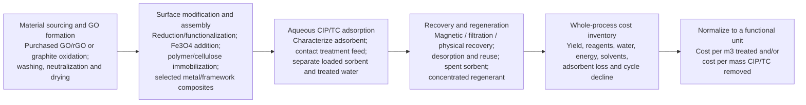

# Figure 2. Preparation-to-recovery process boundary for graphene-based CIP/TC adsorbents

**Figure caption:** Conceptual process boundary for evaluating the practical and low-cost potential of selected graphene-based adsorbents. The flow consolidates alternative preparation, treatment, recovery and regeneration operations reported across the reviewed studies; it is not a single standardized synthesis or treatment protocol.

**Evidence anchors:** Graphite-derived GO and battery-carbon routes are reported by Yasmin et al. (2024) `\cite{yasminEfficientRemovalCiprofloxacin2024}`; sulfonated GO and DMF/HCl regeneration by Shaha et al. (2025) `\cite{shahaExploringAdsorptionEfficiency2025}`; magnetic GO/cellulose and magnetic recovery by Dang et al. (2025) and Dipannita et al. (2025) `\cite{dangIntegrationMagneticGraphene2025,dipannitaCarboxymethylcelluloseFunctionalizedMagnetic2025}`; GO/cellulose aerogel and alkaline regeneration by Yao et al. (2017) `\cite{yao3DAssemblyBased2017}`; hydrogel functionalization and methanol regeneration by Li et al. (2025) `\cite{liThreedimensionalGrapheneOxidebased2025}`; GO/polymer/alginate bead synthesis and its cost-basis discrepancy by Hossain et al. (2026) `\cite{hossainRemovalCiprofloxacinAqueous2026}`; and magnetic GO/Co–Fe recovery by Hossain et al. (2024) `\cite{hossainUltrafastSimultaneousRemoval2024}`.

**Interpretation note:** A waste-derived feedstock does not remove the costs of purification, oxidation, washing, neutralization or drying. Magnetic separation and immobilization can improve handling but may add metal salts, crosslinkers, solvents and fabrication steps. Regeneration can transfer antibiotic mass into a concentrated liquid stream; recovery of the solid alone does not demonstrate destruction or safe disposal of the antibiotic. The functional unit and all input/output balances must be stated before any system can be described as low-cost.
