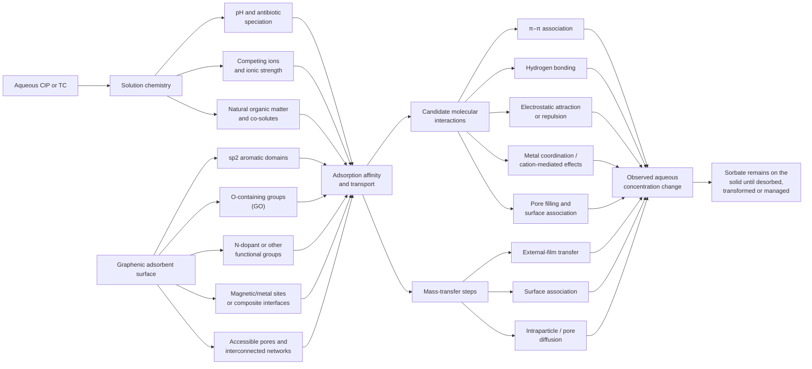

# Figure 3. Candidate interaction pathways for CIP/TC adsorption on graphene-based surfaces

**Figure caption:** Evidence-weighted conceptual schematic of candidate interactions and transport processes in CIP/TC adsorption on GO/rGO and selected graphene-bearing composites. The diagram is not an atomistic structure and does not imply that all pathways act simultaneously or are present in every material.

**Evidence anchors:** π–π interaction is proposed in graphene/CIP and graphene/antibiotic studies and examined using computational/surrogate approaches `\cite{pengAdsorptionAntibioticsGraphene2016,yasminEfficientRemovalCiprofloxacin2024}`. pH/surface-charge and functional-group evidence is reported across GO/Co–Fe, PGOT@GEL, magnetic GO/cellulose and CMC-functionalized magnetic GO systems `\cite{hossainUltrafastSimultaneousRemoval2024,liThreedimensionalGrapheneOxidebased2025,dangIntegrationMagneticGraphene2025,dipannitaCarboxymethylcelluloseFunctionalizedMagnetic2025}`. Multi-step diffusion and porous-composite behaviour are discussed for SGO mixtures and CNF/GO aerogel `\cite{shahaKineticIsothermThermodynamic2026,yao3DAssemblyBased2017}`. Matrix and competition effects are examined for N-rGO and multi-fluoroquinolone SGO tests `\cite{zhangAdsorptionCharacteristicsNrGO2022,shahaKineticIsothermThermodynamic2026}`.

**Interpretation note:** The arrows represent candidate influences, not measured force directions or universal mechanisms. Spectral changes, pH/ion response, surrogate probes and DFT can support an interaction hypothesis but rarely quantify each pathway's share. A pseudo-second-order fit, Langmuir fit or D–R energy parameter alone does not establish chemisorption, a homogeneous monolayer or one unique molecular interaction. Matrix composition can alter both speciation and apparent adsorption. Adsorption reduces the aqueous concentration but does not by itself demonstrate destruction or mineralization of the antibiotic.
