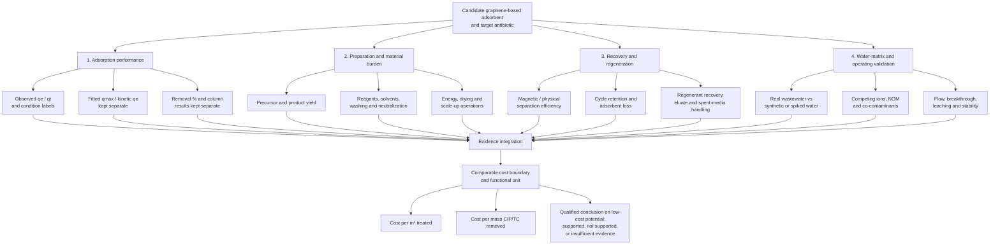

# Figure 4. Evidence framework for assessing practical low-cost potential

**Figure caption:** Four linked evidence dimensions for assessing whether a graphene-based CIP/TC adsorbent has practical low-cost potential. The framework is qualitative and evidence-led; no composite receives a score or rank unless comparable data support it.

**Evidence anchors:** Endpoint conflicts and fitted/observed separation are visible in the battery-derived GO/CIP, sulfonated-GO/CIP and GO/alginate-bead studies `\cite{yasminEfficientRemovalCiprofloxacin2024,shahaExploringAdsorptionEfficiency2025,hossainRemovalCiprofloxacinAqueous2026}`. Magnetic recovery and cycle decline are reported in magnetic GO/cellulose and GO/Co–Fe systems `\cite{dangIntegrationMagneticGraphene2025,dipannitaCarboxymethylcelluloseFunctionalizedMagnetic2025,hossainUltrafastSimultaneousRemoval2024}`. Matrix, trace-mixture and flow-through evidence varies across N-rGO, graphene/GAC benchmarking and alginate/GO PRB work `\cite{zhangAdsorptionCharacteristicsNrGO2022,zhuCiprofloxacinAdsorptionGraphene2015a,zhaoSodiumAlginateGraphene2018}`.

**Interpretation note:** The framework does not convert unreported values into estimates. A material can have strong laboratory adsorption data but weak cost evidence; magnetic recovery can reduce separation difficulty but add reagents and fabrication steps; high percentage removal at high dose does not alone establish low cost. A cost claim requires a stated system boundary, a defined functional unit, product yield, input quantities, energy, replacement/regeneration, and residual-stream handling.
