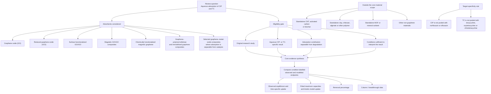
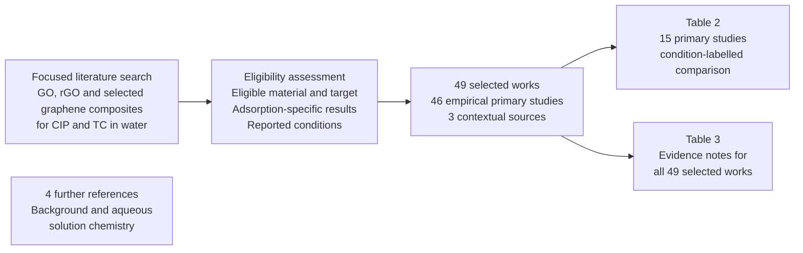
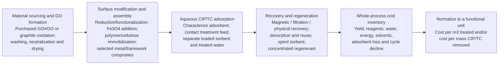
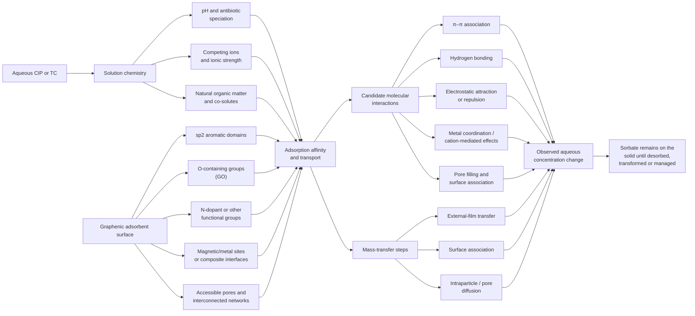
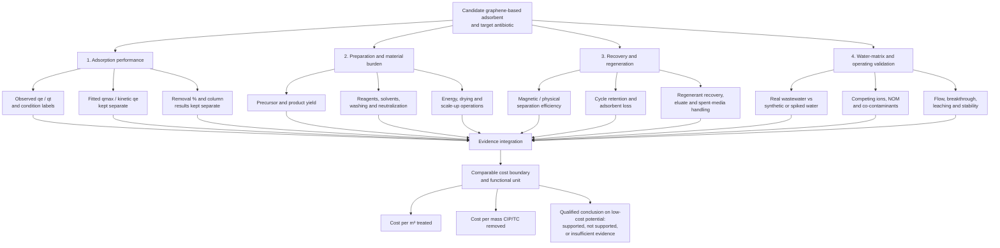

# Assessing the Low-Cost Potential of Non-Conventional Engineered Adsorbents for Ciprofloxacin and Tetracycline Removal from Aqueous Media


## Abstract

Graphene oxide (GO), reduced graphene oxide (rGO) and selected graphene-bearing composites have been investigated as adsorbents for removing ciprofloxacin (CIP) and tetracycline (TC) from aqueous media. Their practical value, however, depends on more than a high reported removal percentage or fitted adsorption capacity: preparation chemistry, separation, regeneration, water-matrix effects and reproducible process costs must also be considered. This paper assesses the adsorption evidence and low-cost potential of selected GO/rGO materials and magnetic, polymer/cellulose and other graphene-bearing composites for CIP and TC. A focused literature search identified relevant primary studies through publisher and biomedical-index records, as well as accessible institutional and author repositories. Experimental conditions and source locations were recorded during data extraction, and observed uptake, fitted isotherm capacities, kinetic-model outputs, removal percentages and column results were treated as distinct endpoints. The review discusses 49 selected works and four additional contextual references. Evidence from full texts, abstracts, publisher previews, and indexed records is interpreted according to its source-access tier. This paper is a narrative evidence synthesis, not a completed systematic review.

Across the studies, graphene-based materials demonstrate adsorption under varied laboratory conditions, but differences in feed concentration, adsorbent dose, pH, contact time, temperature and matrix prevent a defensible universal capacity ranking. Proposed interactions include π–π association, pH-dependent electrostatic effects, hydrogen bonding, and contributions from pore accessibility and mass transfer. Most studies do not independently quantify the relative contribution of these mechanisms. Magnetic separation and immobilized formats can improve handling and recovery, but add synthesis, washing, drying and regeneration steps. Evidence from real-water systems is limited and heterogeneous. Some reported performance values also contain unresolved mass-balance or source-internal inconsistencies. Most studies do not provide product yields, full reagent and energy inventories, regenerant recovery or comparable treatment-cost denominators. The available literature supports the adsorption promise of selected graphene-based materials but does not yet demonstrate that these materials are consistently low-cost for practical water treatment. Future studies should report complete mass balances, validated real-wastewater tests, adsorbent-loss and regeneration balances, and transparent techno-economic data per treated volume or mass of antibiotic removed.

**Keywords:** ciprofloxacin; tetracycline; graphene oxide; reduced graphene oxide; magnetic graphene composites; antibiotic adsorption; regeneration; low-cost potential.


## 1. Introduction

### 1.1. Antibiotic adsorption as a separation process

Antibiotic residues in water and wastewater are a continuing treatment concern because antibiotics differ in molecular structure, charge state, and environmental behavior. Adsorption has been widely investigated as a flexible separation process for removing dissolved antibiotics from aqueous streams, including as a polishing step alongside other treatment processes. Reviews of antibiotic adsorption describe a broad range of sorbents and operating conditions. They also identify regeneration, process losses, and the treatment of spent media or regenerant streams as important parts of practical treatment. \cite{ahmedAdsorptiveRemovalAntibiotics2015a}

Carbon nanomaterials have also been investigated for antibiotic removal in the presence of co-contaminants. A recent review describes how pH, inorganic ions, natural organic matter, and competing contaminants can affect adsorption in multicomponent systems. It reports both enhancing and inhibiting effects, rather than assuming that competition acts in one direction. These observations support treating solution chemistry and matrix composition as experimental variables rather than background details. The review is used here for field mapping and conceptual context only; its compiled capacities are not treated as new primary measurements. \cite{jiaoCarbonNanomaterialsCoremoval2025}

Adsorption must be distinguished from degradation. A decrease in aqueous concentration does not, by itself, demonstrate the chemical destruction or mineralization of an antibiotic. The sorbed mass remains associated with the adsorbent until the adsorbent is recovered, regenerated, or managed as spent material, unless a separate transformation process is demonstrated. Accordingly, practical feasibility assessments must consider adsorbent recovery, desorption chemistry, reuse performance, and residual-stream management—not only maximum adsorption capacity. \cite{ahmedAdsorptiveRemovalAntibiotics2015a,jiaoCarbonNanomaterialsCoremoval2025}

### 1.2. Why solution chemistry matters for ciprofloxacin and tetracycline

Ciprofloxacin (CIP) and tetracycline (TC) are chemically complex adsorption targets because their charge states and interactions depend on solution conditions. A primary study of CIP on Ca-montmorillonite reported pKa values near 6.1 and 8.7 and provided evidence of cation exchange between CIP and interlayer cations under the high-concentration conditions studied. This mineral-sorbent experiment is outside the adsorbents considered in the present paper; it is cited only as a mechanistic illustration that antibiotic speciation and surface charge can influence uptake. Its high feed concentrations should not be treated as representative of trace-level water treatment or as evidence for graphene adsorption. \cite{wangCationExchangeInteraction2010}

Natural organic matter can add another layer of complexity. Equilibrium-dialysis work on TC and Elliott soil humic acid found strongly pH-dependent association, with a reported sorption maximum near pH 4.3 and sensitivity to electrolyte cations; Ca2+ addition increased TC association with the humic-acid system under some conditions. Humic acid in that study was dissolved organic matter, not a graphene adsorbent or a conventional solid sorbent. The paper is therefore used only to support the relevance of dissolved-organic-matter interactions when interpreting aqueous TC chemistry, not as a material-performance comparator. \cite{guComplexationAntibioticTetracycline2007a}

These mechanistic examples do not replace measurements on the selected graphene materials. Instead, they illustrate why adsorption results must be interpreted in the context of pH, electrolyte composition, competing solutes, and water matrix. Evidence from a clay interlayer or dissolved humic-acid system cannot be transferred directly to graphene oxide, reduced graphene oxide or a graphene-bearing composite.

### 1.3. Rationale for examining graphene-based adsorbents and selected composites

Graphene oxide (GO), reduced graphene oxide (rGO), and their functionalized derivatives form a family of carbon-based adsorbents whose surface chemistry can be modified through oxidation, reduction, sulfonation, and other treatments. Selected composites extend this design space by combining graphene-derived surfaces with magnetic particles, polymers, cellulose or other components. These designs can alter surface functionality, dispersion, accessibility, and handling. Magnetic or immobilized formats may also simplify solid–liquid separation. These potential benefits must be weighed against the additional synthesis, washing, drying, cross-linking, and regeneration steps that composite preparation may require.

The primary studies included here illustrate why material design and operational performance must be assessed together. Examples include sulfonated GO for CIP, magnetic rGO/metal-oxide composites for TC, and magnetic GO/cellulose or GO/polymer architectures. The reported endpoints differ: some studies provide direct uptake measurements under defined batch conditions, whereas others report model-fitted capacities, removal percentages, or reuse-cycle performance. The evidence therefore does not justify treating one large reported capacity or one high removal percentage as a universal measure of material superiority. \cite{shahaExploringAdsorptionEfficiency2025,zhuAdsorptionTetracyclineAntibiotics2018,dangIntegrationMagneticGraphene2025,dipannitaCarboxymethylcelluloseFunctionalizedMagnetic2025}

### 1.4. The gap: adsorption performance is better documented than comparable affordability

Across the studies included here, adsorption performance is generally reported in greater detail than the economics of the full process. Studies may provide a Langmuir or Sips fitted parameter, an experimentally observed uptake, a kinetic-model-fitted uptake, a removal percentage or a reuse-cycle result, but these quantities are not interchangeable. Results also differ in initial concentration, adsorbent dose, pH, contact time, temperature and matrix composition. A trace-level removal test, a high-concentration isotherm and a mixed-solute experiment answer different questions and should not be collapsed into a single capacity ranking.

The same caution applies to affordability. A waste-derived precursor, a high fitted \(q_{\max}\) or magnetic separability does not establish low overall cost. A credible assessment must account for the precursor, reagents, product yield, energy use, washing and neutralization, separation, regeneration, solvent recovery, and waste handling. It must also use a meaningful denominator, such as cost per volume treated or mass of CIP or TC removed. Reviews of carbon nanomaterials identify chemical and energy demands as important production-cost drivers, while primary GO-composite studies in the present set frequently do not report a normalized cost inventory. \cite{jiaoCarbonNanomaterialsCoremoval2025,liThreedimensionalGrapheneOxidebased2025,shahaExploringAdsorptionEfficiency2025,hossainRemovalCiprofloxacinAqueous2026}

Accordingly, this paper treats “low-cost potential” as a question to be evaluated using reported preparation and treatment data, not as a property inferred from material origin or adsorption capacity. When a comparable cost estimate is absent or cannot be reconstructed from the stated assumptions, the evidence is described as unreported or uncertain rather than assigned an unsupported price.

### 1.5. Aim and research questions

The aim of this paper is to assess the adsorption behaviour and practical low-cost potential of selected graphene-based adsorbents and graphene-bearing composites for removing ciprofloxacin and tetracycline from aqueous media. The analysis considers:

1. How GO, rGO and surface-functionalized derivatives perform for CIP and TC when observed uptake, fitted capacity, kinetic-model outputs and removal percentages are kept distinct.
2. Whether magnetic functionalization or immobilization into a graphene-bearing composite offers demonstrated benefits for recovery, reuse, water-matrix performance or handling.
3. How pH, antibiotic speciation, dose, initial concentration, contact time, competing solutes and matrix composition affect the interpretation of reported results.
4. Which proposed adsorption mechanisms are supported by primary experimental evidence and which remain author interpretations or model-based hypotheses.
5. Whether studies provide reproducible evidence on chemical inputs, preparation energy, yield, regeneration, waste handling and normalized cost—or merely describe the material as economical or low-cost.

## 2. Scope and methods

Figure 1 summarizes the adsorbents considered in this review and defines the boundaries of the evidence synthesis. The diagram identifies the graphene-based adsorbents included in the review, distinguishes them from standalone non-graphene sorbents, and treats CIP and TC as separate target antibiotics.

**Figure 1. Scope and adsorbents considered**

*Scope and eligibility boundaries for the evidence synthesis of ciprofloxacin (CIP) and tetracycline (TC) adsorption by selected graphene-based adsorbents and graphene-bearing composites.*




### 2.1. Adsorbent and antibiotic eligibility

The core material scope includes graphene oxide (GO), reduced graphene oxide (rGO), surface-functionalized GO/rGO derivatives, magnetic graphene-based adsorbents, and selected graphene–polymer/cellulose, immobilized graphene, and graphene–metal-oxide composites. Composite adsorbents are included only when their adsorption contribution can be distinguished from catalytic or oxidative removal.

Ciprofloxacin (CIP) and tetracycline (TC) are the only targets in the core comparison. Papers may study additional compounds, but only separable CIP- or TC-specific results enter the comparison. CIP is not pooled with norfloxacin or ofloxacin; TC is not pooled with doxycycline, oxytetracycline or chlortetracycline.

Standalone carbon nanotubes, activated carbon, biochar, clay, chitosan, alginate or other polymers without a graphene component are outside the core material scope. Activated carbon may appear as a clearly labelled benchmark when the graphene result is independently reported. Clay and humic-acid studies are used only as solution-chemistry comparators. Reviews support background and citation discovery but are not treated as primary adsorption experiments or sources of new performance values.

A study is eligible for the core evidence synthesis when it is an original research study, examines one of the adsorbents described above, tests CIP and/or TC in an aqueous system, reports a target-specific adsorption result and provides sufficient experimental detail for that result to be interpreted. Studies dominated by photocatalysis, oxidation, Fenton-like chemistry, sonochemical degradation or another non-adsorptive process are excluded from adsorption-performance synthesis unless an adsorption-specific contribution can be separated. Theory-only work may support mechanistic context but does not substitute for measured aqueous adsorption data.

### 2.2. Literature identification and search strategy

A focused literature search was conducted to identify original studies of graphene oxide (GO), reduced graphene oxide (rGO) and graphene-bearing composites used to adsorb ciprofloxacin (CIP) or tetracycline (TC) from water. Search terms combined material names, including magnetic graphene and graphene composites, with the antibiotic names and terms related to adsorption, removal, equilibrium, kinetics, regeneration and treatment of real water. The search formulations are listed in **Table 1**.

Relevant studies were located through public web searches and searches of PubMed/PubMed Central (PMC), RSC Publishing, Frontiers, ScienceDirect and other publisher websites and biomedical indexes. Institutional- and author-hosted copies were also consulted where available. Scopus and Web of Science were not searched. No fixed publication-date or language limits were applied. The search was focused rather than exhaustive, and the findings are therefore discussed as a narrative review.

<!-- TABLE_1_SEARCH_STRATEGY -->

### 2.3. Study selection and source availability

Titles and abstracts were screened against the material, antibiotic, aqueous-system, and adsorption criteria in Section 2.1. Full texts were reviewed when available. Studies were included in the empirical comparison when they used an eligible graphene-based material, reported an adsorption result specific to CIP and/or TC, and provided sufficient experimental detail for interpretation. For studies involving several antibiotics, only separable CIP- or TC-specific results were considered. Reviews, theoretical papers and other contextual sources were used for background or mechanistic discussion, not as substitutes for experimental adsorption results.

This review discusses **49 selected works**: 46 empirical primary studies and three sources used for theoretical, review, or scope-related context. Four additional references provide background on antibiotic adsorption and aqueous solution chemistry; they are separate from the 49 selected works. Source availability varied between studies. The condition-labelled comparison of the 15 primary studies is presented in Table 2, while the selected-reference index and study-level source qualifications are summarized in Table 3. When a full article was available, its methods, results, and supporting data were examined. When only an abstract, preview, indexed excerpt, or hosted manuscript was accessible, the discussion was restricted to information available in that source. Missing details were not inferred, and inconsistencies within individual papers were preserved as explicit qualifications.

**Figure 2** outlines the focused search and eligibility assessment and shows how the selected literature is organized in the main comparison and selected-reference evidence coverage.

**Figure 2. Overview of literature identification and evidence organization.**

*Overview of literature identification and evidence organization. The diagram summarizes the focused search, application of the eligibility criteria and organization of the literature discussed in the review. Four additional background references are shown separately.*



### 2.4. Data extraction and critical evidence assessment

Information was extracted from each selected study using a structured record. Where reported, this included the material composition and preparation method; target antibiotic; water matrix; initial concentration; adsorbent dose and solution volume; pH; contact or equilibrium time; temperature; competing solutes; adsorption measurements; kinetic and isotherm results; mechanistic observations; regeneration and reuse; and process- or cost-related information. For numerical results, the relevant page, section, table, figure or equation was noted whenever it could be located. Missing conditions, unavailable supporting information and inconsistencies within a source were recorded as limitations rather than filled by assumption.

Different adsorption endpoints were kept separate. These included experimentally observed uptake, uptake calculated from a reported mass balance, kinetic-model-fitted uptake, fitted isotherm capacity, percentage removal and column or breakthrough measures. They were not pooled or ranked unless their definitions and experimental conditions were sufficiently comparable. Mechanistic claims were assessed in light of the evidence used to support them: spectroscopy and surface characterization, controlled pH or competition tests, microscopy or probe experiments, computational calculations and author interpretation provide different levels of evidence. A pseudo-second-order fit alone does not establish chemisorption, a Langmuir fit alone does not prove a homogeneous monolayer, and a calculated interaction energy does not quantify the contribution of a binding interaction in water.

### 2.5. Quantitative synthesis and low-cost assessment

Results were synthesized descriptively, with each reported value interpreted alongside its experimental conditions. Observed equilibrium uptake (\(q_e\)), time-specific uptake (\(q_t\)), mass-balance-derived uptake, kinetic-model-fitted uptake, fitted isotherm capacity (\(q_{\max}\) or \(q_m\)), percentage removal and column or breakthrough measures were treated as separate endpoints. These different measures were not combined into a universal capacity ranking. Single-solute experiments were distinguished from multicomponent tests, and synthetic water, synthetic urine, spiked natural water and real wastewater were not treated as equivalent. Results were interpreted in relation to initial concentration, adsorbent dose, pH, contact time, temperature and matrix composition.

Low-cost potential was assessed in terms of adsorbent preparation and operation, rather than inferred from the precursor, reported capacity, or magnetic response. Relevant factors included precursor and reagent requirements, product yield, energy demand, washing and neutralization, water use, solid–liquid separation and recovery losses, regeneration chemicals, solvent recovery, waste handling and adsorbent replacement. A meaningful cost comparison also requires a stated currency and price year, a defined process boundary and a denominator such as cost per volume treated or mass of antibiotic removed. Where these details were missing or inconsistent, the economic evidence was described as unreported or uncertain rather than converted into an unsupported cost estimate.


## 3. Results and discussion

The 15 studies with the most condition-labelled endpoints are presented in **Table 2**, which separates study conditions, experimental endpoints, fitted-model outputs and practical feasibility evidence. Separate experiments are listed independently; observed, derived and model-fitted values are not combined. **Table 3** provides evidence notes for all 49 selected works. Table 2 is a condition-labelled subset, not a ranking of the selected literature.

## 3.1. Reported adsorption performance is condition-dependent, not a universal capacity leaderboard

The evidence does not support ranking graphene-based adsorbents by a single reported “capacity.” Studies report different endpoints—observed equilibrium uptake (\(q_e\)), kinetic-model-fitted \(q_e\), isotherm-fitted \(q_{\max}\) or \(q_m\), percentage removal, and reuse-cycle removal—under different initial concentrations, adsorbent doses, pH values, contact times, temperatures, and matrix compositions. These quantities describe different aspects of performance and cannot be placed in a single numerical ranking without further harmonization. Table 2 therefore presents these endpoints separately and does not rank the materials.

For tetracycline (TC), the graphene oxide/calcium-alginate fiber study reports observed \(q_e = 17.6\) mg/g at an initial concentration of 10 mg/L and \(q_e = 65.4\) mg/g at 60 mg/L; both values came from separate 25 °C, 5-hour equilibrium tests at a dose of 0.50 g/L. Its Langmuir-fitted \(q_{\max} = 131.6\) mg/g is a separate model parameter, not the measured uptake under either feed condition. The authors also report a highest removal of 56.8% at pH 6 in a separate pH test using 50 mg/L TC; that percentage should not be paired with the two \(q_e\) values as though all three results came from the same experiment. The model-fit comparison needs an explicit caveat: the reported Freundlich \(R^2 = .9986\) is slightly higher than the Langmuir \(R^2 = .9938\), even though the paper highlights the Langmuir \(q_{\max}\). Present 131.6 mg/g only as the source-reported Langmuir-fitted parameter, not as an unqualified best-fit capacity. \cite{zhuAdsorptionTetracyclineAntibiotics2018}

A second TC study illustrates why each reported value must remain linked to its endpoint and temperature. Carboxymethylcellulose-functionalized magnetic graphene oxide reportedly removed 96.04% of TC at an initial concentration of 2 mg/L, a dose of 0.1 g/L, pH 5, 25 °C and 25 minutes. A mass-balance calculation from those conditions gives approximately 19.21 mg/g, but this is a derived check rather than a directly quoted experimental \(q_e\). Its linear Langmuir \(q_{\max} = 54.73\) mg/g was fitted at 50 °C. These results are not inherently contradictory because they represent different metric types measured at different temperatures. The derived uptake and fitted parameter should be reported separately; they are not interchangeable measures of capacity. \cite{dipannitaCarboxymethylcelluloseFunctionalizedMagnetic2025}

A magnetic graphene oxide/fibrillated cellulose composite has a reported TC uptake of \(q_e = 93.36\pm3.85\) mg/g at an initial concentration of 70 mg/L and dose of 0.50 g/L; its fitted Sips parameter is \(q_m = 130.11\) mg/g. The source extraction associates this dose test with pH 5 and a 960-minute contact period, but the temperature associated with this specific \(q_e\) result has not yet been confirmed. This result provides a condition-specific composite measurement, but it should not enter a condition-matched ranking until the missing temperature is verified. \cite{dangIntegrationMagneticGraphene2025}

For ciprofloxacin (CIP), a zinc–carbon-battery-derived graphene oxide study reports 99.0% removal at an initial concentration of 2 mg/L, GO dose of 20 mg/L, pH 5.7, 30 °C and 20 minutes. The same paper reports a Langmuir-fitted \\(q_{\\max} = 419.62\\) mg/g at 30 °C and, in a kinetic test with overlapping nominal feed concentration, GO dose, pH and temperature, experimental \\(q_e = 78.82\\) mg/g and pseudo-second-order fitted \\(q_e = 79.36\\) mg/g. The batch arithmetic reveals a dose-basis discrepancy: the Methods section states a 40 mL volume, so 20 mg/L corresponds to 0.80 mg GO and 99.0% removal from 2 mg/L implies \\(q_e \\approx 99\\) mg/g; Table 4's experimental \\(q_e=78.82\\) mg/g would instead correspond to about 78.82% removal on that same basis. Conversely, combining the 99% removal result with \\(q_e=78.82\\) mg/g implies about 1.005 mg GO per 40 mL (25.1 mg/L); the PSO fitted \\(q_e=79.36\\) mg/g implies about 0.998 mg (25.0 mg/L). A different weighed dose could explain the discrepancy, but the paper does not state the exact GO mass used in each kinetic flask or confirm a 25 mg/L dose. Keep the reported removal, experimental uptake and fitted uptake separate; do not silently change the 20 mg/L dose. The 20 g/L value in the Conclusion conflicts with the 20 mg/L value in the abstract, Methods, figure captions, and Results—a 1,000-fold difference. It may be a unit error, but it is not corrected here without author confirmation. The Langmuir \\(q_{\\max}\\) is a separate isotherm-fit parameter, not the uptake at the low-concentration removal condition. This study demonstrates removal at a low initial concentration; it does not establish low overall treatment cost. \\cite{yasminEfficientRemovalCiprofloxacin2024}

## 3.2. High fitted capacities require both a condition label and a source-quality check

The full-text PGOT@GEL study reports a Langmuir-fitted \(q_{\max} = 821.24\) mg/g for CIP (isotherm discussion, printed p. 8). The separate response-surface validation reports measured \(q_e = 807.54\) mg/g versus a predicted 800.60 mg/g at \(C_0 = 296.52\) mg/L, pH 6.70, PGOT@GEL dose 5.08 mg and 298.88 K (RSM discussion, printed p. 9, Section 3.3.6). At that \(q_e\) and adsorbent mass, about 4.10 mg of CIP must have been adsorbed; the initial solution volume would therefore need to be at least about 13.84 mL at the stated \(C_0\) for the mass balance to be feasible. The main paper's Section 2.6 (printed p. 3) refers to the Supporting Materials for the full adsorption-experiment details, but the solution volume is not reported in the main PDF and the supporting information was not available for review. The validation result therefore cannot yet be independently checked by mass balance. This limitation does not, by itself, establish that the reported value is incorrect. A separate pH test reports \(q_e = 192.24\) mg/g and 96.12% removal at pH 7. These are distinct endpoints. The source also has a matrix-label inconsistency: the prose refers to real-water samples while Figure 12 captions the application test as simulated real wastewater (printed pp. 10–11). The high fitted value is evidence of strong reported uptake under the studied conditions, not by itself proof of trace-level treatment, verified real-wastewater performance or low cost. \cite{liThreedimensionalGrapheneOxidebased2025}

The sulfonated graphene oxide (SGO) CIP study reports a fitted Langmuir \(q_{\max} = 1000\) μmol/g (331.35 mg/g) and a separate experimental \(q_e = 237.12\) μmol/g (approximately 78.6 mg/g) at an initial concentration of 50 μmol/L, pH 4, 25 °C and dose 0.2 g/L. Table 1 reports the latter experimental uptake, while the text reports 96.53% removal at the nominally same 25 °C condition. Using the paper's stated dose and mass-balance equation gives approximately 94.85% removal from \(q_e = 237.12\) μmol/g, so that \(q_e\)/removal pair retains a real consistency flag. The distinction between experimental series is important: the kinetic/concentration series covers 10–100 μmol/L (Table 1, printed p. 40822), whereas the Langmuir isotherm series in Figure 10 spans 50–1000 μmol/L at 0.2 g/L and pH 4 (printed p. 40824); Table 2 reports the fitted \(q_m = 1000\) μmol/g across 25–40 °C (printed p. 40825). A 500 μmol/g ceiling calculated from the separate 100 μmol/L kinetic series must therefore not be applied to this isotherm fit. Keep the fitted parameter distinct from measured \(q_e\), preserve the removal discrepancy, and do not silently alter either source value. \cite{shahaExploringAdsorptionEfficiency2025}

The nitrogen-doped reduced graphene oxide (N-rGO) study is relevant to trace-antibiotic treatment. However, the user-supplied full text confirms that its tetracycline mass-balance discrepancy remains unresolved. Methods Section 2.3 combines 80 mL of antibiotic feed with 20 mL of N-rGO dispersion at 0.5 mg/L. At the Figure 2a TC condition \(C_0=10\) µg/L in the stated 80 mL feed, the initial TC mass is 0.8 µg and the N-rGO mass is 0.01 mg, giving a strict feed ceiling of 80 mg/g; Table 1 reports 90.21 mg/g. Figure 2c shows an even larger discrepancy: at \(C_0=1\) µg/L and 40–100 µg/L N-rGO dose, the plotted TC uptake is approximately 88–90 mg/g, above the finite-feed limit under the stated preparation. Table 2 gives a fitted TC Langmuir \(q_m=662.25\) mg/g; the 1,265.82 mg/g abstract maximum belongs to clindamycin (CLI), not TC. These uptake values remain excluded from cross-study capacity rankings pending clarification. The paper’s ion, humic-acid and six-antibiotic competition tests are simulated matrices; humic acid at 10 mg/L reduced uptake by up to 30%, and the general eight-cycle decline of no more than 25% is not a TC-specific retention series. \cite{zhangAdsorptionCharacteristicsNrGO2022}

The graphene-versus-granular activated carbon (GAC) ciprofloxacin study provides a useful conventional benchmark, although the available evidence is limited to the publisher and PubMed abstracts. The publisher and PubMed abstracts report that graphene reached equilibrium within approximately 3 min and had a Langmuir-fitted \(q_{max}=323\) mg/g. They also report that ionic strength (0.01–0.5 mol/L), natural organic matter (5 mg/L), and the tested water sources (river water or drinking water) had less pronounced adverse effects on graphene than on GAC. The abstract does not reveal the initial concentration, adsorbent dose, temperature, numeric pH range, isotherm concentration range, water-matrix preparation or exact effect sizes; the full article and supplemental file were not available. The study therefore supports a qualitative comparison of adsorption rate and relative matrix sensitivity. However, the fitted value of 323 mg/g remains excluded from condition-matched numerical rankings. The authors also condition practical application on proper graphene separation and recovery; the accessible abstract does not provide a monetized recovery cost or verified regeneration-cycle data. GAC is included as an industrial benchmark and is not one of the graphene-based adsorbents examined in this review. \cite{zhuCiprofloxacinAdsorptionGraphene2015a}

## 3.3. Graphene-containing composites add practical benefits, but also processing and regeneration burdens

Composite and magnetic formats can improve separation or handling, but those advantages must be weighed against the recovery procedure. The full-text cellulose nanofibril/GO (CNF/GO) aerogel article reports 82.1% TC removal in a 21-antibiotic screening experiment (Fig. 7). After ten adsorption–desorption cycles, the reported TC removal is 78.9% (Fig. 13). The general batch method specifies 8 mg CNF/GO in 40 mL, agitation at 160 rpm, and incubation overnight at 25 °C. Initial concentrations range from 1 to 100 mg/L, and pH is adjusted from 2 to 12. However, the Fig. 7 caption does not identify the specific initial concentration, pH, or dose used for the 82.1% result. That value is therefore unsuitable for a condition-matched removal ranking. The conditions used in the separate TC factor tests should not be assumed to match those in Fig. 7. Table 1 gives a pseudo-second-order model-fitted \(q_e=84.8\) mg/g (\(R^2 = 0.99\)), while Table 2/Fig. 9 gives Langmuir-fitted theoretical \(q_m=454.6\) mg/g (\(R^2 = 0.99\)); the conclusion rounds the same \(q_m\) to 454.5 mg/g. These model-derived values are not observed uptake and must remain distinct from the removal percentage. Regeneration uses 5 wt.% NaOH for 5 h, followed by washing and vacuum freeze-drying. The article reports no monetary cost estimate or energy inventory; its statements about economic advantages therefore do not constitute a verified cost assessment \cite{yao3DAssemblyBased2017}.

The seven-antibiotic graphene study provides evidence from a low-concentration mixed-solute system. Its experimental design uses 100 mg sorbent in 100 mL containing each antibiotic at 200 ng/mL (200 μg/L), pH 7, 298 K and 120 rpm, equivalent to 1 g/L graphene. The Results text states that TC adsorption by graphene approached equilibrium in about 2.5 hours. The main text reports an 89.3–100% removal range across all seven drugs for graphene, not a TC-specific percentage; that exact point is plotted in Fig. 2 but is not stated numerically in the text, so the TC-specific percentage should not be inferred from the overall range. The mean equilibrium uptake reported for graphene in the main text (190.3 μg/g) is averaged across all seven antibiotics and is not specific to TC. The official Supplementary Information, Table S2, does report TC-specific experimental kinetic \(q_e=200.2202\) μg/g, with first- and second-order fitted \(q_e\) values of 198.8393 and 200.6055 μg/g, respectively; these are kinetic uptake values, not an isotherm \(q_{max}\). On the stated 100 mg sorbent/100 mL/200 μg/L-per-drug basis, the TC feed-mass ceiling is 200 μg/g, so the reported experimental value exceeds it by about 0.11%. Preserve this small mass-balance flag rather than converting it into a removal percentage above 100%. This experiment used a synthetic mixed solution; it was neither a single-solute TC isotherm nor a direct test in untreated wastewater. The paper's biochar comparator results remain outside the core graphene comparison \cite{pengAdsorptionAntibioticsGraphene2016}.

Two additional configurations illustrate why high removal does not, by itself, establish a low-cost advantage. The GO/Co–Fe magnetic composite paper reports tetracycline (TC) removal of 94.1% in its abstract and Section 3.2.2 (Fig. 5b), 93.91% in Section 3.2.4 (Fig. 5d), and 93.94% in Section 4 Conclusion. The reported optimum conditions are an initial TC concentration of 0.2 mg/L, GO/Co–Fe dose 0.15 g/L, pH 7, room temperature (about 25 °C), 250 rpm and 30 s. These three source-reported percentages are internally inconsistent. They should not be averaged or silently reconciled. Table 2 reports Langmuir-fitted TC \(q_m=60.24\), 62.50 and 64.10 mg/g at 30, 40 and 50 °C, respectively; therefore, the 64.10 mg/g value is a fitted capacity at 50 °C, not the 25 °C removal experiment. Section 3.2.7/Fig. 9 reports up to eight reuse rounds after magnetic separation, methanol treatment, water washing and drying at 50 °C, with removal efficiency falling from 95% to 90%. The paper does not supply a normalized cost inventory or demonstrate real-water testing. The rotating-field Fe₃O₄/rGO study reports removal above 96% for both tetracycline hydrochloride (TCH) and ofloxacin (OFL), each under its own reported optimum conditions. The initial concentration was 30 mg/L, the adsorbent dose was 1.0 g/L, and the excitation current was 2 A; the reported optimum pH was 5 for TCH and 7 for OFL. The composite's reported specific surface area is 95.12 m²/g, and the abstract reports above 87% efficiency after four cycles. The publisher's indexed preview indicates that adsorption was compared with and without the rotating magnetic field (RMF); all three tested Fe₃O₄/rGO formulations performed better under RMF, with CP-Fe₃O₄/rGO performing best. The authors describe Langmuir and pseudo-second-order fits, and attribute the field enhancement to particle rotation and improved external mass transfer, with π–π interactions and hydrogen bonding contributing to adsorption. However, a complete full text and its supplementary information were not available. The exact complex-water matrices, numerical field/no-field effect size, fitted capacity values, field frequency/strength, voltage/power, and energy per treated volume therefore remain unverified. An excitation current of 2 A is not a measure of energy consumption. This study therefore does not establish energy efficiency or a low-cost advantage. \cite{hossainUltrafastSimultaneousRemoval2024,dingRotatingMagneticFieldenhanced2026}

## 3.4. Multicomponent, matrix and flow-through results must remain distinct

Multicomponent experiments provide evidence about competition, but their fitted parameters should not be combined with single-solute capacities. For sulfonated graphene oxide (SGO), the full text reports the following Langmuir-fitted \(q_m\) values at 25 °C of 370.37 mg/g for the binary ciprofloxacin–moxifloxacin system, 357.14 mg/g for the ternary ciprofloxacin–moxifloxacin–levofloxacin system, and 333.33 mg/g for the quaternary system (Table 3, printed p. 10). These are fitted outputs for mixture systems, not \(q_{max}\) values for isolated ciprofloxacin. The mixed-solution isotherms cover 18.24–371.64 mg/L, with SGO at 0.2 g/L and pH 5 (Methods Section 2.4, printed p. 3; Fig. 6, p. 9). These results therefore describe high-concentration synthetic mixtures, not trace-level conditions. Although the abstract describes the material as suitable for real-wastewater treatment, the authors state in their limitations section that real-wastewater samples were not tested (Section 3.12, printed p. 14). The study should therefore not be cited as evidence of demonstrated real-water validation. The study also reports more than 97% antibiotic desorption using DMF containing 1 mol/L HCl and more than 92% retention of initial performance after five adsorption–desorption cycles. However, solvent and acid recovery, waste handling, and process costs are not quantified (Fig. 12, printed p. 13; Section 3.12, p. 14). \cite{shahaKineticIsothermThermodynamic2026}

Flow-through results must also be distinguished from batch adsorption data. The sodium alginate/graphene oxide hydrogel-bead study evaluates a permeable reactive barrier (PRB) for ciprofloxacin-contaminated groundwater and reports an equilibration time of approximately 72 h. The authors report that the flow-through experiments varied the flow rate, influent ciprofloxacin concentration, and ionic strength. They also used a two-site chemical non-equilibrium model to design the PRB under local hydrogeological conditions. The reported maximum adsorption capacity is 100 mg/g at pH 7; however, the abstract says the isotherm data fit Freundlich, whereas the indexed publisher conclusion explicitly calls 100 mg/g a Langmuir-model maximum. This inconsistency in model selection must remain explicit; it should not be silently reconciled. The publisher abstract also states that PRB lifetime and cost were calculated. However, the numerical estimates, underlying assumptions, column conditions, and supporting tables could not be verified from the accessible excerpts. This study therefore supports an application-level discussion of a groundwater PRB, but not a quantitative cost comparison or a verified comparison of column performance. \cite{zhaoSodiumAlginateGraphene2018}

## 3.5. “Low-cost potential” remains a hypothesis until costs are normalized

Figure 3 shows the process boundary used to assess low-cost potential. It brings together alternative preparation, treatment, recovery, and regeneration operations reported across the studies; it does not represent one standardized synthesis or treatment protocol.

**Figure 3. Preparation-to-recovery process boundary for graphene-based CIP/TC adsorbents**

*Conceptual process boundary for evaluating the practical and low-cost potential of selected graphene-based adsorbents. The flow consolidates alternative preparation, treatment, recovery and regeneration operations reported across the reviewed studies; it is not a single standardized synthesis or treatment protocol.*




The evidence reviewed here is substantially stronger for laboratory adsorption performance than for comparative economics. Most studies do not report a full-process cost inventory that includes adsorbent yield; reagent quantities and prices; energy use; washing and drying; regeneration; solvent recovery; residual handling; and a denominator such as cost per volume treated or mass of CIP or TC removed. Preparation and recovery can also impose substantial process burdens. Examples across the studies include strong-acid/oxidant routes for functionalized graphene oxide; freeze-drying; regeneration with 5 wt.% NaOH, methanol, or DMF containing 1 mol/L HCl; a 10 g/L dose in one GO/PVA/calcium-alginate removal test; and rotating-magnetic-field operation for which power and energy per treated volume are not reported. These examples show why a normalized cost boundary must account for synthesis yield, reagents, washing, drying, regeneration, solvent recovery, residual handling, and operating energy. \cite{shahaExploringAdsorptionEfficiency2025,yao3DAssemblyBased2017,hossainUltrafastSimultaneousRemoval2024,shahaKineticIsothermThermodynamic2026,hossainRemovalCiprofloxacinAqueous2026,dingRotatingMagneticFieldenhanced2026}

One study of GO/PVA/calcium-alginate beads reports a cost estimate. However, its calculation assumes a dose of 0.1 g/L, whereas one experimental condition—0.5 g in 50 mL—corresponds to 10 g/L, a 100-fold difference. The Methods section also alternates between 50 mL and 55 mL. The paper reports a bead price of USD 10–30/kg, a maximum observed uptake of 7.15 mg/g and a nonlinear Langmuir-fitted \(q_{\max} = 10.14\) mg/g. Using the reported bead-price range, the corresponding first-loading material-purchase ratio is approximately USD 1,399–4,196 per kg CIP at the observed uptake, or USD 986–2,959 per kg CIP if the fitted \(q_{\max}\) is assumed. These ratios are screening estimates, not lifecycle costs. They do not account for reuse, regeneration, or other process inputs. The reported cycle data do not provide a sufficiently reconciled cumulative mass-removed denominator to support a lifetime-cost estimate. The source's cost conclusion is therefore not independently reproducible from the available extraction. \cite{hossainRemovalCiprofloxacinAqueous2026}

Accordingly, *low-cost potential* should be assessed using multiple criteria. It cannot be inferred from a large fitted \(q_{\max}\), a waste-derived precursor, easy magnetic separation, or a high removal percentage alone. At present, the evidence supports condition-specific conclusions about adsorption and identifies important gaps in process-cost data. It does not support a universal claim that any one graphene-based material is the lowest-cost option.

## 3.6. Further studies illustrate the range of graphene-based adsorbents

The 49 selected references are summarized in Table 3, including the adsorbent type, target antibiotic, source-access tier and permitted quantitative use. This wider coverage should not be confused with 49 equally condition-complete adsorption experiments: some records support condition-labelled uptake or removal, while others can only support qualitative design, matrix, mechanism or scope context.

### 3.6.1. Graphene oxide baselines show target- and model-dependent behaviour

Early GO studies provide useful baselines, but their reported capacities are not directly comparable. For TC, Ghadim et al. report a Langmuir-fitted \(q_m = 322.43\pm1.25\) mg/g at 298 K, followed by 101.87 and 73.53 mg/g at 303 and 308 K, respectively. These values are fitted parameters. The Methods section, figure, and table identify three isotherm temperatures, whereas the Results text refers to additional temperatures. The reported temperature trend also appears inconsistent with the paper's interpretation of the process as endothermic. An earlier GO–TC article reports an abstract-level, Langmuir-derived theoretical \(q_{\max}\) of 313 mg/g. However, the accessible publisher text does not include the full set of experimental conditions or the isotherm table. The abstract and Highlights also disagree on whether Temkin or Freundlich provides the second-best fit. These values document what the sources report; they do not support a harmonized capacity ranking. \cite{ghadimAdsorptionPropertiesTetracycline2013,gaoAdsorptionRemovalTetracycline2012}

For CIP, the GO-nanosheet study by Rostamian et al. reports a maximum fitted or modeled capacity of 173.4 mg/g. The accessible abstract does not provide a numerical TC-specific result, so its qualitative ordering of CIP, doxycycline, and TC must not be converted into an inferred TC capacity. Yadav et al. examine CIP, norfloxacin, and ofloxacin separately. For CIP, the reported batch conditions identify pH 7 and an equilibrium time of 50 minutes. Norfloxacin and ofloxacin remain separate targets, and fitted kinetic or isotherm values are not substitutes for measured uptake. A later GO study compares CIP adsorption in aqueous solution and fresh synthetic urine. It reports author-described maxima of 354.24 and 291.39 mg/g at pH 5 and 6, respectively. However, the accessible preview does not establish whether these values represent measured \(q_e\), conventional fitted \(q_{\max}\), or a statistical-physics saturation parameter. The GO/SMX–CIP paper reports a Langmuir \(S_{\max}\) of 379 mg/g, although the available kinetic and model results favor a Freundlich fit. Some detailed methods and table information were checked against a non-publisher manuscript copy. Together, these studies show that GO adsorption depends on the target antibiotic and water matrix. Their headline capacities should not be ranked as though they represented the same endpoint. \cite{rostamianComprehensiveAdsorptionStudy2018,yadavRemovalFluoroquinoloneAqueous2018,dasilvabruckmannAdsorptionCiprofloxacinAqueous2024,chenRemovalSulfamethoxazoleCiprofloxacin2015}

### 3.6.2. Magnetic and chemically modified graphene can improve handling, but high model capacities remain qualified

Magnetic modification is often proposed as a way to simplify solid recovery, but the available evidence varies in completeness. The magnetic GO sponge study reports 473 mg/g for TC, but the accessible abstract does not indicate whether this value is observed uptake or a fitted capacity. DTPA-functionalized magnetic GO has pseudo-second-order-fitted values of 294.12 mg/g for TC and 111.73 mg/g for CIP. The supporting-information tables needed to assess the equilibrium fits were unavailable. Binary tests also show asymmetric competition: CIP suppresses TC more strongly than TC suppresses CIP. For \(\mathrm{MnFe_2O_4}\)-decorated rGO, the reported condition-specific TC uptake is about 41 mg/g at \(C_0 = 10\) mg/L, with 5 mg sorbent in 30 mL at 25 °C for approximately 8 h. Much larger Langmuir values (870–1326 mg/g) are extrapolated fits; the Freundlich model provides the better fit. A separate magnetic-GO study reports an optimum pH of approximately 3.3 for tetracycline hydrochloride and oxytetracycline, whereas chlortetracycline behaves differently under alkaline conditions. The accessible publisher preview does not provide a primary numerical capacity. \cite{yuAdsorptionBehaviorsTetracycline2017,liPerformanceMagneticGraphene2018,baoAdsorptionTetracyclineReduced2018,miaoAdsorptionPerformanceTetracyclines2019}

Other magnetic derivatives provide additional examples, although the available documentation is uneven. A third-party full-text copy reports a Langmuir \(q_{\max}\) of 555.56 mg/g for CIP on magnetic guar-gum-grafted GO. However, the dose description differs by a factor of ten, and the fit-statistics wording is inconsistent. This value is not a verified observed \(q_e\). For GO·\(\mathrm{Fe_3O_4}\), the abstract reports a maximum TC capacity of 531.93 mg/g at \(C_0 = 1000\) mg/L, pH 7, and 293 K. The solution volume is not available, so a complete mass-balance check is not possible. EDTA-functionalized magnetic GO reports 93.23% TC removal at 0.2 mg/L, a dose of 0.1 g/L, pH 5, 25 °C, and 5 minutes. The derived \(q_e \approx 1.865\) mg/g is a mass-balance check. The kinetic-model values are physically inconsistent with the feed ceiling and are excluded from capacity rankings. Thiourea-dioxide-reduced magnetic GO has an abstract-level, Langmuir-fitted \(q_m = 1233\) mg/g at 313 K. The abstract also describes qualitative effects of pH, NaCl, and humic acid, but the full conditions and tables are not accessible. Magnetic chitosan-grafted GO has an abstract-level Langmuir \(q_m = 282.9\) mg/g for CIP and reportedly retains about 72% of its initial adsorption capacity after four uses. The exact operating conditions, fit statistics, and regeneration protocol remain unavailable. These findings are provisional model and reuse evidence, not a condition-matched capacity result. These studies inform discussion of functionalization and recovery, but do not support a single ranking of magnetic adsorbents. \cite{sayaAdsorptiveRemovalCiprofloxacin2023,dasilvabruckmannDFTTheoreticalExperimental2022,lilyEDTAfunctionalizedMagneticGraphene2026,yangDecontaminationTetracyclineThioureadioxidereduced2017,wangRemovalCiprofloxacinAqueous2016}

### 3.6.3. Polymer, cellulose and immobilized formats add handling options but have their own process and data constraints

Several studies incorporate GO into polymer-based structures. An IOP conference paper compares GO and GO–\(\mathrm{TiO_2}\) and reports 20-minute CIP removal of 34% and 31.5%, respectively, at \(C_0 = 10\) mg/L, a dose of 1 g/L, neutral pH, and ambient temperature. Its source-reported capacities and kinetic fits conflict with the time-course data, so they are excluded from capacity rankings. The GO–sodium-alginate hydrogel/aerogel study is supported by the primary publisher abstract and a third-party copy of the author-accepted manuscript. Table 3 in that copy reports Langmuir-fitted \(q_{\max} = 86.12\) mg/g for GO-SA hydrogel and 55.55 mg/g for GO-SA aerogel. Table 2 separately reports experimental kinetic \(q_e = 25.86\) and 22.59 mg/g, respectively. These are different endpoint types: 86.12 mg/g is a fitted parameter, not an observed uptake measurement. Because these table values were transcribed from an accepted-manuscript copy hosted outside the publisher's platform, the source-access qualification must be retained. The polyacrylamide-functionalized GO/alginate bead study reports a Langmuir \(q_m = 6.846\) mg/g, but the extracted source does not identify an observed uptake or removal endpoint. The Methods describe 55 mL of solution in a 50 mL conical tube, and the reported \(q_e\) equation does not clearly specify the mL-to-L conversion. These dimensional and methodological caveats must be retained; an observed \(q_e\) should not be reverse-engineered. For GO/calcium-alginate fibers, the accessible abstract reports 78.9% removal at 2 g/L and 6 wt.% GO, as well as a separate capacity of 39.06 mg/g at an equilibrium concentration of 60 mg/L. The abstract does not establish that these values come from the same test, and the latter is not a fitted \(q_{\max}\). \cite{padmajaAdsorptiveRemovalCiprofloxacin2024,feiAdsorptiveRemovalCiprofloxacin2016,choiPolyacrylamideFunctionalizedGraphene2022,wuAdsorptionCiprofloxacinBiocomposite2013}

The chitin/GO hybrid illustrates why batch and flow-through results must be interpreted separately. The batch Langmuir fits are reported as 282±11 mg/g for nano-GO and 73±3 mg/g for a chitin:nano-GO 3:1 material; the Sips model is reported as the best overall fit. However, the accepted manuscript states that 100 g of material was packed into a column with an internal volume of only about 1.18 \(\mathrm{cm^3}\). This implies a physically implausible packing density, so the dynamic Thomas and Yoon–Nelson outputs remain on hold. Real-water samples in that paper were spiked. The abstract for a GO/MgO/chitosan composite reports a CIP Langmuir \(q_{\max}\) of 1111 mg/g. Publisher previews of Figure 5 visually corroborate high Langmuir fits, but the captions are not accessible, so the mapping of the CIP result to a specific panel cannot be independently confirmed. The concentration, dose, volume, and model-fit tables remain inaccessible. Norfloxacin is a separate analyte and must not be pooled with CIP. Neither study supports a condition-matched capacity ranking. \cite{gonzalezContinuousFlowAdsorption2018,nazrazChitosanbasedSorbentEfficient2019}

### 3.6.4. Recent engineered composites add matrix and recovery examples, but not yet comparable process economics

Recent studies extend the evidence base beyond unmodified GO and rGO to include engineered magnetic and functionalized composites. For ultrasound-assisted magnetic GO, the experimentally validated response-surface optimum for CIP was 96.39±3.3% removal at \(C_0 = 15\) mg/L, using 0.55 g adsorbent in 15 mL at pH 7 for 33 minutes. This corresponds to a dose of 36.7 g/L; the ultrasound energy was not reported. The study also reports CIP removal of 94.12±2.2% in tap water, 91.66±1.8% in river water, 90.65±3.1% in lake water, and 89.96±2.3% in wastewater. These are the source-reported matrix results. However, Table 5 specifies n=5, whereas Section 3.9 describes triplicate tests. A GO/layered-double-hydroxide composite reports 84.84% CIP removal at \(C_0 = 1\) mg/L, a dose of 10 mg/L, pH 7, and 60 minutes. The accompanying values of 97.43–106.96 mg/g conflict with or exceed the stated feed-mass basis. The reported 84.84% removal implies \(q_e \approx 84.84\) mg/g, while removal during reuse declines from 80.4% in cycle 1 to 27% by cycle 5. A GO–\(\mathrm{[Ni(DMG)]_n}\) study reports model-derived Langmuir values of 117–159 mg/g, although Freundlich and Temkin provide better fits. The accessible source does not identify the value associated with each formulation or provide the exact adsorption conditions. These examples show why response-surface removal, matrix-specific removal, fitted isotherm parameters, and condition-specific uptake must be reported as distinct endpoints. \cite{alishiriRemovalCiprofloxacinCephalexin2023,sikriGrapheneOxideLayered2025,ceylanTailoredGrapheneOxide2026}

Recent magnetic composites provide additional condition-specific results, but their reported endpoints and matrix limitations require careful interpretation. Magnetic GO/Co-MOF is reported to remove 98% of TC at 0.2 mg/L, a dose of 0.1 g/L, pH 7, and 25 °C. Removal declines from 98% to 91% over ten cycles. The reported 98% removal corresponds to a feed-limited uptake of approximately 1.96 mg/g. By contrast, the pseudo-second-order-fitted \(q_e = 19.52\) mg/g exceeds the 2 mg/g feed-mass ceiling under the same conditions and must not be interpreted as observed uptake. The Langmuir-fitted \(q_m = 185.87\) mg/g at 45 °C also exceeds the 100 mg/g ceiling calculated from the highest stated isotherm feed (10 mg/L) and the 0.1 g/L dose. The Fig. 6 caption gives an isotherm \(C_0\) of 0.2 mg/L, whereas Methods §2.7 specifies a range of 0.05–10 mg/L. These values should be retained as source-reported model outputs with an unresolved condition-label conflict, not treated as validated uptake. Zr-modified magnetic GO reports 93.92% CIP removal at a synthetic-water optimum of 30 mg/L, using 0.3 g per 100 mL at pH 7 for 45 minutes. Its reported \(q_e\) conflicts with the feed-mass ceiling. For the pharmaceutical-effluent sample, the decrease from 8.37 to 2.01 mg/L corresponds to 76.0% removal, not the 90.75% reported by the source. The body text and abstract also give different values for the eighth reuse cycle. The magnetic GO/\(\mathrm{NH_2}\)-UiO-66/alginate study reports 98.5% removal and an experimental \(q_e=9.89\) mg/g at the response-surface optimum (pH 5.5, 44 minutes, 1.0 g/L, and \(C_0=10\) mg/L). Removal in river water was 89.34%, but the initial spike concentration or baseline is not disclosed. The abstract reports a Langmuir \(q_m=161.4\) mg/g, but Table 4 identifies Sips as the better-fitting model (\(q_m=746.4\) mg/g, \(m_s=0.46\), \(R^2=0.998\)). Across ten cycles, adsorption efficiency declines from approximately 99% to 80%, while desorption efficiency declines from approximately 98% to 75%. Neither metric represents measured capacity retention. The rGO/\(\mathrm{Pr_6O_{11}}\) CIP paper reports 88.0% removal in the abstract and 88.3% in the conclusion at 10 mg/L, pH 6.6, 0.4 g/L, and 160 minutes. The derived uptake is approximately 22 mg/g; the separate value of 85.5 mg/g is a fitted Langmuir parameter. The pH value of 6.6 should be treated as the source-reported optimum or operating condition, not as a fully reconciled pH point, because the accessible pH-effect series lists pH 2, 4, 8, and 10. The 2026 study by Panda et al. on rGO/\(\mathrm{Pr_6O_{11}}\) reports observed CIP \(q_e\) values of 22.08, 41.04, and 56.12 mg/g at \(C_0=10\), 20, and 30 mg/L, respectively. Its Langmuir \(q_m\) values of 85.5, 79.36, and 71.42 mg/g at 298, 308, and 318 K, respectively, are fitted outputs. The abstract and conclusion report slightly different removal values (88.0% and 88.3%). Figure 19 compares tap water with deionized water, not wastewater, and the reported capacity retention after four cycles is 85.8%. \cite{jahanFabricationMagneticGraphene2026,tekletegieOptimizationCiprofloxacinAdsorption2026,aminMultifunctionalMagneticGraphene2026,pandaInterfaceengineeredReducedGraphene2026}

Copper-alginate/GO/MOF-525 beads are reported to remove 96.6% of TC at pH 7. A separate contact-time result reports 54.6% removal within 38 minutes. However, the source contains inconsistencies in dose, concentration units, and panel/caption references, so the very high low-dose uptake cannot be assigned a complete set of conditions. The GO–TOPO:LevA membrane study provides more detailed process evidence. The municipal wastewater was prefiltered through a 0.45 µm PES membrane and deliberately spiked. In the main single-solute membrane experiment (5 mg/L TET), the reported \(q_e\) is \(17.3\pm0.5\) mg/g. A four-drug co-spiked experiment reports TET removal of \(85.4\pm1.8\%\) and \(q_e=16.9\) mg/g. Separate low-concentration trials at 500 and 1,000 µg/L report removals of 97.8% and 95.4%, respectively. After six regeneration cycles using 0.1 M NaOH, the material retained \(65.4\pm0.9\%\) of its reported performance. The active-layer estimates are USD 2.5–6.8/m² and 14–59 kg \(\mathrm{CO_2}\)-eq/m². These values are not full-module costs or financial costs per volume treated. The powder-batch \(q_e=22.7\pm0.6\) mg/g remains quarantined because its exact feed denominator is unresolved. Citric-acid-crosslinked CMC/GO beads report 94.93% TC removal at an initial concentration of 200 mg/L, a solution volume of 20 mL, a bead mass of 20 mg, and pH 4. These conditions correspond to a derived \(q_e\approx189.86\) mg/g. Full-text Table 3 confirms that the Langmuir \(q_m\) values of 267–278 mg/g are fitted parameters and that the Hill model provides the best fit. Table 8 reports a bead cost of USD 0.541/g and an author-estimated cost of USD 1.95/g TC removed. However, the calculation uses the linear Langmuir \(q_m\), despite the better Hill fit, and illustrates treatment at 1 g TC/L even though the experiments reached only 250 mg/L. The Methods report 0.1 M acid/base for desorption, whereas the Results and Figure 10 use 1.0 M. The reported 83.9% NaOH value is desorption efficiency after three cycles, not capacity retention. No real-wastewater or flow validation is reported. \cite{chenEffectiveRemovalTetracycline2022,lemaouiSurfaceAssembledGraphene2026,saheedCitricAcidCrosslinked2026}

Some references provide context rather than additional adsorption measurements. The graphene-based tetracycline review is used for background, while the rGO/CIP/TC molecular-modelling study contributes calculated interaction energies but no aqueous batch measurements. The onion-peel-derived GO-like carbon nanosheet study reports experimental adsorption results. However, the material is described as GO-like carbon rather than analytically verified GO or rGO, so it is discussed separately from the core graphene comparison. \cite{minaleApplicationGraphenebasedMaterials2020,ngoctriAdsorptionTetracyclineCiprofloxacin2024,ghahremaniRemovalCiprofloxacinWater2025}

## 3.7. Limitations of the available evidence

The studies report different adsorption metrics under different experimental conditions. Observed uptake, fitted isotherm capacities, kinetic-model outputs, removal percentages and column results therefore cannot be treated as interchangeable measures of performance. Differences in initial concentration, adsorbent dose, pH, temperature and water composition further limit direct comparisons between studies.

Evidence strength also varies with source availability. Some results could be checked against full articles and supporting data; others were available only in abstracts, previews, or indexed excerpts. Several papers contain inconsistencies in reported values or experimental details. These discrepancies are retained as explicit qualifications rather than resolved by assumption.

Evidence from real wastewater and continuous-flow systems is still limited. Similarly, few studies report the preparation yield, reagent and energy requirements, recovery losses and treatment-cost basis needed for a reliable economic comparison. The available results support a descriptive assessment of adsorption performance and practical considerations. They do not support a universal ranking or a definitive conclusion that these materials are low-cost.

\newpage

**Table 2.** The comparison covers 15 primary studies and reports 19 experimental conditions with 28 separately identified endpoints. It is intended to show how results depend on experimental conditions, not to rank the adsorbents by a single capacity value. Table 3 summarizes the evidence available for all 49 selected works.

**Guide to the table.** Table 2 A identifies the studies, target antibiotics and adsorbents. Table 2B lists the conditions for each experiment, and the author–year labels link these conditions to the results in Table 2C. Tables 2D and 2E present fitted isotherm and kinetic parameters, respectively. Tables 2F(a) and 2F(b) summarize separation, regeneration and reuse; Table 2G describes water-matrix tests; and Tables 2H and 2I summarize preparation and cost information. NR indicates that a value was not reported or could not be obtained from the available article. Mass-balance-derived uptake is identified separately from uptake reported directly by the authors; fitted isotherm and kinetic parameters are model outputs, not observed uptake.

```{=openxml}
<w:p><w:r><w:br w:type="page"/></w:r></w:p>
```
## Table 2 A. Study identity, target and adsorbent type

| Study | Target / system | Adsorbent | Study context |
|---|---|---|---|
| Zhu et al. (2018) | TC | GO/calcium-alginate fibers | Single-solute batch |
| Yasmin et al. (2024) | CIP | Zn–C battery-derived GO | Single-solute batch |
| Shaha et al. (2025) | CIP | Sulfonated GO (SGO) | Single-solute batch |
| Dang et al. (2025) | TC | Magnetic GO/fibrillated-cellulose | Single-solute batch |
| Dipannita et al. (2025) | TC | CMC-functionalized magnetic GO/Fe3O4 | Single-solute batch |
| Zhu et al. (2015) | CIP | Graphene; GAC comparator | Batch and matrix tests; abstract-level |
| Hossain et al. (2026) | CIP | GO/PVA/calcium-alginate beads | Single-solute batch |
| Shaha et al. (2026) | CIP-containing FQ mixtures | SGO | Binary/ternary/quaternary mixtures |
| Li et al. (2025) | CIP | PGOT@GEL hydrogel | RSM validation |
| Ding et al. (2026) | TCH; OFL separate | Rotating-field Fe3O4/rGO | Separate single-analyte tests; preview-level |
| Hossain et al. (2024) | TC with CTC/OTC/DTC | GO/Co–Fe magnetic composite | Four-tetracycline mixture |
| Zhao et al. (2018) | CIP | Sodium-alginate/GO hydrogel beads; PRB | Batch and groundwater PRB |
| Zhang & Wu (2022) | TC | Nitrogen-doped rGO (N-rGO) | Trace-level single-analyte test |
| Yao et al. (2017) | TC | CNF/GO hybrid aerogel | Antibiotic screen and reuse |
| Peng et al. (2016) | TC within seven-drug mixture | Graphene | Synthetic seven-analyte mixture |

\newpage

```{=openxml}
<w:p><w:r><w:br w:type="page"/></w:r></w:p>
```
## Table 2B. Conditions for the 19 experimental or test endpoints

| Study (author–year) | Initial concentration / feed | Dose | pH | Temperature | Contact / test time |
|---|---|---|---|---|---|
| Zhu et al. (2018) | 10 mg/L | 0.50 g/L | NR | 25 °C | 5 h |
| Zhu et al. (2018) | 60 mg/L | 0.50 g/L | NR | 25 °C | 5 h |
| Zhu et al. (2018) | 50 mg/L | 0.50 g/L | NR | NR | 15 h |
| Yasmin et al. (2024) | 2 mg/L | 20 mg/L* | 5.7 | 30 °C | 20 min |
| Yasmin et al. (2024) | 2 mg/L | 20 mg/L* | 5.7 | 30 °C | Kinetic time series |
| Shaha et al. (2025) | 50 µmol/L | 0.20 g/L | 4 | 25 °C | 240 min |
| Dang et al. (2025) | 70 mg/L | 0.50 g/L | 5 | NR | 960 min |
| Dipannita et al. (2025) | 2 mg/L | 0.10 g/L | 5 | 25 °C | 25 min |
| Zhu et al. (2015) | NR | NR | pH effect; range NR | NR | Equilibrium ≈3 min |
| Hossain et al. (2026) | 40 mg/L | 10 g/L | NR | 298 K | 150 min |
| Shaha et al. (2026) | Equimolar FQ mixture | 0.20 g/L | 5 | 25 °C | 240 min |
| Li et al. (2025) | 296.52 mg/L | 5.08 mg; volume NR | 6.70 | 298.88 K | ≈120 min; exact validation time NR |
| Ding et al. (2026) | 30 mg/L | 1.0 g/L | 5 for TCH; 7 for OFL | NR | NR |
| Hossain et al. (2024) | 0.2 mg/L TC | 0.15 g/L | 7 | 25 °C | 30 s |
| Zhao et al. (2018) | Influent range NR | NR | Maximum reported at pH 7 | NR | ≈72 h |
| Zhang & Wu (2022) | 10 µg/L in 80 mL feed | 0.01 mg in 20 mL dispersion | Separate pH series | 25 ± 1 °C | Overall adsorption completed within 60 min; TC-specific plateau not separately tabulated |
| Yao et al. (2017) | Figure 7 \(C_0\) NR | Figure 7 dose NR | NR | NR | NR |
| Yao et al. (2017) | Reuse endpoint feed NR | NR | NR | NR | After 10 cycles |
| Peng et al. (2016) | 200 µg/L per drug | 1.0 g/L | 7 | 298 K | ≈2.5 h |

\newpage

```{=openxml}
<w:p><w:r><w:br w:type="page"/></w:r></w:p>
```
## Table 2C. Experimental and source-reported endpoints

| Study (author–year) | Target / system | Metric | Value |
|---|---|---|---|
| Zhu et al. (2018) | TC | Observed \(q_e\) | 17.6 mg/g |
| Zhu et al. (2018) | TC | Observed \(q_e\) | 65.4 mg/g |
| Zhu et al. (2018) | TC | Observed \(q_e\) | 56.8 mg/g |
| Yasmin et al. (2024) | CIP | Removal | 99% |
| Yasmin et al. (2024) | CIP | Derived \(q_e\) | ≈99 mg/g |
| Yasmin et al. (2024) | CIP | Experimental kinetic \(q_e\) | 78.82 mg/g |
| Shaha et al. (2025) | CIP | Experimental \(q_e\) | 237.12 µmol/g |
| Dang et al. (2025) | TC | Observed \(q_e\) | 93.36 ± 3.85 mg/g |
| Dipannita et al. (2025) | TC | Removal | 96.04% |
| Dipannita et al. (2025) | TC | Derived \(q_e\) | 19.208 mg/g |
| Zhu et al. (2015) | CIP | Equilibrium time | ≈3 min |
| Hossain et al. (2026) | CIP | Removal | 89.82% |
| Hossain et al. (2026) | CIP | Derived \(q_e\) | 3.5928 mg/g |
| Shaha et al. (2026) | Binary FQ mixture | Total-mixture \(q_e\) | 81.70 mg/g |
| Shaha et al. (2026) | Ternary FQ mixture | Total-mixture \(q_e\) | 79.90 mg/g |
| Shaha et al. (2026) | Quaternary FQ mixture | Total-mixture \(q_e\) | 78.92 mg/g |
| Li et al. (2025) | CIP | Author-reported \(q_e\) | 807.54 mg/g |
| Ding et al. (2026) | TCH | Removal | >96% |
| Ding et al. (2026) | OFL | Removal | >96% |
| Hossain et al. (2024) | TC + CTC/OTC/DTC | TC removal (abstract / Section 3.2.2) | 94.1% |
| Hossain et al. (2024) | TC + CTC/OTC/DTC | TC removal (Section 3.2.4) | 93.91% |
| Hossain et al. (2024) | TC + CTC/OTC/DTC | TC removal (Conclusion) | 93.94% |
| Hossain et al. (2024) | TC + CTC/OTC/DTC | Derived TC \(q_e\) | 1.252–1.255 mg/g |
| Zhao et al. (2018) | CIP / PRB | Observed \(q_e\) or breakthrough | Not accessible |
| Zhang & Wu (2022) | TC | Experimental \(q_e\) (held) | 90.21 mg/g |
| Yao et al. (2017) | TC | Screen removal | 82.1% |
| Yao et al. (2017) | TC | Cycle-10 removal | 78.9% |
| Peng et al. (2016) | TC in seven-drug mixture | Experimental \(q_e\) (SI) | 200.2202 µg/g |

\newpage

```{=openxml}
<w:p><w:r><w:br w:type="page"/></w:r></w:p>
```

## Table 2D. Fitted isotherm-model outputs

| Study (author–year) | Model | Parameter | Value |
|---|---|---|---|
| Zhu et al. (2018) | Langmuir | \(q_{\max}\) | 131.57 mg/g |
| Zhu et al. (2018) | Langmuir | \(R^2\) | 0.9938 |
| Zhu et al. (2018) | Freundlich | \(R^2\) | 0.9986 |
| Yasmin et al. (2024) | Langmuir | \(q_{\max}\) (30–50 °C) | 419.62–441.44 mg/g |
| Shaha et al. (2025) | Langmuir | \(q_{\max}\) | 1000 µmol/g (331.35 mg/g) |
| Dang et al. (2025) | Sips | \(q_{\max}\) | 130.11 mg/g |
| Dang et al. (2025) | Langmuir | \(q_{\max}\) | 107.06 mg/g |
| Dipannita et al. (2025) | Linear Langmuir | \(q_{\max}\) (50 °C) | 54.73 mg/g |
| Dipannita et al. (2025) | Nonlinear Langmuir | \(q_{\max}\) (50 °C) | 48.47 mg/g |
| Zhu et al. (2015) | Langmuir | \(q_{\max}\) | 323 mg/g |
| Hossain et al. (2026) | Linear Langmuir | \(q_{\max}\) | 8.210 mg/g |
| Hossain et al. (2026) | Nonlinear Langmuir | \(q_{\max}\) | 10.14 mg/g |
| Shaha et al. (2026) | Langmuir (binary FQ mixture) | \(q_{\max}\) | 370.37 mg/g |
| Shaha et al. (2026) | Langmuir (ternary FQ mixture) | \(q_{\max}\) | 357.14 mg/g |
| Shaha et al. (2026) | Langmuir (quaternary FQ mixture) | \(q_{\max}\) | 333.33 mg/g |
| Li et al. (2025) | Langmuir | \(q_{\max}\) | 821.24 mg/g |
| Ding et al. (2026) | Langmuir | Numerical \(q_{\max}\) | NR |
| Hossain et al. (2024) | Langmuir (30 °C) | \(q_{\max}\) (TC) | 60.24 mg/g |
| Hossain et al. (2024) | Langmuir (40 °C) | \(q_{\max}\) (TC) | 62.50 mg/g |
| Hossain et al. (2024) | Langmuir (50 °C) | \(q_{\max}\) (TC) | 64.10 mg/g |
| Zhao et al. (2018) | Unresolved attribution | Reported maximum | 100 mg/g (abstract) |
| Zhang & Wu (2022) | Langmuir | \(q_{\max}\) (TC) | 662.25 mg/g |
| Yao et al. (2017) | Langmuir | \(q_{\max}\) | 454.6 mg/g |
| Peng et al. (2016) | Isotherm capacity | Conventional \(q_{\max}\) | NR |

## Table 2E. Kinetic-model outputs

| Study (author–year) | Model | Parameter | Value |
|---|---|---|---|
| Zhu et al. (2018) | PFO | Fitted \(q_e\) | 40.93 mg/g |
| Zhu et al. (2018) | PSO | Fitted \(q_e\) | 62.50 mg/g |
| Yasmin et al. (2024) | PSO | Fitted \(q_e\) | 79.36 mg/g |
| Shaha et al. (2025) | PSO | Fitted \(q_e\) series | Not reported in the available source |
| Dang et al. (2025) | PSO | Fitted \(q_e\) | 87.74 mg/g |
| Dipannita et al. (2025) | Linear PSO | Fitted \(q_e\) | 19.50 mg/g |
| Zhu et al. (2015) | PSO | Fitted \(q_e\) | NR in accessible source |
| Hossain et al. (2026) | Nonlinear PSO | Fitted \(q_e\) | 4.458 mg/g |
| Shaha et al. (2026) | Mixture kinetic model | Fitted output | Mixture-specific; not CIP-specific |
| Li et al. (2025) | Kinetic comparison | Numeric endpoint | Not used here |
| Ding et al. (2026) | PSO | Fitted \(q_e\) | NR in accessible preview |
| Hossain et al. (2024) | PSO (TC) | Fitted \(q_e\) | 1.2681 mg/g |
| Zhao et al. (2018) | PSO | Fitted \(q_e\) | Parameters inaccessible |
| Zhang & Wu (2022) | Kinetic fits (TC) | Fitted \(q_e\) | 93.13 / 92.84 mg/g |
| Yao et al. (2017) | PSO | Fitted \(q_e\) | 84.8 mg/g |
| Peng et al. (2016) | PFO (TC) | Fitted \(q_e\) | 198.8393 µg/g |
| Peng et al. (2016) | PSO (TC) | Fitted \(q_e\) | 200.6055 µg/g |

## Table 2F(a). Recovery and regeneration method

| Study (author–year) | Separation / recovery | Regeneration medium | Cycles |
|---|---|---|---:|
| Zhu et al. (2018) | NR | NR | NR |
| Yasmin et al. (2024) | NR | Methanol | 7 |
| Shaha et al. (2025) | NR | DMF + 1 M HCl | 5 |
| Dang et al. (2025) | Magnetic | NR | 5 |
| Dipannita et al. (2025) | Magnetic | Methanol | 10 |
| Zhu et al. (2015) | NR | NR | NR |
| Hossain et al. (2026) | NR | NR | 4–5 claimed |
| Shaha et al. (2026) | NR | DMF + 1 M HCl | 5 |
| Li et al. (2025) | NR | Methanol | 7 |
| Ding et al. (2026) | NR | Not stated | 4 |
| Hossain et al. (2024) | Magnetic | Methanol | Up to 8 |
| Zhao et al. (2018) | PRB configuration | NR | Not a batch cycle |
| Zhang & Wu (2022) | NR | NR | Up to 8 |
| Yao et al. (2017) | NR | 5 wt.% NaOH | 10 |
| Peng et al. (2016) | NR | NR | NR |

## Table 2F(b). Cycle performance and qualification

| Study (author–year) | Cycle metric | Cycle result | Qualification |
|---|---|---|---|
| Zhu et al. (2018) | Reuse status | Not verified | No multicycle reuse evidence |
| Yasmin et al. (2024) | Removal | 92% at cycle 7 | Not \(q_e\) retention |
| Shaha et al. (2025) | \(q_e\) retention | 95.78% at cycle 5 | Separate desorption-release result |
| Dang et al. (2025) | Removal | 88.33% to 75.38% | Cycle 1 to cycle 5 |
| Dipannita et al. (2025) | Removal | About 96% to 92% | Not \(q_e\)-capacity retention |
| Zhu et al. (2015) | Reuse status | Not verified | No verified regeneration cycles |
| Hossain et al. (2026) | Cycle balance | Incomplete | Cycle-level mass balance unavailable |
| Shaha et al. (2026) | Mixture performance | Above 92% after cycle 5 | Mixture-level result |
| Li et al. (2025) | Removal retention | About 90.53% of initial removal | Not a \(q_e\)-capacity metric |
| Ding et al. (2026) | Removal | Above 87% after 4 cycles | Preview-level evidence |
| Hossain et al. (2024) | TC-specific cycle result | Not available | No TC-only cycle series |
| Zhao et al. (2018) | PRB lifetime | Not reported | Not a regeneration-cycle metric |
| Zhang & Wu (2022) | Capacity decline | At most 25% | Across system; not TC-specific |
| Yao et al. (2017) | TC removal | 82.1% to 78.9% | Screen result vs cycle 10 |
| Peng et al. (2016) | Reuse status | Not identified | No graphene reuse protocol reported |

## Table 2G. Water-matrix validation

| Study (author–year) | Matrix / feed | Test type | Evidence / limitation |
|---|---|---|---|
| Zhu et al. (2018) | Synthetic batch | Single-solute adsorption | No real-water validation reported |
| Yasmin et al. (2024) | Synthetic batch | Single-solute batch | No real-water trial |
| Shaha et al. (2025) | Synthetic single-solute | Single-solute batch | No real-water trial |
| Dang et al. (2025) | Synthetic batch | Single-solute batch | No real-water validation reported |
| Dipannita et al. (2025) | Synthetic batch | Single-solute batch | No real-water experiment |
| Zhu et al. (2015) | Salts; 5 mg/L NOM; river/drinking-water sources | Matrix-effect and water-source tests | Effect sizes and full conditions unavailable in accessible source |
| Hossain et al. (2026) | Synthetic batch | Single-solute batch | No real-water validation reported |
| Shaha et al. (2026) | FQ mixtures | Multisolute batch | Authors state real wastewater was not tested |
| Li et al. (2025) | Wastewater-labelled application samples | RSM / matrix application | Real vs simulated-water description conflicts |
| Ding et al. (2026) | Complex-water claim in preview | Preview-level matrix test | Matrix composition and details inaccessible |
| Hossain et al. (2024) | Four-tetracycline mixture | Multisolute batch | No real-water trial |
| Zhao et al. (2018) | Groundwater PRB application | Flow-through / PRB | Numeric breakthrough results inaccessible |
| Zhang & Wu (2022) | Trace-level single/mixed-analyte feeds | Single/mixed-solute and interferent tests | Simulated interferents; not field wastewater validation |
| Yao et al. (2017) | Synthetic antibiotic screen | Multisolute screen | No real-water validation reported |
| Peng et al. (2016) | Synthetic seven-antibiotic mixture | Multisolute batch | Not untreated wastewater |

\newpage

```{=openxml}
<w:p><w:r><w:br w:type="page"/></w:r></w:p>
```

## Table 2H. Preparation burden

| Study (author–year) | Precursor / feedstock | Key processing steps | Energy / drying note |
|---|---|---|---|
| Zhu et al. (2018) | GO + calcium alginate | Fiber formation | Freeze-drying; energy/yield not quantified |
| Yasmin et al. (2024) | Spent Zn–C battery carbon | Acid pretreatment; GO oxidation | Energy/yield not quantified |
| Shaha et al. (2025) | Graphitic carbon / GO precursor | Modified-Hummers oxidation; sulfonation; solvent washing | Energy/yield not quantified |
| Dang et al. (2025) | GO + fibrillated cellulose | Acid/alkali treatment; magnetite formation | 48 h freeze-drying |
| Dipannita et al. (2025) | Waste Li-ion battery graphite | Purification; GO oxidation; Fe3O4/CMC functionalization | Vacuum drying; energy not quantified |
| Zhu et al. (2015) | Graphene | Preparation details not given in the publisher abstract | NR |
| Hossain et al. (2026) | GO + PVA + alginate | Bead formation and curing | Yield/energy not reconciled |
| Shaha et al. (2026) | Sulfonated GO | Hummers oxidation; sulfonation; solvent washing | Energy/yield not quantified |
| Li et al. (2025) | GO precursor | P-doping; TETA grafting; hydrogel functionalization | Energy/yield not quantified |
| Ding et al. (2026) | Fe3O4/rGO | Rotating-field system configuration | Power/equipment details unavailable |
| Hossain et al. (2024) | Waste dry-cell graphite | GO oxidation; Co/Fe salts; methanol treatment | Energy/yield not quantified |
| Zhao et al. (2018) | Alginate/GO beads | Preparation details access-gated | Not available |
| Zhang & Wu (2022) | GO precursor | N-doping with ammonia; hydrothermal treatment | Energy/yield not quantified |
| Yao et al. (2017) | CNF/GO | Ultrasonication | 1000 W; 48 h freeze-drying |
| Peng et al. (2016) | Graphene | Synthesis referred to earlier work | Yield not reported in this article |

## Table 2I. Cost evidence

| Study (author–year) | Reported price / cost | Cost-evidence limitation |
|---|---|---|
| Zhu et al. (2018) | Not reported | No monetary cost or yield/energy inventory |
| Yasmin et al. (2024) | Not reported | Waste precursor does not establish low total cost |
| Shaha et al. (2025) | Not reported | DMF/HCl recovery and disposal unpriced |
| Dang et al. (2025) | Not reported | Product yield and process energy not quantified |
| Dipannita et al. (2025) | Not reported | No full cost/energy or solvent-recovery inventory |
| Zhu et al. (2015) | Not reported | Manufacturing and recovery costs unavailable |
| Hossain et al. (2026) | USD 10–30/kg (bead price) | Price scenario assumes 0.1 g/L vs 10 g/L key experimental dose |
| Shaha et al. (2026) | Not reported | No cost per mass removed; DMF/HCl recovery uncosted |
| Li et al. (2025) | Not reported | No quantified cost, yield or energy inventory |
| Ding et al. (2026) | Not reported | 2 A excitation current is not an energy or cost metric |
| Hossain et al. (2024) | Not reported | No monetized cost, yield or solvent-recovery inventory |
| Zhao et al. (2018) | Cost calculation claimed by authors | Numeric assumptions and outcome inaccessible |
| Zhang & Wu (2022) | Not reported | No normalized treatment-cost denominator |
| Yao et al. (2017) | Not reported | Sonication, NaOH and freeze-drying unpriced |
| Peng et al. (2016) | Not reported | No graphene cost/yield/energy inventory |

## Table 2. Notes on selected study results

- **Yasmin et al. (2024):** The paper reports 99% CIP removal in the abstract and Figure 3, whereas kinetic Table 4 gives experimental \\(q_e=78.82\\) mg/g. On the stated 40 mL/20 mg/L basis, 99% implies \\(q_e\\approx99\\) mg/g, while 78.82 mg/g corresponds to 78.82% removal. Combining 99% and 78.82 mg/g instead implies about 1.005 mg GO per 40 mL (25.1 mg/L); this is a plausible but unverified weighed-dose explanation because the exact mass per kinetic flask is not stated. The Conclusion separately says 20 g/L rather than 20 mg/L in the main text. Keep these qualifications explicit; do not invent a correction.
- **Shaha et al. (2025):** The reported uptake and removal values do not consistently reconcile across the concentration, temperature and dose experiments. The fitted Langmuir capacity is a separate model output and is not treated as an observed uptake value.
- **Dipannita et al. (2025):** The value of 19.208 mg/g is calculated from the reported removal percentage and is not directly tabulated by the authors. Removal during reuse cycles is not interpreted as retention of adsorption capacity.
- **Hossain et al. (2026):** The experimental adsorbent dose is 10 g/L, whereas the price scenario assumes 0.1 g/L. The methods also refer to both 50 and 55 mL solution volumes. These differences limit the interpretation of the reported cost estimate.
- **Shaha et al. (2026):** The binary, ternary and quaternary uptake values represent total-mixture uptake, not isolated CIP uptake. The authors state that real wastewater was not tested.
- **Li et al. (2025):** The solution volume needed to verify the response-surface validation by mass balance is not reported in the accessible article. The application test is also described inconsistently as real water and simulated real wastewater.
- **Hossain et al. (2024):** The paper reports different TC removal percentages in the abstract, Results and Conclusion. TC was tested in a mixture with other tetracyclines, so the reported value should be interpreted as a multicomponent result.
- **Zhao et al. (2018):** The abstract and indexed conclusion attribute the reported maximum capacity to different isotherm models. Numerical breakthrough and cost results for the permeable reactive barrier were not available for independent assessment.
- **Zhang and Wu (2022):** Table 1 reports a TC uptake of 90.21 mg/g, above the 80 mg/g ceiling calculated from the stated feed conditions. Figure 2c shows a further discrepancy between the feed basis and the reported result. These values are shown with this qualification and are not used in capacity ranking.
- **Yao et al. (2017):** Figure 7 does not specify the initial concentration, pH or dose for the TC result. Conditions from separate factor experiments are therefore not assigned to that result. Removal after the tenth cycle is not treated as a measure of capacity retention.
- **Peng et al. (2016):** The supporting information reports a TC-specific experimental uptake of 200.2202 µg/g. The main-text mean of 190.3 µg/g is averaged across seven antibiotics and is not TC-specific. The TC-specific value is approximately 0.11% above the stated feed-mass ceiling and is retained with this qualification.


## 4. Mechanistic interpretation: multiple interactions are plausible, but rarely isolated

The evidence-weighted conceptual interaction map is shown in Figure 4. Its arrows denote candidate influences; the relative contribution of each interaction remains material- and condition-dependent.

**Figure 4. Candidate interaction pathways for CIP/TC adsorption on graphene-based surfaces**

*Evidence-weighted conceptual schematic of candidate interactions and transport processes in CIP/TC adsorption on GO/rGO and selected graphene-bearing composites. The diagram is not an atomistic structure and does not imply that all pathways act simultaneously or are present in every material.*




The cited studies support a recurring set of candidate interactions between CIP/TC and graphenic surfaces: π–π interactions with sp² carbon domains, electrostatic attraction or repulsion that changes with pH and antibiotic speciation, hydrogen bonding involving oxygen- or nitrogen-containing surface groups, and transport into accessible pores or interlayer regions. These mechanisms are not mutually exclusive. More importantly, the strength of the evidence differs among papers. Spectral shifts, pH/ionic-strength response, microscopy, model fits and density-functional calculations each answer different questions; none alone demonstrates that a single interaction controls the whole adsorption process. The source-by-source evidence grade and permitted inference are summarized in the [mechanism-evidence matrix](../data/semester-mechanism-evidence-matrix.csv).

### 4.1. π–π interactions and graphenic aromatic domains

Several studies propose π–π interactions because graphene-derived surfaces contain aromatic sp² domains, while both CIP and TC contain conjugated ring systems. The multi-antibiotic graphene study provides one of the clearest examples. The authors combine DFT calculations with FITC fluorescence quenching as a structural surrogate and report that calculated adsorption energies increase with the number of aromatic rings. These findings support π–π interactions as a plausible contributor in the tested mixed solution. However, FITC is a surrogate probe, not a direct image of TC binding, and the calculations do not exclude hydrophobic, hydrogen-bonding, electrostatic, or pore-filling contributions. GO/CIP studies also discuss π–π interactions. These proposed mechanisms should be considered alongside pH and surface-charge evidence rather than treated as universal explanations. \cite{pengAdsorptionAntibioticsGraphene2016,shahaExploringAdsorptionEfficiency2025,yasminEfficientRemovalCiprofloxacin2024,zhuCiprofloxacinAdsorptionGraphene2015a}

### 4.2. Electrostatic effects depend on pH, speciation and electrolyte composition

The main cross-study conclusion is not that electrostatic attraction always dominates, but that its contribution depends on the system. The battery-derived GO study reports a point of zero charge near pH 2.0 and a removal maximum near pH 5.7. The sulfonated-GO/CIP study reports a pH-dependent response and a point of zero charge (\(\mathrm{pH}_{PZC}\)) of approximately 2.5. The GO/CIP study available through a publisher preview reports reduced sorption and GO aggregation at pH 2. Uptake is also affected by pH and the presence of NaCl or \(\mathrm{CaCl_2}\). The N-rGO full text shows that the ion and humic-acid tests used simulated matrices rather than actual water. Humic acid at 10 mg/L reduced uptake by up to 30%. The general statement of no more than 25% capacity loss over eight cycles is not a TC-specific retention result. These observations support treating electrolyte screening, antibiotic charge state, and natural organic matter as coupled variables rather than fixed material properties. \cite{yasminEfficientRemovalCiprofloxacin2024,shahaExploringAdsorptionEfficiency2025,zhuCiprofloxacinAdsorptionGraphene2015a,zhangAdsorptionCharacteristicsNrGO2022}

For the GO/Co–Fe magnetic composite, FTIR and zeta-potential analyses support the authors' proposed hydrogen-bonding and electrostatic interactions under the reported pH conditions. The PGOT@GEL study combines FTIR and XPS shifts with pH-dependent tests. It estimates the contributions of different interactions by comparing results for reference compounds. Those percentages depend on the authors' method and test system. They should not be interpreted as universal estimates of the electrostatic contribution to adsorption on graphene-based materials. \cite{hossainUltrafastSimultaneousRemoval2024,liThreedimensionalGrapheneOxidebased2025}

### 4.3. Hydrogen bonding and oxygen-/nitrogen-containing functionality

Oxygen-containing groups on GO, including hydroxyl, carboxyl, and epoxide groups, can provide polar sites for hydrogen bonding and acid–base interactions. Functionalization and composite formation may introduce additional sites, as in carboxymethylcellulose-functionalized magnetic GO, magnetic GO/cellulose, SGO, and polymer-supported GO. Changes in FTIR or XPS spectra before and after adsorption, reported for the cellulose composite, PGOT@GEL, GO/Co–Fe, and aerogel materials, are consistent with interactions involving these groups. However, a spectral band shift does not directly measure the energy or fractional contribution of an individual bond. The same limitation applies to nitrogen-doped rGO. XPS can identify pyridinic, pyrrolic, and graphitic nitrogen populations, but these nitrogen environments do not, by themselves, establish a unique antibiotic-binding geometry. \cite{dipannitaCarboxymethylcelluloseFunctionalizedMagnetic2025,dangIntegrationMagneticGraphene2025,liThreedimensionalGrapheneOxidebased2025,yao3DAssemblyBased2017,hossainUltrafastSimultaneousRemoval2024,zhangAdsorptionCharacteristicsNrGO2022}

Recent studies of GO/Co-MOF, GO–TOPO:LevA, and CMC/GO extend this evidence but do not establish a unique binding pathway. Jahan et al. report pH- and speciation-dependent behavior and a point of zero charge for the magnetic GO/Co-MOF. Hydrogen bonding, π–π association, coordination, and pore filling remain plausible interpretations, but the audited evidence does not include post-adsorption spectra of binding states or interaction-specific controls. Lemaoui et al. combine FTIR and XPS analyses with DFT/MD calculations and a heterogeneous interfacial model. The calculated interaction energies are model outputs, not measured bond energies. Saheed et al. report before-and-after FTIR changes in the O–H, \(\mathrm{COO}^{-}\), and C–O regions, together with a pH response consistent with the role of oxygenated groups and surface charge. These observations do not quantify the contribution of each interaction. \cite{jahanFabricationMagneticGraphene2026,lemaouiSurfaceAssembledGraphene2026,saheedCitricAcidCrosslinked2026}

### 4.4. Pores, diffusion and composite architecture

The SGO multicomponent study reports multilinear intraparticle-diffusion behavior, which is consistent with more than one transport step. This finding supports discussion of film transfer, surface association, and pore diffusion. However, mixture-level results cannot be reinterpreted as CIP-specific binding constants. The CNF/GO aerogel has an interconnected porous structure. Microscopy shows TC associated with or embedded in the aerogel, suggesting that this architecture may improve accessible surface area and physical retention. In alginate-containing composites, calcium “egg-box” cross-linking primarily supports formation of the polymer network and bead integrity. It should not be presented as evidence that calcium bridges CIP to GO unless the study directly demonstrates that interaction. Similarly, adding \(\mathrm{Fe_3O_4}\) primarily provides a magnetic response that may facilitate recovery. It does not, by itself, demonstrate stronger intrinsic molecular affinity for CIP or TC. \cite{shahaKineticIsothermThermodynamic2026,yao3DAssemblyBased2017,dipannitaCarboxymethylcelluloseFunctionalizedMagnetic2025,hossainUltrafastSimultaneousRemoval2024,hossainRemovalCiprofloxacinAqueous2026}

### 4.5. Limits of mechanistic inference

Kinetic and isotherm fits are descriptive models, not direct molecular evidence. A pseudo-second-order fit does not independently prove chemisorption; a Langmuir fit does not prove a perfectly homogeneous monolayer surface; and a D–R energy parameter is not a direct spectroscopic measurement of a bond. DFT calculations on idealized pristine or ion-supported rGO surfaces can test molecular plausibility, but they are not evidence that the modelled configurations were experimentally formed or that the calculated interaction energies equal measured adsorption energies in water. This distinction is important for the DFT-only rGO/CIP/TC study, which supplies theory context but no aqueous adsorption experiment. Mechanistic claims should therefore be graded by the combination of direct characterization, controlled pH/competition experiments, source access and alternative explanations. The current evidence is strongest for a multi-mechanism interpretation whose relative contributions depend on antibiotic identity, surface functionalization, pH, ionic strength and matrix composition. It is not strong enough to assign one universal mechanism to all GO/rGO composites. \cite{ngoctriAdsorptionTetracyclineCiprofloxacin2024}

## 5. Practical feasibility: recovery advantages do not yet establish low total cost

Figure 5 summarizes the factors used to assess low-cost potential: adsorption performance, preparation requirements, recovery, and evidence from different water matrices.

**Figure 5. Evidence framework for assessing practical low-cost potential**

*Four linked evidence dimensions for assessing whether a graphene-based CIP/TC adsorbent has practical low-cost potential. The framework is qualitative and evidence-led; no composite receives a score or rank unless comparable data support it.*




The practical comparison is not simply between magnetic and nonmagnetic materials. It concerns the balance among adsorbent manufacture, material form, recovery, regeneration, matrix tolerance, and the treatment of spent media or regenerant. The [practical-feasibility matrix](../data/semester-practical-feasibility-matrix.csv) distinguishes what each cited study demonstrates from what remains uncosted or unverified.

### 5.1. Preparation and fabrication burden

Several graphene-based materials require strong-acid/oxidant chemistry, extensive washing, and drying. The battery-derived GO study uses acid pretreatment of recovered battery carbon and a modified-Hummers oxidation route; the SGO study adds sulfonation and solvent washing; PGOT@GEL adds phosphorus doping, amine grafting, coupling agents, β-cyclodextrin functionalization and hydrogel polymerization. These examples illustrate why using a waste-derived precursor or reporting a high fitted capacity is not, by itself, evidence of low-cost production. Most studies do not report product yield, reagent recovery, wash-water demand, or energy consumption per kilogram of adsorbent. \cite{yasminEfficientRemovalCiprofloxacin2024,shahaExploringAdsorptionEfficiency2025,liThreedimensionalGrapheneOxidebased2025}

Immobilized and aerogel formats can simplify handling, but they also require additional processing. GO/calcium-alginate fibers require cross-linking and freeze-drying. The CNF/GO aerogel is prepared using high-output ultrasonication, freezing, and 48 hours of vacuum freeze-drying. GO/PVA/calcium-alginate beads require heating, sonication, and curing. The CMC/GO bead route also involves modified-Hummers oxidation of GO, repeated acid/water washing and centrifugation, GO sonication, citric-acid cross-linking at 60 °C, 24 hours of hardening in 1 M NaOH, and drying. Magnetic GO/Co-MOF and GO/Co–Fe composites require synthesis of the magnetic phase or MOF, followed by solvent washing and drying. The magnetic GO/\(\mathrm{NH_2}\)-UiO-66/alginate material additionally requires DMF-based MOF synthesis, dichloromethane solvent exchange, vacuum activation at 200 °C, and formation of \(\mathrm{Fe_3O_4}\). Copper-alginate/GO/MOF-525 beads require alginate immobilization and in situ MOF-525 growth. The source does not report reuse, real-water validation, or a quantified preparation-cost boundary. These preparation steps should be considered alongside any reduction in downstream separation requirements when defining the cost boundary. \cite{zhuAdsorptionTetracyclineAntibiotics2018,yao3DAssemblyBased2017,hossainRemovalCiprofloxacinAqueous2026,saheedCitricAcidCrosslinked2026,jahanFabricationMagneticGraphene2026,hossainUltrafastSimultaneousRemoval2024,aminMultifunctionalMagneticGraphene2026,chenEffectiveRemovalTetracycline2022}

### 5.2. Separation and regeneration

Magnetic composites demonstrate an operational advantage: they can be recovered with an external magnet. The cited magnetic GO/cellulose studies report reuse over five or ten cycles. However, removal declines over repeated cycles, and regeneration requires methanol or other washing steps. Battery-derived GO is reported to undergo seven methanol-regeneration cycles, with CIP removal declining to 92%. The study does not provide cycle-resolved \(q_e\) retention. The GO/Co–Fe study also reports methanol-based reuse, but its cycle-level results are not resolved specifically for TC. For magnetic GO/Co-MOF, removal reportedly declines from about 98% to 91% over ten methanol-regeneration cycles. Zr-modified magnetic GO is reported to undergo eight rinsing cycles, although the abstract and main text give different final-cycle values. The ultrasound-assisted magnetic GO study reports seven methanol/water regeneration cycles. Its removal results should not be relabeled as capacity retention. The magnetic GO/\(\mathrm{NH_2}\)-UiO-66/alginate composite is reported to undergo ten cycles using 0.01 M HCl. Adsorption efficiency declines from about 99% to 80%, while desorption efficiency declines from about 98% to 75%. Neither measure represents capacity retention. The rGO/\(\mathrm{Pr_6O_{11}}\) CIP material retains 85.8% of its capacity after four cycles, but regeneration requires 14 hours of ethanol–water desorption followed by washing with 0.1 M HCl. For N-rGO, the authors report an overall capacity decline of no more than 25% across the antibiotic set after up to eight cycles. This result is not specific to TC. Magnetic response may simplify solid recovery, but it does not eliminate chemical regeneration or provide a complete account of particle loss, leaching, or regenerant treatment. \cite{dipannitaCarboxymethylcelluloseFunctionalizedMagnetic2025,dangIntegrationMagneticGraphene2025,yasminEfficientRemovalCiprofloxacin2024,hossainUltrafastSimultaneousRemoval2024,jahanFabricationMagneticGraphene2026,tekletegieOptimizationCiprofloxacinAdsorption2026,alishiriRemovalCiprofloxacinCephalexin2023,aminMultifunctionalMagneticGraphene2026,pandaInterfaceengineeredReducedGraphene2026,zhangAdsorptionCharacteristicsNrGO2022}

Nonmagnetic GO formats and functionalized GO may require solvent- or acid-based regeneration. The single-solute SGO/CIP study reports high desorption within 240 minutes using DMF containing 1 mol/L HCl, followed by five cycles with capacity retention above 95.78%. The multicomponent SGO study also uses DMF/1 mol/L HCl and reports more than 92% retention after five cycles. These values apply to the mixture, not to CIP alone. The CNF/GO aerogel is regenerated using 5 wt.% NaOH for 5 hours, followed by washing and freeze-drying. PGOT@GEL is reported to undergo seven methanol adsorption–desorption cycles. However, the reported retention measure is based on removal, not a target-specific \(q_e\) series. GO/PVA/calcium-alginate beads are recovered by filtration or centrifugation. The authors describe four to five reuse cycles with less than 25% capacity loss, but a matched cycle-by-cycle mass balance has not been verified. The chitin/GO study reports column modeling, but its stated packing mass of 100 g in a bed of approximately 1.18 \(\mathrm{cm^3}\) implies a physically implausible density. The dynamic column outputs therefore remain quarantined. Although these protocols may restore adsorption performance, they also create requirements for solvent, acid, or alkali recovery and waste treatment. The reported studies do not assign costs to these steps. \cite{shahaExploringAdsorptionEfficiency2025,shahaKineticIsothermThermodynamic2026,yao3DAssemblyBased2017,liThreedimensionalGrapheneOxidebased2025,hossainRemovalCiprofloxacinAqueous2026,gonzalezContinuousFlowAdsorption2018}

### 5.3. Water-matrix and operational evidence

The studies examine markedly different water matrices. The multi-antibiotic graphene study uses a synthetic mixture containing seven antibiotics at 200 μg/L each. The N-rGO study examines trace-level single- and multi-antibiotic systems with controlled additions of humic acid and ions; it does not test actual water. The rGO/\(\mathrm{Pr_6O_{11}}\) CIP study compares tap water with deionized water but does not report a wastewater trial. The magnetic GO/\(\mathrm{NH_2}\)-UiO-66/alginate study reports 89.34% removal in a characterized river-water sample, with TOC of 4.9 mg/L and major ions recorded. However, the study section does not state the initial TC spike or native starting concentration. The ultrasound-assisted magnetic GO study reports separate removal results for tap, river, lake, and wastewater samples. These results must be interpreted alongside the high composite dose (36.7 g/L) and the discrepancy between the replicate counts in Table 5 and Section 3.9. The GO–TOPO:LevA membrane study provides the clearest real-matrix example. Municipal wastewater was prefiltered through a 0.45 μm membrane and deliberately spiked. Single-solute and four-drug membrane tests were reported separately. The SGO multicomponent study explicitly states that real wastewater was not tested. For PGOT@GEL, the text and figure labels conflict on whether the application samples represent real water or simulated real wastewater. The chitin/GO study also describes experiments using spiked real-water samples. Its dynamic column metrics remain on hold because the packing mass reported in the accepted manuscript is physically implausible. The Zr-modified magnetic GO study reports a result for one pharmaceutical-effluent sample. The concentration change corresponds to 76.0% removal, not the 90.75% stated by the source. These studies therefore do not provide a common basis for comparing performance in real water. \cite{pengAdsorptionAntibioticsGraphene2016,zhangAdsorptionCharacteristicsNrGO2022,shahaKineticIsothermThermodynamic2026,zhuCiprofloxacinAdsorptionGraphene2015a,liThreedimensionalGrapheneOxidebased2025,alishiriRemovalCiprofloxacinCephalexin2023,gonzalezContinuousFlowAdsorption2018,tekletegieOptimizationCiprofloxacinAdsorption2026,lemaouiSurfaceAssembledGraphene2026}

### 5.4. Cost claims and the denominator problem

The GO/PVA/calcium-alginate bead paper is the only cited study in this set that reports a nominal bead purchase price (USD 10–30/kg). However, its cost discussion assumes an adsorbent loading of 0.1 g/L, whereas a key experimental condition uses 0.5 g in 50 mL, equivalent to 10 g/L. This is a 100-fold dose difference. The paper's additional cost-per-wastewater and cost-per-CIP-removal statements are not supported by a traceable worksheet that resolves the loading, yield, regeneration sequence, and denominator. They should therefore be reported as author estimates, not validated lifecycle costs. \cite{hossainRemovalCiprofloxacinAqueous2026}

A second author-reported cost estimate is for citric-acid-crosslinked CMC/GO beads: USD 1.95 per gram of TC removed, calculated from laboratory chemical and energy inputs using a Malaysian electricity tariff. The estimate uses a linear Langmuir \(q_{\max} = 277.78\) mg/g even though the Hill model provides a better fit. Its illustrative treatment scenario of 1 g TC/L also exceeds the maximum experimental initial concentration of 250 mg/L. The detailed itemized prices, price year, product yield, and calculation worksheet could not be independently recovered. It is therefore a reported author estimate, not a validated treatment-cost result. \cite{saheedCitricAcidCrosslinked2026}

No independently reproducible full-system cost per cubic meter treated or per gram of antibiotic removed has therefore been established. The Saheed et al. (2026) value is a source-reported USD/g estimate with unresolved model and feed-scenario assumptions. The Lemaoui et al. (2026) estimate is expressed in USD/m² for the active layer, not as a financial cost per m³ treated. The Hossain et al. (2026) bead-price calculation is undermined by the 100-fold dose mismatch. A defensible comparison would require, at minimum, data on adsorbent yield and replacement rate; reagent and solvent quantities; energy consumption for oxidation, functionalization, and drying; wash-water and neutralization demand; magnetic or filtration recovery losses; regeneration chemicals; solvent recovery; spent-media disposal; and the treatment endpoint achieved. Because these inputs are not reported together, the current evidence supports comparing process burdens and identifying missing data. It does not support declaring any particular graphene composite to be low-cost. \cite{lemaouiSurfaceAssembledGraphene2026}

## 6. Conclusions and research priorities

The available studies demonstrate that GO, rGO and selected graphene-bearing composites can adsorb CIP and/or TC under a range of aqueous laboratory conditions. The evidence includes high percentage-removal results at defined low feed concentrations, trace-level multi-antibiotic tests, batch uptake measurements, fitted isotherm parameters, reuse tests and a small number of application-oriented flow-through or water-matrix studies. These results establish research promise, but they do not support a single capacity leaderboard: observed uptake, fitted \(q_{\max}\), kinetic-model parameters and removal percentages differ in meaning and are reported under non-equivalent conditions. \cite{yasminEfficientRemovalCiprofloxacin2024,dipannitaCarboxymethylcelluloseFunctionalizedMagnetic2025,pengAdsorptionAntibioticsGraphene2016,zhaoSodiumAlginateGraphene2018}

The mechanism evidence points to a combination of π–π interactions, pH- and speciation-dependent electrostatic effects, hydrogen bonding and transport through accessible pores or composite networks. In most papers, the relative contribution of each pathway is not directly quantified. Spectral changes, pH response, computation and kinetic/isotherm fits should therefore be used as complementary evidence, not as proof of one universal adsorption mechanism. \cite{yasminEfficientRemovalCiprofloxacin2024,shahaExploringAdsorptionEfficiency2025,pengAdsorptionAntibioticsGraphene2016,yao3DAssemblyBased2017}

Magnetic functionalization and immobilization can address a practical weakness of dispersed nanosorbents by enabling magnetic recovery or easier physical handling. However, those formats introduce additional synthesis, cross-linking, washing, drying or regeneration steps. Magnetic separation is not evidence of lower total process cost, and a waste-derived carbon precursor is not evidence of low lifecycle cost unless yields, reagents, energy and residual streams are accounted for. \cite{dipannitaCarboxymethylcelluloseFunctionalizedMagnetic2025,dangIntegrationMagneticGraphene2025,hossainUltrafastSimultaneousRemoval2024,yao3DAssemblyBased2017}

The central conclusion on affordability is therefore cautious: **the current literature establishes low-cost potential as a research question, not as a demonstrated comparative outcome**. Most studies do not report a full, reproducible cost boundary or a comparable cost per volume treated or mass of CIP/TC removed. The GO/PVA bead-price estimate is undermined by a 100-fold mismatch between the assumed and a key experimental adsorbent dose, while the CMC/GO estimate uses a linear Langmuir \(q_{\max}\) despite the better Hill fit and an illustrative feed scenario above the tested concentration range. \cite{hossainRemovalCiprofloxacinAqueous2026,saheedCitricAcidCrosslinked2026,shahaExploringAdsorptionEfficiency2025,liThreedimensionalGrapheneOxidebased2025}

Future studies should, at minimum, (i) report complete mass balances and reconcile measured uptake with feed concentration, volume and adsorbent mass; (ii) publish the full concentration range, dose and fitting basis for every reported \(q_{\max}\); (iii) validate performance in real wastewater and mixed-contaminant matrices, including natural organic matter and competing ions; (iv) quantify adsorbent loss, leaching, regeneration efficiency and spent-regenerant treatment across repeated cycles; and (v) provide product yield, reagent and solvent balances, energy demand, wash-water and neutralization requirements, replacement rates and transparent techno-economic assumptions. Magnetic-field-assisted systems should additionally report field strength/frequency, voltage, power, operating time and energy per treated volume.

Until those data are available, the most defensible comparison is not a declaration of one universally superior or cheapest adsorbent, but a transparent account of what each material demonstrates, under which conditions, with what recovery burden and with what unresolved cost evidence.

<!-- TABLE_3_EVIDENCE_COVERAGE -->

---
