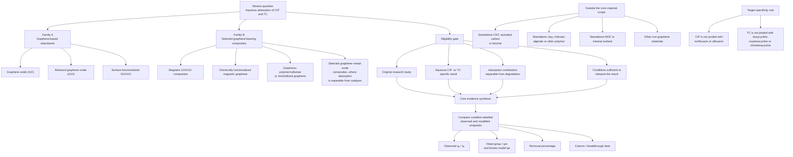
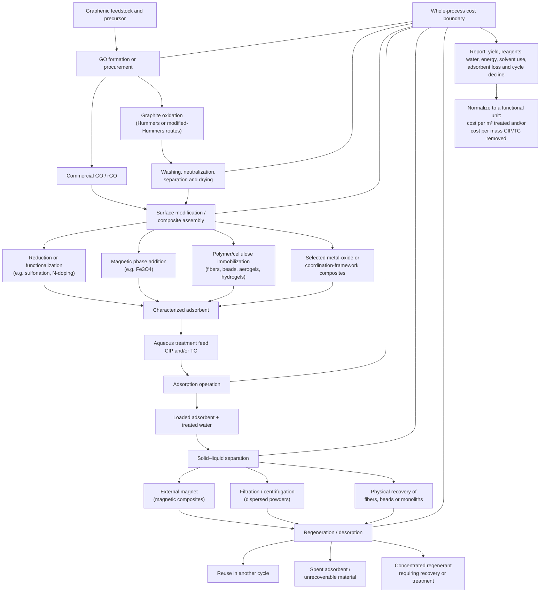
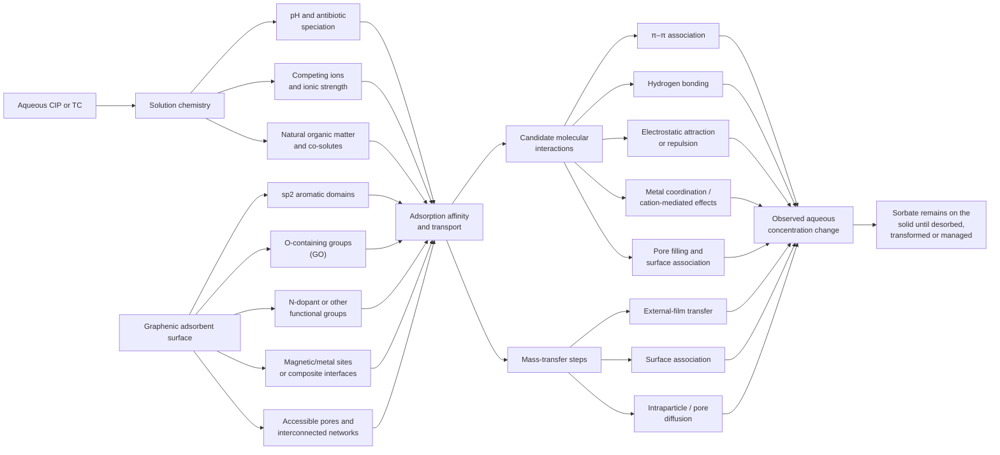
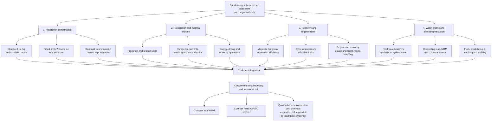

# Assessing the Low-Cost Potential of Non-Conventional Engineered Adsorbents for Ciprofloxacin and Tetracycline Removal from Aqueous Media

**Assembled working source V2 — 49-reference semester scope.** Updated 31 October 2026. The active selected set contains 49 distinct works, with four additional contextual sources retained from the previous draft (53 distinct cited works if all remain in the final bibliography). The selected set includes empirical studies and separately labelled theory, review and scope-boundary roles; it is not a completed systematic review or PRISMA-compliant review. Source-access levels and quantitative caveats remain visible throughout.

**Consolidated bibliography:** semester-manuscript-cited-references-49-selected-plus-4-context.bib (53 entries: 49 active selected works plus four retained contextual sources). The repository's older references/semester-manuscript-cited-references.bib is a V1 19-entry snapshot and is not the V2 bibliography. This assembled Markdown retains the verified source-linked citation keys; the final university/journal citation-style rendering remains pending because the required style has not been specified.

## Abstract (working draft)

Graphene oxide (GO), reduced graphene oxide (rGO) and selected graphene-bearing composites have been investigated as adsorbents for removing ciprofloxacin (CIP) and tetracycline (TC) from aqueous media. Their practical value, however, depends on more than a high reported removal percentage or fitted adsorption capacity: preparation chemistry, separation, regeneration, water-matrix effects and reproducible process costs must also be considered. This paper assesses the adsorption evidence and low-cost potential of selected GO/rGO materials and magnetic, polymer/cellulose and other graphene-bearing composites for CIP and TC. A focused literature search and source-level audit were conducted using the project's recorded discovery searches and accessible publisher, biomedical-index and repository sources. Primary-study data were extracted with source locations and operating conditions, and observed uptake, model-fitted capacities, kinetic-model outputs, removal percentages and column results were treated as distinct endpoints. The active selection contains 49 works; four earlier contextual comparators are retained outside that selected set. Evidence from full texts, abstracts, previews and indexed material is used according to its source tier; the paper remains a narrative evidence synthesis, not a completed systematic review.

Across the studies, graphene-based materials demonstrate adsorption under varied laboratory conditions, but differences in feed concentration, adsorbent dose, pH, contact time, temperature and matrix prevent a defensible universal capacity ranking. Proposed interactions include π–π association, pH-dependent electrostatic effects, hydrogen bonding and pore/transport contributions; in most studies their relative contributions are not independently quantified. Magnetic separation and immobilized formats can improve handling and recovery, but add synthesis, washing, drying and regeneration steps. Real-water evidence is limited and heterogeneous, while reported performance values sometimes contain unresolved mass-balance or source-internal inconsistencies. Most studies do not provide product yields, full reagent and energy inventories, regenerant recovery or comparable treatment-cost denominators. The available literature therefore supports the adsorption promise of selected graphene-based materials, but does not yet demonstrate that they are consistently low-cost in practical water treatment. Future studies should report complete mass balances, validated real-wastewater tests, adsorbent-loss and regeneration balances, and transparent techno-economic data per treated volume or mass of antibiotic removed.

**Keywords:** ciprofloxacin; tetracycline; graphene oxide; reduced graphene oxide; magnetic graphene composites; antibiotic adsorption; regeneration; low-cost potential.

## 1. Introduction

### 1.1. Antibiotic adsorption as a separation process

Antibiotic residues in water and wastewater remain a treatment concern because the compounds span different molecular structures, charge states and environmental behaviours. Adsorption has been widely investigated as a flexible separation step for removing dissolved antibiotics from aqueous streams, including as a polishing option alongside other treatment processes. Reviews of antibiotic adsorption describe a broad range of sorbents and operating conditions, while also identifying regeneration, process losses and treatment of spent media or regenerant streams as part of the practical treatment problem. \cite{ahmedAdsorptiveRemovalAntibiotics2015a}

Carbon nanomaterials have also been examined for antibiotic removal in the presence of co-contaminants. A recent review describes how pH, inorganic ions, natural organic matter and competing contaminants can alter adsorption in multi-component systems; it discusses promoting and inhibiting effects rather than assuming that competition has one universal direction. These observations support treating solution chemistry and matrix composition as experimental variables, not as background details. The review is used here for field mapping and conceptual context only; its compiled capacities are not treated as new primary measurements. \cite{jiaoCarbonNanomaterialsCoremoval2025}

Adsorption should also be described accurately as a separation process. A decrease in aqueous concentration does not, by itself, demonstrate chemical destruction or mineralization of an antibiotic. The sorbed mass remains associated with the adsorbent until it is recovered, regenerated, transformed by a separately demonstrated process, or managed as spent material. Consequently, adsorbent recovery, desorption chemistry, reuse performance and the handling of residual streams belong in any assessment of practical feasibility, not only in a discussion of maximum adsorption capacity. \cite{ahmedAdsorptiveRemovalAntibiotics2015a,jiaoCarbonNanomaterialsCoremoval2025}

### 1.2. Why solution chemistry matters for ciprofloxacin and tetracycline

Ciprofloxacin (CIP) and tetracycline (TC) are chemically complex targets for adsorption because their charge state and interactions depend on solution conditions. A primary study of CIP on Ca-montmorillonite reported pKa values near 6.1 and 8.7 and provided evidence of cation exchange between CIP and interlayer cations under the high-concentration conditions studied. This mineral-sorbent experiment is outside the material families compared in the present paper; it is cited only as a mechanistic illustration that antibiotic speciation and surface charge can influence uptake. Its high feed concentrations should not be treated as representative of trace-level water treatment or as evidence for graphene adsorption. \cite{wangCationExchangeInteraction2010}

Natural organic matter can add another layer of complexity. Equilibrium-dialysis work on TC and Elliott soil humic acid found strongly pH-dependent association, with a reported sorption maximum near pH 4.3 and sensitivity to electrolyte cations; Ca2+ addition increased TC association with the humic-acid system under some conditions. Humic acid in that study was dissolved organic matter, not a graphene adsorbent or a conventional solid sorbent. The paper is therefore used only to support the relevance of dissolved-organic-matter interactions when interpreting aqueous TC chemistry, not as a material-performance comparator. \cite{guComplexationAntibioticTetracycline2007a}

These mechanistic examples do not replace measurements on the selected graphene materials. Rather, they explain why reported adsorption results must remain tied to pH, electrolyte composition, competing solutes and water matrix. Evidence from a clay interlayer or dissolved humic-acid system cannot be transferred directly to graphene oxide, reduced graphene oxide or a graphene-bearing composite.

### 1.3. Rationale for examining graphene-based adsorbents and selected composites

Graphene oxide (GO), reduced graphene oxide (rGO) and functionalized derivatives provide a family of carbon-based surfaces whose chemistry can be altered through oxidation, reduction, sulfonation and other modifications. Selected composites extend this design space by combining graphene-derived surfaces with magnetic particles, polymers, cellulose or other components. In principle, these designs can alter surface functionality, dispersion, accessibility and handling; magnetic or immobilized formats may also make solid–liquid separation more convenient. These benefits must be evaluated against the additional synthesis, washing, drying, cross-linking and regeneration steps that the composite may require.

The primary studies in the current evidence set illustrate why material design and operational performance need to be assessed together. Examples include sulfonated GO for CIP, magnetic rGO/metal-oxide composites for TC, and magnetic GO/cellulose or GO/polymer architectures. Their reported endpoints differ: some provide direct uptake under a defined batch condition, others report model-fitted capacities, removal percentages or reuse-cycle performance. The evidence therefore does not justify treating one large reported capacity or one high removal percentage as a universal measure of material superiority. \cite{shahaExploringAdsorptionEfficiency2025,zhuAdsorptionTetracyclineAntibiotics2018,dangIntegrationMagneticGraphene2025,dipannitaCarboxymethylcelluloseFunctionalizedMagnetic2025}

### 1.4. The gap: adsorption performance is better documented than comparable affordability

Across the studies assessed so far, adsorption performance is generally reported in more detail than the full process economics. Studies may provide a Langmuir or Sips fitted parameter, an experimentally observed uptake, a kinetic-model-fitted uptake, a removal percentage or a reuse-cycle result, but these quantities are not interchangeable. Results also differ in initial concentration, adsorbent dose, pH, contact time, temperature and matrix composition. A trace-level removal test, a high-concentration isotherm and a mixed-solute experiment answer different questions and should not be collapsed into a single capacity ranking.

The same caution applies to affordability. A waste-derived precursor, a high fitted qmax or magnetic separability does not establish low overall cost. The assessment must consider the precursor, reagents, product yield, energy, washing and neutralization, separation, regeneration, solvent recovery, waste handling and a meaningful denominator such as cost per volume treated or mass of CIP/TC removed. Reviews of carbon nanomaterials identify chemical and energy demands as important production-cost drivers, while primary GO-composite studies in the present set frequently do not report a normalized cost inventory. \cite{jiaoCarbonNanomaterialsCoremoval2025,liThreedimensionalGrapheneOxidebased2025,shahaExploringAdsorptionEfficiency2025,hossainRemovalCiprofloxacinAqueous2026}

Accordingly, this paper treats “low-cost potential” as a question to be evaluated from reported preparation and treatment evidence, not as a property inferred from material origin or adsorption capacity. Where a comparable cost estimate is absent or cannot be reconstructed from the stated assumptions, the manuscript records the cost evidence as unreported or uncertain rather than assigning an invented price.

### 1.5. Aim and research questions

The aim of this paper is to assess the adsorption behaviour and practical low-cost potential of selected graphene-based adsorbents and graphene-bearing composites for removing ciprofloxacin and tetracycline from aqueous media. The analysis considers:

1. How GO, rGO and surface-functionalized derivatives perform for CIP and TC when observed uptake, fitted capacity, kinetic-model outputs and removal percentages are kept distinct.
2. Whether magnetic functionalization or immobilization into a graphene-bearing composite offers demonstrated benefits for recovery, reuse, water-matrix performance or handling.
3. How pH, antibiotic speciation, dose, initial concentration, contact time, competing solutes and matrix composition affect the interpretation of reported results.
4. Which proposed adsorption mechanisms are supported by primary experimental evidence and which remain author interpretations or model-based hypotheses.
5. Whether studies provide reproducible evidence on chemical inputs, preparation energy, yield, regeneration, waste handling and normalized cost—or merely describe the material as economical or low-cost.

## 2. Scope, search strategy and evidence method

The approved material taxonomy and eligibility gates are summarized in Figure 1. The diagram distinguishes the two included graphene families from standalone non-graphene sorbents and keeps CIP and TC target identities separate.

**Figure 1. Scope and material taxonomy**

*Scope and eligibility boundaries for the evidence synthesis of ciprofloxacin (CIP) and tetracycline (TC) adsorption by selected graphene-based adsorbents and graphene-bearing composites.*

### 2.1. Material and antibiotic eligibility

The core scope comprises two material families and two target antibiotics. **Family A** includes graphene oxide (GO), reduced graphene oxide (rGO) and surface-functionalized GO/rGO derivatives, provided target-specific adsorption data for CIP and/or TC are available. **Family B** includes selected magnetic GO/rGO composites, chemically functionalized magnetic graphene, graphene–polymer/cellulose or immobilized graphene composites, and graphene–metal-oxide composites only when the adsorption contribution can be separated from catalytic or oxidative removal.

Ciprofloxacin (CIP) and tetracycline (TC) are the only targets in the core comparison. Papers may study additional compounds, but only separable CIP- or TC-specific results enter the comparison. CIP is not pooled with norfloxacin or ofloxacin; TC is not pooled with doxycycline, oxytetracycline or chlortetracycline.

Standalone carbon nanotubes, activated carbon, biochar, clay, chitosan, alginate or other polymers without a graphene component are outside the core material scope. Activated carbon may appear as a clearly labelled benchmark when the graphene result is independently reported. Clay and humic-acid studies are used only as solution-chemistry comparators. Reviews support background and citation discovery but are not treated as primary adsorption experiments or sources of new performance values.

A record is eligible for the core evidence synthesis only when it is an original research study, uses a Family A or Family B material, tests CIP and/or TC in an aqueous system, reports a target-specific result and supplies enough conditions to interpret that result. Studies dominated by photocatalysis, oxidation, Fenton-like chemistry, sonochemical degradation or another non-adsorptive process are excluded from adsorption-performance synthesis unless an adsorption-specific contribution can be separated. Theory-only work may support mechanistic context but does not substitute for measured aqueous adsorption data.

### 2.2. Search sources, dates and search strings

A focused public-web discovery search was logged on **28 October 2026**. A second focused pass and reruns on the same date expanded coverage to newer GO/rGO, magnetic graphene, polymer/cellulose composites, CIP and TC studies. Source-level verification and full-text or indexed-text audits continued from **28 to 30 October 2026** using sources already identified in the search log and project Library.

The search log identifies records in PubMed/PubMed Central (PMC), RSC Publishing, Frontiers and ScienceDirect, alongside publisher records, biomedical indexes and accessible institutional/author-hosted copies. The exact general search-engine/platform name used for discovery was not captured in the log; accordingly, this is reported as a focused public-web search rather than a named-database search. Scopus and Web of Science searches are not documented as completed. No general publication-date or language restriction is recorded. Some individual query terms targeted recent years (for example, 2024, 2025 or 2017–2026), but these do not constitute a systematic date limit.

Additional targeted searches on 30–31 October 2026 examined recent magnetic GO/Co-MOF/TC, ZrO2–Fe3O4/GO/CIP and GO/[Ni(DMG)]n/CIP studies. The 31 October formulations included: `2026 graphene oxide adsorption ciprofloxacin water adsorbent magnetic composite`; `2026 tetracycline adsorption graphene oxide composite magnetic MOF water adsorption`; and `2025 graphene oxide reduced graphene oxide ciprofloxacin tetracycline adsorption aqueous primary study`. These later targeted searches were used to identify and screen SEM-030 and SEM-045–SEM-047; only the two SEM-045/046 sources were fully text-audited in this pass, while SEM-030 and SEM-047 remain abstract/preview-level. SEM-013 is a computational-only rGO interaction paper and is not a measured adsorption study.

The 11 logged query formulations were:

1. `("graphene oxide" OR "reduced graphene oxide") AND ciprofloxacin AND tetracycline AND adsorption AND ("magnetic graphene composite")`
2. `graphene oxide adsorption ciprofloxacin aqueous solution primary study DOI`
3. `magnetic graphene oxide tetracycline adsorption primary study DOI`
4. `reduced graphene oxide tetracycline ciprofloxacin adsorption 2024 study`
5. `graphene polymer composite ciprofloxacin adsorption aqueous primary research`
6. `sulfonated graphene oxide ciprofloxacin adsorption 2025`
7. `graphene oxide ciprofloxacin adsorption real water wastewater study`
8. `tetracycline magnetic graphene oxide composite adsorption regeneration column study`
9. `site:PubMed.gov graphene oxide ciprofloxacin adsorption`
10. `site:PubMed.gov tetracycline graphene oxide adsorption`
11. `graphene-based tetracycline ciprofloxacin adsorption primary research 2017–2026`

Search results were entered into the semester candidate register with the title, year, journal where available, DOI or source URL, target antibiotic, material family, preliminary disposition and next screening action. The search log is a dated record of targeted discovery, not a claim that all potentially relevant studies or databases were exhaustively searched.

### 2.3. Screening, deduplication and source-access hierarchy

Candidate rows were screened against the material, antibiotic, aqueous-system and adsorption-specific criteria in Section 2.1. Decisions use the project vocabulary **Include**, **Exclude**, **Await full text**, **Needs clarification** and **Context only**. A source was not accepted into quantitative comparison on title or abstract relevance alone; full-text or indexed-source checks were used where available, and missing details were retained as unresolved.

Known duplicates were consolidated using DOI/title matching. The search log records the planned-pool sulfonated-GO lead as merged into its verified study record. In the current semester candidate register, SEM-041 is an alias of SEM-026. The historical register snapshot contains **51 candidate rows**, with **50 unique DOI-defined works after the SEM-041/SEM-026 alias is excluded**. The user subsequently elected to omit candidate SEM-035 for administrative/time reasons and proceed with an active set of **49 distinct works**. This does not constitute a scientific rejection of SEM-035. The active selection is defined in data/semester-final-49-reference-selection.csv. These figures are not a PRISMA screening-flow total.

Evidence access is not uniform. Records are labelled according to whether the relevant content came from an accessible primary full text, publisher abstract/preview, PubMed/PMC record, indexed full-text excerpt, institutional or author-hosted manuscript, or third-party mirror. Quantitative claims from abstract-only and mirror-limited sources receive narrower permitted uses and explicit source-quality caveats. Main-text Table 1 remains a condition-labelled comparison subset of **15 studies with the most usable operating-condition data**. Section 3.6 expands the source-tier-qualified synthesis across the full active 49-reference selection. Four additional contextual works are retained outside that selected set: two reviews and two solution-chemistry comparators.

No formal PRISMA flow diagram is presented. The project does not yet contain a reconciled count of records retrieved from each source, automated/manual duplicates removed, title/abstract exclusions, full-text exclusions by reason and final included studies. Those counts must be logged before a systematic-review or PRISMA-compliant search claim is made.

### 2.4. Data extraction and evidence assessment

For each study, the evidence register captures the DOI and target, exact material identity and family, preparation route and reagents, experimental matrix, initial concentration, adsorbent dose, solution volume where reported, pH, contact/equilibrium time, temperature, competing solutes, observed endpoints, fitted parameters, kinetics/isotherms, mechanistic evidence, regeneration, cost/energy evidence, source location and unresolved caveats. Numerical claims are pinned to the source section, page, table, figure or equation wherever accessible.

Mechanistic evidence is assessed by type rather than inferred from model fit alone. Spectroscopy and surface characterization, controlled pH/ion/competition experiments, microscopy, surrogate probes, computational calculations and author interpretation are identified separately. A pseudo-second-order fit does not independently prove chemisorption; a Langmuir fit does not by itself prove a homogeneous monolayer; and a calculated interaction energy is not a direct measurement of the relative contributions of molecular binding forces in water.

### 2.5. Quantitative synthesis and low-cost assessment

The synthesis is condition-labelled, not a universal capacity ranking. Observed equilibrium uptake (\(q_e\)), time-specific uptake (\(q_t\)), isotherm-fitted maximum capacity (\(q_{\max}\) or \(q_m\)), kinetic-model-fitted \(q_e\), percentage removal and column/breakthrough parameters are kept separate. Each percentage-removal result remains attached to its own feed concentration, dose, pH, contact time, temperature and matrix. Single-solute and multicomponent tests are distinguished, and synthetic water, synthetic urine, spiked real water and real wastewater are not treated as equivalent.

Low-cost potential is assessed from the preparation and treatment process rather than inferred from waste origin, high capacity or magnetic response. The desired boundary includes precursor and reagent quantities, synthesis yield, energy, washing and neutralization, water use, separation/recovery losses, regeneration chemicals, solvent recovery, waste handling, adsorbent replacement and a denominator such as cost per treated volume or mass of antibiotic removed. Currency, price year and system boundary are required before reported prices can be compared. Where these inputs are absent or internally inconsistent, the manuscript reports cost evidence as missing or uncertain rather than estimating a price without support.

## 3. Results and discussion

The 15 studies with the most condition-labelled endpoints are presented in **Table 1**, which separates study conditions, experimental endpoints, fitted-model outputs and practical feasibility evidence. Separate experiments are listed independently; observed, derived and model-fitted values are not combined. The broader 49-work coverage register is supplied as **Supplementary Table S1**. Table 1 is a condition-labelled subset, not a ranking of all selected references.

## 3.1. Reported adsorption performance is condition-dependent, not a universal capacity leaderboard

The evidence assembled so far does not support a single ranking of graphene-based adsorbents by one reported “capacity.” The available studies report different endpoints—observed equilibrium uptake (`q_e`), kinetic-model-fitted `q_e`, isotherm-fitted `q_{max}` or `q_m`, percentage removal, and reuse-cycle removal—under different initial concentrations, doses, pH values, contact times, temperatures and matrix compositions. These quantities answer different questions and cannot be placed in one numeric order without further harmonization. The condition-labelled working table therefore records these endpoints in separate fields rather than ranking them ([comparison table](../data/semester-condition-labelled-comparison.csv)).

For tetracycline (TC), the graphene oxide/calcium-alginate fiber study reports observed `q_e=17.6` mg/g at an initial concentration of 10 mg/L and `q_e=65.4` mg/g at 60 mg/L; both values came from separate 25°C, 5-hour equilibrium tests at a dose of 0.50 g/L. Its Langmuir-fitted `q_{max}=131.6` mg/g is a separate model parameter, not the measured uptake under either feed condition. The authors also report a highest removal of 56.8% at pH 6 in a separate pH test using 50 mg/L TC; that percentage should not be paired with the two `q_e` values as though all three results came from the same experiment. The model-fit comparison needs an explicit caveat: the reported Freundlich `R²=.9986` is slightly higher than the Langmuir `R²=.9938`, even though the paper highlights the Langmuir `q_{max}`. Present 131.6 mg/g only as the source-reported Langmuir-fitted parameter, not as an unqualified best-fit capacity. \cite{zhuAdsorptionTetracyclineAntibiotics2018} [evidence: EV-SEM-002]

Another TC example shows why the endpoint and temperature must remain attached to the number. Carboxymethylcellulose-functionalized magnetic graphene oxide reportedly removed 96.04% of TC at an initial concentration of 2 mg/L, a dose of 0.1 g/L, pH 5, 25°C and 25 minutes. A mass-balance calculation from those conditions gives approximately 19.21 mg/g, but this is a derived check rather than a directly quoted experimental `q_e`. Its linear Langmuir `q_{max}=54.73` mg/g was fitted at 50°C. These are not contradictory by themselves: they are different metric types at different temperatures. The derived value and fitted parameter should be reported separately, not treated as interchangeable evidence of capacity. \cite{dipannitaCarboxymethylcelluloseFunctionalizedMagnetic2025} [evidence: EV-SEM-007]

A magnetic graphene-oxide/fibrillated-cellulose composite has a reported observed TC uptake of `q_e=93.36\pm3.85` mg/g at an initial concentration of 70 mg/L and dose of 0.50 g/L; its fitted Sips parameter is `q_m=130.11` mg/g. The source extraction associates that dose test with pH 5 and a 960-minute contact period, but the temperature for this specific `q_e` result has not yet been pinned down. The result is useful as a condition-specific composite measurement, but it should not be used in a condition-matched ranking until that missing condition is checked. \cite{dangIntegrationMagneticGraphene2025} [evidence: EV-SEM-006]

For ciprofloxacin (CIP), a zinc–carbon-battery-derived graphene oxide study reports 99.0% removal at an initial concentration of 2 mg/L, GO dose of 20 mg/L, pH 5.7, 30°C and 20 minutes. The same paper reports a Langmuir-fitted `q_{max}=419.62` mg/g at 30°C and, in a kinetic test with overlapping nominal feed concentration, GO dose, pH and temperature, experimental `q_e=78.82` mg/g and pseudo-second-order fitted `q_e=79.36` mg/g. These results expose an unresolved source-level mass-balance discrepancy: with the Methods section's 40 mL volume, 99.0% removal at the stated feed/dose implies a calculated uptake of about 99 mg/g, whereas Table 4 reports experimental `q_e=78.82` mg/g (and fitted `q_e=79.36` mg/g). The source does not reconcile this difference. Its Conclusion also states a GO dose of 20 g/L, conflicting with 20 mg/L in the abstract, Methods/figure captions and Results—a 1000-fold unit discrepancy. Preserve the source-reported values and unit conflict; do not silently choose one. The Langmuir `q_{max}` is a separate isotherm-fit parameter, not the uptake at the low-concentration removal condition. This is a useful low-concentration removal case, not proof of low total treatment cost. \cite{yasminEfficientRemovalCiprofloxacin2024} [evidence: EV-SEM-004]

## 3.2. High fitted capacities require both a condition label and a source-quality check

The full-text PGOT@GEL study reports a Langmuir-fitted `q_{max}=821.24` mg/g for CIP (isotherm discussion, printed p. 8). The separate response-surface validation reports measured `q_e=807.54` mg/g versus a predicted 800.60 mg/g at `C_0=296.52` mg/L, pH 6.70, PGOT@GEL dose 5.08 mg and 298.88 K (RSM discussion, printed p. 9, §3.3.6). At that `q_e` and adsorbent mass, about 4.10 mg of CIP must have been adsorbed; the initial solution volume would therefore need to be at least about 13.84 mL at the stated `C_0` for the mass balance to be feasible. The main paper's §2.6 (printed p. 3) refers to the Supporting Materials for the full adsorption-experiment details, but the solution volume is not reported in the main PDF and the supporting file was not present in the project files located for this pass. This means the validation value cannot yet be independently mass-balanced; it does not establish that the value is wrong. A separate pH test reports `q_e=192.24` mg/g and 96.12% removal at pH 7. These are distinct endpoints. The source also has a matrix-label inconsistency: the prose refers to real-water samples while Figure 12 captions the application test as simulated real wastewater (printed pp. 10–11). The high fitted value is evidence of strong reported uptake under the studied conditions, not by itself proof of trace-level treatment, verified real-wastewater performance or low cost. \cite{liThreedimensionalGrapheneOxidebased2025} [evidence: EV-SEM-013]

The sulfonated graphene oxide (SGO) CIP study reports a fitted Langmuir `q_{max}=1000` μmol/g (331.35 mg/g) and a separate experimental `q_e=237.12` μmol/g (approximately 78.6 mg/g) at an initial concentration of 50 μmol/L, pH 4, 25°C and dose 0.2 g/L. Table 1 reports the latter experimental uptake, while the text reports 96.53% removal at the nominally same 25°C condition. Using the paper's stated dose and mass-balance equation gives approximately 94.85% removal from `q_e=237.12` μmol/g, so that `q_e`/removal pair retains a real consistency flag. The source pin matters here: the separate kinetic/concentration series covers 10–100 μmol/L (Table 1, printed p. 40822), whereas the Langmuir isotherm series in Figure 10 spans 50–1000 μmol/L at 0.2 g/L and pH 4 (printed p. 40824); Table 2 reports the fitted `q_m=1000` μmol/g across 25–40°C (printed p. 40825). Therefore, a 500 μmol/g ceiling calculated from the separate 100 μmol/L kinetic series must not be applied to this isotherm fit. Keep the fitted parameter distinct from measured `q_e`, preserve the removal discrepancy, and do not silently alter either source value. \cite{shahaExploringAdsorptionEfficiency2025} [evidence: EV-SEM-012]

The nitrogen-doped reduced graphene oxide (N-rGO) paper is relevant to TC and trace-antibiotic treatment, but its numeric capacities require a source-basis caveat. The methods state that 80 mL of antibiotic solution was combined with 20 mL of N-rGO dispersion at 0.5 mg/L (printed p. 1300, §2.3), while Table 1 reports experimental `q_e` values of 80.58–90.21 mg/g for the nominal `C_0=10` μg/L kinetic tests (printed p. 1302, Figure 2 and Table 1). The method does not clarify whether `C_0` denotes the concentration in the original 80 mL solution or the final 100 mL mixture. On the first interpretation, the initial antibiotic mass and 0.01 mg of N-rGO imply an upper uptake of about 80 mg/g; if 10 μg/L instead denotes the final 100 mL system, the ceiling is about 100 mg/g. Thus the upper Table 1 values expose an unresolved concentration/volume basis, not a settled arithmetic correction. Table 2 reports fitted Langmuir `q_m` values including 662.25 mg/g for TC and 1265.82 mg/g for clindamycin (printed p. 1303), far above the directly observed kinetic `q_e` values; retain these as model outputs only and exclude them from cross-study capacity ranking pending unit, dosage and fit-range reconciliation. Existing source-linked evidence remains in CORP-031 / EV-B10-004–EV-B10-009; do not re-extract it as a duplicate. Cite with the verified key \cite{zhangAdsorptionCharacteristicsNrGO2022}. [evidence: CORP-031; EV-B10-004–EV-B10-009]

The graphene-versus-granular-activated-carbon (GAC) ciprofloxacin study is a useful conventional benchmark, but its numbers remain abstract-level in this audit. The publisher and PubMed abstracts report that graphene reached equilibrium within approximately 3 min and had a Langmuir-fitted \(q_{max}=323\) mg/g. They also report that the adverse effects of ionic strength (0.01–0.5 mol/L), natural organic matter (5 mg/L), and the tested water sources (river water or drinking water) were less significant for graphene than for GAC. The abstract does not reveal the initial concentration, adsorbent dose, temperature, numeric pH range, isotherm concentration range, water-matrix preparation or exact effect sizes; the complete article and supplemental file were not retrievable in this audit. Accordingly, the study supports a qualitative claim about rapid adsorption and relative matrix sensitivity, but the fitted 323 mg/g value remains excluded from condition-matched numerical ranking. The authors also condition practical application on proper graphene separation and recovery; the accessible abstract does not provide a monetized recovery cost or verified regeneration-cycle data. GAC is an industrial benchmark in this comparison, not a core material family in this review. \cite{zhuCiprofloxacinAdsorptionGraphene2015a} [evidence: EV-SEM-014]

## 3.3. Graphene-containing composites add practical benefits, but also processing and regeneration burdens

Composite and magnetic formats can improve separation or handling, but those advantages must be weighed against the recovery procedure. The full-text cellulose-nanofibril/GO (CNF/GO) aerogel article reports TC removal of 82.1% in its 21-antibiotic screen (Fig. 7), compared with 78.9% TC removal after ten adsorption–desorption cycles (Fig. 13). The general batch method specifies 8 mg CNF/GO in 40 mL, 160 rpm, 25 °C overnight, with initial concentrations in the 1–100 mg/L range and pH adjusted from 2 to 12; however, Fig. 7's caption does not identify one specific initial concentration, pH or dose, so the 82.1% point remains unsuitable for a condition-matched removal ranking. Separate TC factor tests must not be assumed to be the Fig. 7 conditions. Table 1 gives a pseudo-second-order model-fitted \(q_e=84.8\) mg/g (R²=0.99), while Table 2/Fig. 9 gives Langmuir-fitted theoretical \(q_m=454.6\) mg/g (R²=0.99); the conclusion rounds the same \(q_m\) to 454.5 mg/g. These model-derived values are not observed uptake and remain separate from removal percentage. Regeneration uses 5 wt.% NaOH for 5 h, followed by washing and vacuum freeze-drying. No monetized cost or energy inventory is reported, so the article's economic language is not a verified cost assessment. Cite with \cite{yao3DAssemblyBased2017}. [evidence: EV-SEM-015]

The seven-antibiotic graphene study provides a low-concentration mixed-solute context. Its experimental design uses 100 mg sorbent in 100 mL containing each antibiotic at 200 ng/mL (200 μg/L), pH 7, 298 K and 120 rpm, equivalent to 1 g/L graphene. The Results text states that TC adsorption by graphene approached equilibrium in about 2.5 hours. The main text reports an 89.3–100% removal range across all seven drugs for graphene, not a TC-specific percentage; that exact point is plotted in Fig. 2 but is not stated numerically in the text, so the TC-specific percentage should not be inferred from the overall range. The main-text mean equilibrium uptake for graphene, 190.3 μg/g, is averaged across the seven antibiotics and is not TC-specific. The official Supplementary Information, Table S2, does report TC-specific experimental kinetic \(q_e=200.2202\) μg/g, with first- and second-order fitted \(q_e\) values of 198.8393 and 200.6055 μg/g, respectively; these are kinetic uptake values, not an isotherm \(q_{max}\). On the stated 100 mg sorbent/100 mL/200 μg/L-per-drug basis, the TC feed-mass ceiling is 200 μg/g, so the reported experimental value exceeds it by about 0.11%. Preserve this small mass-balance flag rather than converting it into a removal percentage above 100%. This experiment is a synthetic mixed solution, not a single-solute TC isotherm or direct validation in untreated wastewater; the paper's biochar comparator results remain outside the core graphene comparison. Cite with \cite{pengAdsorptionAntibioticsGraphene2016}. [evidence: EV-SEM-016]

Two additional configurations illustrate why high removal does not automatically translate into low-cost superiority. The GO/Co–Fe magnetic composite paper reports tetracycline (TC) removal of 94.1% in its abstract and §3.2.2 (Fig. 5b), 93.91% in §3.2.4 (Fig. 5d), and 93.94% in §4 Conclusion. The reported optimum conditions are an initial TC concentration of 0.2 mg/L, GO/Co–Fe dose 0.15 g/L, pH 7, room temperature (about 25°C), 250 rpm and 30 s. These three source-reported percentages are an unresolved internal inconsistency and should not be averaged or silently corrected. Table 2 reports Langmuir-fitted TC \(q_m=60.24\), 62.50 and 64.10 mg/g at 30, 40 and 50°C, respectively; therefore, the 64.10 mg/g value is a fitted capacity at 50°C, not the 25°C removal experiment. Section 3.2.7/Fig. 9 reports up to eight reuse rounds after magnetic separation, methanol treatment, water washing and drying at 50°C, with removal efficiency falling from 95% to 90%. The paper does not supply a normalized cost inventory or demonstrate real-water testing. The rotating-field Fe₃O₄/rGO study reports removal above 96% for both tetracycline hydrochloride (TCH) and ofloxacin (OFL) under separate optimum conditions: an initial concentration of 30 mg/L, adsorbent dose of 1.0 g/L and excitation current of 2 A, with pH 5 for TCH and pH 7 for OFL. The composite's reported specific surface area is 95.12 m²/g, and the abstract reports above 87% efficiency after four cycles. The publisher's indexed preview indicates that adsorption was compared with and without the rotating magnetic field (RMF); all three tested Fe₃O₄/rGO formulations performed better under RMF, with CP-Fe₃O₄/rGO performing best. The authors describe Langmuir and pseudo-second-order fits, and attribute the field enhancement to particle rotation and improved external mass transfer, with π–π interactions and hydrogen bonding contributing to adsorption. However, a complete full text and its supplementary information were not accessible in this audit. The exact complex-water matrices, numerical field/no-field effect size, fitted capacity values, field frequency/strength, voltage/power, and energy per treated volume therefore remain unverified. An excitation current of 2 A is not an energy measurement, so this example does not establish energy efficiency or low-cost superiority. \cite{hossainUltrafastSimultaneousRemoval2024,dingRotatingMagneticFieldenhanced2026} [evidence: EV-SEM-027 and EV-SEM-037]

## 3.4. Multicomponent, matrix and flow-through results must remain distinct

Multicomponent results are valuable because they test competition, but their fitted parameters should not be mixed with single-solute capacities. For sulfonated graphene oxide (SGO), the full text reports Langmuir-fitted \(q_m\) values at 25 °C of 370.37 mg/g for the binary ciprofloxacin–moxifloxacin system, 357.14 mg/g for the ternary ciprofloxacin–moxifloxacin–levofloxacin system, and 333.33 mg/g for the quaternary system (Table 3, printed p. 10). These are mixture-system fitted outputs, not isolated-ciprofloxacin \(q_{max}\) values. The stated mixed-solution isotherm range is 18.24–371.64 mg/L, with SGO at 0.2 g/L and pH 5 (Methods §2.4, printed p. 3; Fig. 6, p. 9); the results therefore describe high-concentration synthetic mixtures, not trace-level conditions. Importantly, the abstract claims suitability for treating real wastewater, but the authors' own limitations section says real-wastewater samples were not tested (§3.12, printed p. 14). The study should not be cited as demonstrated real-water validation. It also reports over 97% antibiotic desorption with DMF containing 1 mol/L HCl and over 92% initial performance retained after five adsorption–desorption cycles; the solvent/acid recovery, waste handling and process cost are not quantified (Fig. 12, printed p. 13; §3.12, p. 14). \cite{shahaKineticIsothermThermodynamic2026} [evidence: EV-SEM-036]

Flow-through evidence should also be reported separately from batch adsorption. The sodium alginate/graphene-oxide hydrogel-bead study evaluates a permeable reactive barrier (PRB) for ciprofloxacin-contaminated groundwater and reports approximately 72 h to equilibrium. The authors state that flow-through experiments varied flow rate, influent ciprofloxacin concentration and ionic strength, and that a two-site chemical non-equilibrium model was used for PRB design under local hydrogeological conditions. The reported maximum adsorption capacity is 100 mg/g at pH 7; however, the abstract says the isotherm data fit Freundlich, whereas the indexed publisher conclusion explicitly calls 100 mg/g a Langmuir-model maximum. This model-selection inconsistency must remain visible rather than be silently reconciled. The publisher abstract also states that PRB lifetime and cost were calculated, but the numerical lifetime/cost outputs, assumptions, column conditions and underlying tables could not be verified from the accessible excerpts. Thus, this paper supports an application-level discussion of a groundwater PRB, but it does not yet support a quantitative cost or verified column-performance comparison. \cite{zhaoSodiumAlginateGraphene2018} [evidence: EV-SEM-040]

## 3.5. “Low-cost potential” remains a hypothesis until costs are normalized

The process boundary used for the low-cost assessment is shown in Figure 2. It consolidates alternative preparation, treatment, recovery and regeneration operations reported across the studies; it is not a single standardized synthesis or treatment protocol.

**Figure 2. Preparation-to-recovery process boundary for graphene-based CIP/TC adsorbents**

*Conceptual process boundary for evaluating the practical and low-cost potential of selected graphene-based adsorbents. The flow consolidates alternative preparation, treatment, recovery and regeneration operations reported across the reviewed studies; it is not a single standardized synthesis or treatment protocol.*

The evidence reviewed here is substantially stronger on laboratory adsorption results than on comparative economics. Most studies do not report a full-process cost inventory containing adsorbent yield, reagent quantities and prices, energy, washing, drying, regeneration, solvent recovery, residual handling and a denominator such as cost per volume treated or mass of CIP/TC removed. The preparation and recovery burden can also be substantial. Across the studies cited here, examples include strong-acid/oxidant routes for functionalized graphene oxide, freeze-drying, regeneration with 5 wt.% NaOH, methanol treatment, DMF containing 1 mol/L HCl, a 10 g/L dose in one GO/PVA/calcium-alginate removal test, and rotating-magnetic-field operation for which power and energy per treated volume are not reported. These examples show why synthesis yield, reagents, washing, drying, regeneration, solvent recovery, residual handling and operating energy must be included in a normalized cost boundary rather than assumed away. \cite{shahaExploringAdsorptionEfficiency2025,yao3DAssemblyBased2017,hossainUltrafastSimultaneousRemoval2024,shahaKineticIsothermThermodynamic2026,hossainRemovalCiprofloxacinAqueous2026,dingRotatingMagneticFieldenhanced2026}

One GO/PVA/calcium-alginate bead paper reports a cost estimate, but its cost calculation assumes 0.1 g/L while an experimental 0.5 g per 50 mL condition corresponds to 10 g/L—a 100-fold difference in dose. The method also alternates between 50 mL and 55 mL wording. The paper reports a bead price of USD 10–30/kg, a maximum observed uptake of 7.15 mg/g and a nonlinear Langmuir-fitted q_{max}=10.14 mg/g. Dividing the bead price by either loading gives an indicative first-loading material-purchase ratio of about USD 1,399–4,196 per kg CIP at the observed uptake, or USD 986–2,959 per kg CIP if the fitted q_{max} is assumed. These are screening ratios, not lifecycle costs: they do not credit reuse, but also exclude regeneration and all other process inputs. The reported cycle data do not provide a sufficiently reconciled cumulative mass-removed denominator to validate a lifetime-cost claim. The source's cost conclusion is therefore not independently reproducible from the available extraction. \cite{hossainRemovalCiprofloxacinAqueous2026} [evidence: EV-SEM-026]

Accordingly, the term *low-cost potential* should be assessed as a multi-criteria question, not inferred from a large fitted `q_{max}`, a waste-derived precursor, easy magnetic separation, or a high percentage removal by itself. At present, the evidence supports condition-specific adsorption findings and identifies process-cost gaps; it does not yet support a universal claim that one graphene-based material is the lowest-cost option.

## 3.6. The expanded evidence set broadens material coverage but does not remove source-quality limits

The 49 selected references are mapped in Supplementary Table S1, including their material family, target antibiotic, source-access tier and permitted quantitative use. This wider coverage should not be confused with 49 equally condition-complete adsorption experiments: some records support condition-labelled uptake or removal, while others can only support qualitative design, matrix, mechanism or scope context.

### 3.6.1. Graphene oxide baselines show target- and model-dependent behaviour

Early GO studies provide useful baselines but should not be treated as directly comparable capacity measurements. For TC, Ghadim et al. report a Langmuir-fitted (q_m=322.43\pm1.25) mg/g at 298 K, followed by 101.87 and 73.53 mg/g at 303 and 308 K, respectively. These are fitted parameters; the methods, figure and table identify three isotherm temperatures, whereas the Results prose refers to additional temperatures, and the reported temperature trend is in tension with the paper's endothermic interpretation. An earlier GO–TC article reports an abstract-level Langmuir theoretical (q_{max}) of 313 mg/g, but the accessible publisher text does not expose the full condition vector or isotherm table; its abstract and Highlights also disagree on whether Temkin or Freundlich is the second-best-fitting isotherm. These values therefore establish what the sources report, not a harmonized capacity ranking. \cite{ghadimAdsorptionPropertiesTetracycline2013,gaoAdsorptionRemovalTetracycline2012}

For CIP, the GO-nanosheet study of Rostamian et al. reports a maximum fitted/modelled capacity of 173.4 mg/g for CIP, but accessible abstract material does not provide a numeric TC-specific result; its ordinal ordering of CIP, doxycycline and TC must not be converted into an invented TC capacity. Yadav et al. examine CIP, norfloxacin and ofloxacin separately, and the CIP data identify pH 7 and a 50-minute equilibrium time under the reported batch conditions; the other fluoroquinolones remain separate targets, and the fitted kinetic/isotherm values are not substitutes for measured uptake. A later GO study comparing aqueous CIP with fresh synthetic urine reports author-described maxima of 354.24 and 291.39 mg/g at pH 5 and 6, respectively, but the accessible preview does not establish whether these are measured (q_e), conventional fitted (q_{max}) or a statistical-physics saturation parameter. The GO/SMX–CIP paper reports a Langmuir (S_{max}) of 379 mg/g, yet the accessible kinetic/model audit gives a better Freundlich fit; detailed methods and tables partly rely on a non-publisher manuscript mirror. Together these studies support target-specific and matrix-dependent GO adsorption, but their headline capacities should not be ranked as if they represented the same endpoint. \cite{rostamianComprehensiveAdsorptionStudy2018,yadavRemovalFluoroquinoloneAqueous2018,dasilvabruckmannAdsorptionCiprofloxacinAqueous2024,chenRemovalSulfamethoxazoleCiprofloxacin2015}

### 3.6.2. Magnetic and chemically modified graphene can improve handling, but high model capacities remain qualified

Magnetic modification is repeatedly proposed as a way to simplify solid recovery, although the accessible evidence varies in completeness. The magnetic GO sponge study reports 473 mg/g for TC without enough information in the accessible abstract to determine whether this is observed uptake or a fitted capacity. DTPA-functionalized magnetic GO reports pseudo-second-order-fitted values of 294.12 mg/g for TC and 111.73 mg/g for CIP; the supporting-information tables needed to audit the equilibrium fits were not available, and its binary tests show asymmetric competition, with CIP suppressing TC more than TC suppresses CIP. For MnFe\(_2\)O\(_4\)-decorated rGO, a condition-specific TC uptake of about 41 mg/g is reported at (C_0=10) mg/L, 5 mg sorbent in 30 mL, 25°C and approximately 8 h; much larger Langmuir values (870–1326 mg/g) are extrapolated fits, while Freundlich gives the better fit. A separate magnetic-GO study reports the best pH around 3.3 for tetracycline hydrochloride and oxytetracycline, while chlortetracycline behaves differently under alkaline conditions; a primary numerical capacity is not exposed in the accessible publisher preview. \cite{yuAdsorptionBehaviorsTetracycline2017,liPerformanceMagneticGraphene2018,baoAdsorptionTetracyclineReduced2018,miaoAdsorptionPerformanceTetracyclines2019}

Other magnetic derivatives add further but unevenly documented examples. Magnetic guar-gum-grafted GO is reported to have a Langmuir (q_{max}) of 555.56 mg/g for CIP in a third-party full-text mirror, but the dose description differs by a factor of ten and the fit-statistics wording is inconsistent; the number is not a verified observed (q_e). For GO·Fe\(_3\)O\(_4\), the abstract reports a maximum TC capacity of 531.93 mg/g at (C_0=1000) mg/L, pH 7 and 293 K, but solution volume is unavailable, preventing a complete mass-balance check. EDTA-functionalized magnetic GO reports 93.23% TC removal at 0.2 mg/L, 0.1 g/L dose, pH 5, 25°C and 5 min; the derived (q_e\approx1.865) mg/g is a mass-balance check, while the kinetic-model values are physically inconsistent with the feed ceiling and are held out of capacity ranking. Thiourea-dioxide-reduced magnetic GO reports an abstract-level Langmuir-fitted (q_m=1233) mg/g at 313 K and qualitative effects of pH, NaCl and humic acid, but full conditions and tables are not accessible. Magnetic chitosan-grafted GO reports an abstract-level Langmuir (q_m=282.9) mg/g for CIP and about 72% retention of initial adsorption capacity after four uses; the exact operating conditions, fit statistics and regeneration protocol remain unavailable. This is a provisional model/reuse report, not a condition-matched capacity result. These studies support discussion of functionalization and recovery concepts, not a single magnetic-adsorbent leaderboard. \cite{sayaAdsorptiveRemovalCiprofloxacin2023,dasilvabruckmannDFTTheoreticalExperimental2022,lilyEDTAfunctionalizedMagneticGraphene2026,yangDecontaminationTetracyclineThioureadioxidereduced2017,wangRemovalCiprofloxacinAqueous2016}

### 3.6.3. Polymer, cellulose and immobilized formats add handling options but have their own process and data constraints

Several studies immobilize GO in polymeric structures. An IOP conference study comparing GO and GO–TiO\(_2\) reports 20-minute CIP removal of 34% and 31.5%, respectively, at (C_0=10) mg/L, 1 g/L dose, neutral pH and ambient temperature; its source-labelled capacities and kinetic fits conflict with the time-course and are not used for capacity ranking. The GO–sodium-alginate hydrogel/aerogel study is supported by the primary publisher abstract and a third-party-hosted copy of the author-accepted manuscript. Table 3 in that copy reports Langmuir-fitted q_{max}=86.12 mg/g for GO-SA hydrogel and 55.55 mg/g for GO-SA aerogel; Table 2 separately reports experimental kinetic q_e=25.86 and 22.59 mg/g, respectively. These are different endpoint types: 86.12 mg/g is a fitted parameter, not observed uptake. Because the table transcription comes from a non-publisher-hosted accepted-manuscript copy, retain this source-access qualification. Polyacrylamide-functionalized GO/alginate beads report a Langmuir (q_m=6.846) mg/g, while an observed uptake/removal endpoint is not identified in the extracted source. The Methods describe 55 mL of solution in a 50 mL conical tube, and the reported q_e equation does not make the mL-to-L conversion explicit; retain these dimensional/method caveats and do not reverse-engineer an observed qe. For GO/calcium-alginate fibers, the accessible abstract reports 78.9% removal at 2 g/L and 6 wt.% GO, and a separate capacity of 39.06 mg/g at an equilibrium concentration of 60 mg/L; the abstract does not establish that these belong to the same test, and the latter value is not a fitted (q_{max}). \cite{padmajaAdsorptiveRemovalCiprofloxacin2024,feiAdsorptiveRemovalCiprofloxacin2016,choiPolyacrylamideFunctionalizedGraphene2022,wuAdsorptionCiprofloxacinBiocomposite2013}

The chitin/GO hybrid illustrates why batch and flow-through evidence must be audited separately. Batch Langmuir fits are reported as 282±11 mg/g for nano-GO and 73±3 mg/g for a chitin:nano-GO 3:1 material, with Sips reported as the best overall fit. However, the accepted manuscript states that 100 g of material was packed into a column with an internal volume of only about 1.18 cm\(^3\), a physically implausible packing density; dynamic Thomas and Yoon–Nelson outputs are therefore held. Real-water samples in that paper were spiked. A GO/MgO/chitosan composite reports a CIP Langmuir (q_{max}) of 1111 mg/g in the abstract; publisher Figure 5 previews visually corroborate high Langmuir fits, but without accessible captions the CIP-to-panel mapping cannot be independently confirmed. Concentration, dose, volume and fit tables remain inaccessible; norfloxacin is a separate analyte and must not be pooled with CIP. Neither source supports a condition-matched capacity ranking. \cite{gonzalezContinuousFlowAdsorption2018,nazrazChitosanbasedSorbentEfficient2019}

### 3.6.4. Recent engineered composites add matrix and recovery examples, but not yet comparable process economics

Recent magnetic and functionalized composites broaden the evidence beyond simple GO and rGO. Ultrasound-assisted magnetic GO for CIP reports an experimentally validated response-surface optimum of 96.39±3.3% removal at (C_0=15) mg/L, 0.55 g adsorbent in 15 mL, pH 7 and 33 min; the dose is 36.7 g/L, and the ultrasound energy was not reported. The same study reports CIP removal of 94.12±2.2% in tap water, 91.66±1.8% in river water, 90.65±3.1% in lake water and 89.96±2.3% in wastewater; these are source-reported matrix results, while Table 5 states n=5 and §3.9 says triplicate tests. A GO/layered-double-hydroxide composite reports 84.84% CIP removal at (C_0=1) mg/L, 10 mg/L dose, pH 7 and 60 min, but the accompanying 97.43–106.96 mg/g values conflict with or exceed the stated feed-mass basis; the 84.84% result implies q_e≈84.84 mg/g, while reuse falls from 80.4% at cycle 1 to 27% by cycle 5. A GO–[Ni(DMG)]\(_n\) study provides model-derived comparative Langmuir values of 117–159 mg/g but identifies Freundlich and Temkin as better-fitting models; formulation-specific mapping and exact adsorption conditions are unavailable. These examples highlight that response-surface removal, matrix-specific removal, fitted isotherm parameters and condition-specific uptake must remain distinct. \cite{alishiriRemovalCiprofloxacinCephalexin2023,sikriGrapheneOxideLayered2025,ceylanTailoredGrapheneOxide2026}

The newest magnetic composites offer potentially useful low-concentration or matrix tests, but the source caveats are material. Magnetic GO/Co-MOF reports 98% TC removal at 0.2 mg/L, 0.1 g/L, pH 7 and 25°C, with removal declining from 98% to 91% over ten cycles. The reported 98% removal implies a feed-limited uptake of about 1.96 mg/g, whereas the pseudo-second-order-fitted q_e=19.52 mg/g exceeds the same-condition 2 mg/g ceiling and must not be treated as observed uptake. The Langmuir-fitted q_m=185.87 mg/g at 45°C also exceeds the 100 mg/g ceiling calculated from the highest stated isotherm feed (10 mg/L) and 0.1 g/L dose. In addition, the Fig. 6 caption gives an isotherm C_0 of 0.2 mg/L while Methods §2.7 states a 0.05–10 mg/L range; retain the fit as a source-reported model parameter with this unresolved condition-label conflict, not as validated uptake. Zr-modified magnetic GO reports 93.92% CIP removal at a synthetic-water optimum of 30 mg/L, 0.3 g per 100 mL, pH 7 and 45 min, but the reported (q_e) conflicts with the feed ceiling; the stated raw-effluent change from 8.37 to 2.01 mg/L calculates to 76.0% removal, not the 90.75% reported in the source. A magnetic GO/NH\(_2\)-UiO-66/alginate study reports 98.5% synthetic-water removal and 89.34% river-water removal, with a fitted Langmuir (q_m=161.4) mg/g; the abstract does not disclose enough conditions to mass-balance the river-water result. The rGO/Pr\(_6\)O\(_{11}\) CIP paper reports 88.0% removal in its abstract and 88.3% in its conclusion at 10 mg/L, pH 6.6, 0.4 g/L and 160 min; the derived uptake is about 22 mg/g, whereas 85.5 mg/g is a fitted Langmuir parameter. Treat pH 6.6 as the source-reported optimum/condition, not a fully reconciled directly tested pH point: the accessible indexed description of the pH-effect series lists pH 2, 4, 8 and 10, leaving the basis for pH 6.6 unresolved. \cite{jahanFabricationMagneticGraphene2026,tekletegieOptimizationCiprofloxacinAdsorption2026,aminMultifunctionalMagneticGraphene2026,pandaInterfaceengineeredReducedGraphene2026}

Copper-alginate/GO/MOF-525 beads report 96.6% TC removal at pH 7 and a separate contact-time result of 54.6% within 38 min, but the source contains dose, concentration-unit and panel/caption conflicts; the very high low-dose uptake is not fully condition-pinned. A GO–deep-eutectic-solvent membrane supplies important application evidence: tests used prefiltered municipal wastewater deliberately spiked with antibiotics, and the article reports six-cycle NaOH regeneration. Its active-layer estimate of USD 2.5–6.8/m² and cradle-to-gate footprint of 14–59 kg CO\(_2\)-eq/m² apply to the active layer only, not a complete module or treatment cost per cubic metre. Its batch (q_e=22.7\pm0.6) mg/g remains quarantined because the reported feed/dose basis does not reconcile. Finally, citric-acid-crosslinked CMC/GO beads report 94.93% TC removal at 200 mg/L, 20 mL, 20 mg beads and pH 4, corresponding to a derived (q_e\approx189.86) mg/g. The fitted Langmuir (q_{max}) is 267–278 mg/g, although the Hill model fits better; the author's USD 1.95/g-TC estimate is based on the linear Langmuir (q_{max}) and is not validated treatment-cost analysis. The cost scenario describes treating 1 g TC/L, whereas the reported experimental initial-concentration range extends only to 250 mg/L; this functional-unit assumption is not demonstrated by the adsorption tests. No real-wastewater or continuous-flow validation is reported. \cite{chenEffectiveRemovalTetracycline2022,lemaouiSurfaceAssembledGraphene2026,saheedCitricAcidCrosslinked2026}

The selected set also includes context-only records that must not be counted as new adsorption experiments. The graphene-based tetracycline review supports background mapping, not new primary capacity data. The rGO/CIP/TC molecular-modelling study reports calculated intermolecular adsorption energies and can support a clearly labelled mechanistic hypothesis, but it contains no aqueous batch experiment or measured (q_e). Conversely, the onion-peel-derived GO-like carbon nanosheet study is an empirical adsorption paper but is retained only as a scope-boundary example because its material is described as GO-like carbon nanosheets rather than analytically verified GO/rGO. \cite{minaleApplicationGraphenebasedMaterials2020,ngoctriAdsorptionTetracyclineCiprofloxacin2024,ghahremaniRemovalCiprofloxacinWater2025}

## 3.7. Limits that must be preserved in the final manuscript

1. **Metric type:** keep measured `q_e`, fitted `q_{max}/q_m`, kinetic-model-fitted `q_e`, removal percentage and column metrics separate.
2. **Condition comparability:** do not compare capacities measured at different concentrations, doses, pH values, temperatures, matrix compositions or models as a simple ranking.
3. **Source integrity:** preserve the source-specific inconsistencies for studies actually discussed here: the SGO `q_e`/removal mass-balance mismatch; the unresolved concentration/volume basis and unusually large fitted values in the N-rGO study; the GO/Co–Fe removal-percentage discrepancy; and the GO/PVA/calcium-alginate dose/cost and method-volume inconsistencies. The 500 μmol/g ceiling previously calculated from the separate 10–100 μmol/L SGO kinetic series is not valid for the Langmuir fit, because Figure 10 reports an isotherm range of 50–1000 μmol/L. Caveats for other screened candidates (including GO–LDH, EDTA-functionalized GO and chitin/nGO column data) remain in the evidence register; do not imply they were evaluated in this draft unless they are added and cited.
4. **Citation readiness:** the unified V2 draft contains **53 distinct in-text citation keys**: all **49 active selected works** plus the four retained contextual sources. Each key resolves to a unique entry in the consolidated 53-entry BibTeX build delivered with this manuscript. The selected 49 keys were reconciled against the user's supplied Better BibTeX exports; 34 use post-merge keys from Untitled +++.bib, and 15 retained keys come from the complete 173-entry My Library export. All 53 bibliography entries have unique keys and unique DOI values; no duplicate DOI groups remain in the latest post-merge subset export. Candidate SEM-035 is omitted by user decision and is not cited. This verifies citation-key linkage, not scientific correctness or final style rendering. The repository's old 19-entry references/semester-manuscript-cited-references.bib is a V1 snapshot; do not use it as the V2 bibliography.
5. **Cost evidence:** an author's “low-cost” or “economical” statement remains an author claim unless the cost boundary, inputs, date/currency and denominator are reported.

Final bibliography rendering should follow the required university or journal style once that style is specified. The current in-text citation notation is a working source-linked drafting format, not the finished formatted bibliography.

**Scope.** This main-text evidence table covers 15 selected primary-study records from the active 49-work corpus. Endpoint and condition tables contain 19 matched rows because some studies report independent experiments or source conflicts. Table 1 is not a universal capacity ranking; Supplementary Table S1 covers all 49 selected works.

**Reading rule.** Table 1A identifies the material and target once per study. Table 1B gives the condition vector for each endpoint row in Table 1C; the study ID links the corresponding rows. Tables 1D and 1E separate isotherm-fit outputs from kinetic-model outputs. Tables 1F and 1G separate recovery, matrix validation, preparation burden and cost evidence. NR = not reported or not available in the audited source record. “Derived qe” is calculated from the exact stated feed, volume, adsorbent mass and removal percentage; it is not a directly tabulated measurement. Fitted qmax/qm and kinetic qe are model outputs, not observed uptake.

## Table 1A. Study identity, target and material family

| Study | Target | Adsorbent | Study context |
|---|---|---|---|
| Zhu et al. (2018), SEM-004 | TC | GO/calcium-alginate fibers | Single-solute isotherm and time-course tests |
| Yasmin et al. (2024), SEM-010 | CIP | Zn–C battery-derived GO | Single-solute optimum removal and kinetic tests |
| Shaha et al. (2025), SEM-016 | CIP | Sulfonated GO (SGO) | Single-solute concentration series |
| Dang et al. (2025), SEM-017 | TC | Magnetic GO/fibrillated-cellulose | Single-solute dose study |
| Dipannita et al. (2025), SEM-018 | TC | CMC-functionalized magnetic GO/Fe3O4 | Single-solute optimum |
| Zhu et al. (2015), SEM-020 | CIP | Graphene; GAC comparator | Abstract-level batch and matrix tests |
| Hossain et al. (2026), SEM-029 | CIP | GO/PVA/calcium-alginate beads | Single-solute concentration test |
| Shaha et al. (2026), SEM-031 | CIP-containing FQ mixtures | SGO | Binary / ternary / quaternary mixtures |
| Li et al. (2025), SEM-032 | CIP | PGOT@GEL hydrogel | RSM validation |
| Ding et al. (2026), SEM-033 | TCH; OFL separate | Rotating-field Fe3O4/rGO | Separate single-analyte tests; abstract/preview |
| Hossain et al. (2024), SEM-034 | TC with CTC/OTC/DTC | GO/Co–Fe magnetic composite | Simultaneous four-tetracycline test |
| Zhao et al. (2018), SEM-037 | CIP | Sodium-alginate/GO hydrogel beads; PRB | Batch plus groundwater PRB; abstract/indexed excerpts |
| Zhang & Wu (2022), SEM-038 | TC | Nitrogen-doped rGO (N-rGO) | Single-analyte kinetic test |
| Yao et al. (2017), SEM-039 | TC | CNF/GO hybrid aerogel | 21-antibiotic screen and reuse tests |
| Peng et al. (2016), SEM-040 | TC within seven-drug mixture | Graphene | Synthetic seven-analyte trace mixture |

## Table 1B. Condition sets for the 19 experimental/source-reported endpoints

| Study ID | Initial concentration / mixture | Dose | pH | Temperature | Contact / equilibrium time |
|---|---|---|---|---|---|
| SEM-004 | 10 mg/L | 0.50 g/L | NR | 25°C | 5 h |
| SEM-004 | 60 mg/L | 0.50 g/L | NR | 25°C | 5 h |
| SEM-004 | 50 mg/L | 0.50 g/L | NR | NR | 15 h |
| SEM-010 | 2 mg/L | 20 mg/L* | 5.7 | 30°C | 20 min |
| SEM-010 | 2 mg/L | 20 mg/L* | 5.7 | 30°C | Kinetic time series |
| SEM-016 | 50 µmol/L (selected point) | 0.20 g/L | 4 | 25°C | 240 min protocol |
| SEM-017 | 70 mg/L | 0.50 g/L | 5 | NR | 960 min |
| SEM-018 | 2 mg/L | 0.10 g/L | 5 | 25°C | 25 min |
| SEM-020 | NR | NR | pH effect tested; range NR | NR | Equilibrium within ≈3 min |
| SEM-029 | 40 mg/L | 10 g/L | NR at this endpoint | 298 K | 150 min |
| SEM-031 | Equimolar; high-concentration range | 0.20 g/L | 5 | 25°C | 240 min |
| SEM-032 | 296.52 mg/L | 5.08 mg; volume NR | 6.70 | 298.88 K | About 120 min; exact validation time NR |
| SEM-033 | 30 mg/L | 1.0 g/L | 5 for TCH; 7 for OFL | NR | NR |
| SEM-034 | 0.2 mg/L TC | 0.15 g/L | 7 | 25°C | 30 s |
| SEM-037 | Influent range NR | NR | Maximum reported at pH 7 | NR | ≈72 h to equilibrium |
| SEM-038 | 10 µg/L in 80 mL feed | 0.01 mg in 20 mL dispersion | NR | 25 ± 1°C | NR |
| SEM-039 | Figure-specific C0 NR | Figure-specific dose NR | NR | NR | NR |
| SEM-039 | Same screen/reuse protocol; endpoint feed basis NR | NR | NR | NR | After 10 cycles |
| SEM-040 | 200 µg/L per drug | 1.0 g/L | 7 | 298 K | ≈2.5 h |

## Table 1C. Experimental/source-reported endpoints

| Study ID | Endpoint class | Endpoint value | Interpretation / qualification |
|---|---|---|---|
| SEM-004 | Observed qe | 17.6 mg/g | Isotherm point at C0 = 10 mg/L |
| SEM-004 | Observed qe | 65.4 mg/g | Separate isotherm point at C0 = 60 mg/L |
| SEM-004 | Observed qe | 56.8 mg/g | Separate time-course endpoint; not the PSO-fitted qe |
| SEM-010 | Removal; derived qe | 99% removal; qe ≈ 99 mg/g | Abstract/Fig. 3 claim; conflicts with kinetic Table 4 endpoint below |
| SEM-010 | Experimental kinetic qe | 78.82 mg/g | Table 4 value; implies ≈78.82% removal on the stated 40 mL basis, not 99% |
| SEM-016 | Experimental qe | 237.12 µmol/g | At C0 = 50 µmol/L; mass-balance implies ≈94.85% removal, while prose gives 97.32% at the low end of series |
| SEM-017 | Observed qe | 93.36 ± 3.85 mg/g | At C0 = 70 mg/L and dose = 0.50 g/L; temperature not pinned |
| SEM-018 | Removal; derived qe | 96.04% removal; qe = 19.208 mg/g | Derived from the exact optimum mass balance; feed ceiling = 20 mg/g |
| SEM-020 | Qualitative endpoint | Equilibrium within ≈3 min | No numerical observed qe available in accessible abstract-level source |
| SEM-029 | Removal; derived qe | 89.82% removal; qe = 3.5928 mg/g | Derived at C0 = 40 mg/L and 10 g/L dose; separate maximum observed qe = 7.15 mg/g |
| SEM-031 | Total-mixture qe | 81.70 / 79.90 / 78.92 mg/g | Binary / ternary / quaternary systems; not isolated-CIP uptake |
| SEM-032 | Author-reported qe | 807.54 mg/g | RSM validation; solution volume unavailable for mass-balance verification |
| SEM-033 | Removal | >96% for TCH and OFL | Separate analytes; TCH is not silently pooled with TC; no numeric qe/qmax available |
| SEM-034 | Removal; derived qe | 94.1 / 93.91 / 93.94% removal; qe ≈ 1.252–1.255 mg/g | Three source locations disagree; co-target system; feed ceiling ≈1.333 mg/g |
| SEM-037 | No verified observed endpoint | NR | Numeric column/breakthrough results inaccessible; 100 mg/g model-linked maximum described in Table 1C |
| SEM-038 | Experimental qe (held) | 90.21 mg/g | Exceeds strict 80 mg/g feed ceiling; do not quantitatively rank; Figure 2c mismatch is larger |
| SEM-039 | Removal | 82.1% | Figure 7 screen; figure-specific C0, pH and dose are not stated |
| SEM-039 | Removal after reuse | 78.9% | After cycle 10; removal retention, not qe-capacity retention |
| SEM-040 | Experimental qe (SI) | 200.2202 µg/g | TC-specific Table S2 value; ≈0.11% above the stated 200 µg/g feed ceiling; keep the small mass-balance flag |

## Table 1D. Fitted isotherm-model outputs

| Study ID | Isotherm-model output |
|---|---|
| SEM-004 | Langmuir qmax = 131.57 mg/g; Freundlich R² = 0.9986 > Langmuir 0.9938 |
| SEM-010 | Langmuir qmax = 419.62–441.44 mg/g (30–50°C) |
| SEM-016 | Langmuir qmax = 1000 µmol/g (331.35 mg/g) |
| SEM-017 | Sips qmax = 130.11; Langmuir qmax = 107.06 mg/g |
| SEM-018 | Linear / nonlinear Langmuir qmax = 54.73 / 48.47 mg/g at 50°C |
| SEM-020 | Langmuir fitted qmax = 323 mg/g |
| SEM-029 | Linear / nonlinear Langmuir qmax = 8.210 / 10.14 mg/g |
| SEM-031 | Binary / ternary / quaternary mixture qmax = 370.37 / 357.14 / 333.33 mg/g |
| SEM-032 | Langmuir qmax = 821.24 mg/g |
| SEM-033 | Langmuir named; numeric qmax unavailable |
| SEM-034 | TC Langmuir qmax = 60.24 / 62.50 / 64.10 mg/g at 30 / 40 / 50°C |
| SEM-037 | 100 mg/g maximum is abstract-reported; abstract says Freundlich, indexed conclusion says Langmuir |
| SEM-038 | TC Langmuir qmax = 662.25 mg/g; headline 1265.82 mg/g belongs to clindamycin |
| SEM-039 | Langmuir qmax = 454.6 mg/g (conclusion rounds to 454.5) |
| SEM-040 | No conventional qmax reported; seven-drug mean qe = 190.3 µg/g is not TC-specific |

## Table 1E. Kinetic-model outputs

| Study ID | Kinetic-model output |
|---|---|
| SEM-004 | PFO qe = 40.93; PSO qe = 62.50 mg/g |
| SEM-010 | PSO fitted qe = 79.36 mg/g |
| SEM-016 | PSO fitted qe series; not observed qe |
| SEM-017 | PSO fitted qe = 87.74 mg/g |
| SEM-018 | Linear PSO fitted qe = 19.50 mg/g |
| SEM-020 | PSO fit reported; numeric qe unavailable |
| SEM-029 | Nonlinear PSO fitted qe = 4.458 mg/g |
| SEM-031 | Mixture-model outputs only; not CIP-specific |
| SEM-032 | Not used as a comparative kinetic endpoint here |
| SEM-033 | PSO named; numeric qe unavailable |
| SEM-034 | TC PSO fitted qe = 1.2681 mg/g |
| SEM-037 | PSO label reported; parameters inaccessible |
| SEM-038 | TC fitted qe = 93.13 / 92.84 mg/g |
| SEM-039 | PSO fitted qe = 84.8 mg/g |
| SEM-040 | TC SI: PFO qe = 198.8393; PSO qe = 200.6055 µg/g |

## Table 1F. Recovery/reuse and water-matrix evidence

| Study ID | Recovery / reuse | Water-matrix evidence |
|---|---|---|
| SEM-004 | No multicycle reuse verified | Synthetic batch only |
| SEM-010 | Methanol; 7 cycles; 92% removal at cycle 7 | No real-water trial |
| SEM-016 | DMF + 1 M HCl; fifth-cycle qe retention = 95.78% | Synthetic single-solute; no real water |
| SEM-017 | Magnetic recovery; removal 88.33% to 75.38% over 5 cycles | Synthetic batch only |
| SEM-018 | Magnetic recovery; methanol; 10 cycles; removal ≈96% to ≈92% | No real-water experiment |
| SEM-020 | No verified regeneration cycles | Salts, 5 mg/L NOM and river/drinking-water sources; effect sizes unavailable |
| SEM-029 | Authors claim 4–5 cycles; cycle mass balance incomplete | Synthetic water only |
| SEM-031 | DMF + 1 M HCl; >92% mixture performance after 5 cycles | Authors state no real-wastewater samples tested |
| SEM-032 | Methanol; 7 cycles; ≈90.53% initial removal retained | Real vs simulated wastewater description conflicts |
| SEM-033 | >87% removal efficiency after 4 cycles; eluent unavailable | Complex-water claim in preview; matrix details inaccessible |
| SEM-034 | Magnetic recovery; methanol; up to 8 rounds; no TC-only cycle series | No real-water test |
| SEM-037 | No batch regeneration metric verified; PRB lifetime is distinct | Groundwater PRB application described; numeric breakthrough results inaccessible |
| SEM-038 | Up to 8 cycles; ≤25% capacity decline stated across system, not TC-specific | Trace-level single/mixed-analyte and simulated-interferent tests |
| SEM-039 | 5 wt.% NaOH; 10 cycles; TC removal 82.1% to 78.9% | No real-water trial |
| SEM-040 | No graphene reuse protocol identified | Synthetic seven-antibiotic mixture; not untreated wastewater |

## Table 1G. Preparation burden and cost evidence

| Study ID | Preparation burden | Cost evidence |
|---|---|---|
| SEM-004 | GO precursor and alginate fiber formation; freeze-drying used | No monetized cost, yield or energy inventory |
| SEM-010 | Spent Zn–C battery carbon; acid pretreatment and oxidant-based GO synthesis | No product-yield, reagent-cost, washing-waste or energy inventory |
| SEM-016 | Modified-Hummers GO followed by sulfonation and solvent washing | No monetized cost; DMF/HCl recovery and disposal uncosted |
| SEM-017 | Strong-acid/alkali cellulose processing, magnetite formation and 48 h freeze-drying | No quantified cost, product yield or process-energy inventory |
| SEM-018 | Waste Li-ion battery graphite purification, GO oxidation, Fe3O4/CMC functionalization and vacuum drying | No full cost or energy inventory; methanol recovery/handling uncosted |
| SEM-020 | Graphene preparation details not exposed in accessible abstract | Manufacturing and recovery costs unavailable |
| SEM-029 | GO/PVA/alginate bead preparation and curing; material yield/energy not reconciled | Author price USD 10–30/kg; price scenario assumes dose 100× below a key experimental condition |
| SEM-031 | Hummers oxidation, sulfonation and solvent washing for SGO | No cost per mass removed; DMF/HCl recovery and disposal uncosted |
| SEM-032 | Multi-step GO oxidation, phosphorus doping, TETA grafting and hydrogel functionalization | No quantified cost, yield, chemical-recovery or energy inventory |
| SEM-033 | Rotating-field Fe3O4/rGO configuration; power and equipment details unavailable | No cost inventory; 2 A excitation current alone does not quantify energy |
| SEM-034 | Waste dry-cell graphite to GO; Aqua Regia/Hummers chemistry and Co/Fe salts; methanol treatment | No monetized cost, yield, energy or solvent recovery inventory |
| SEM-037 | Alginate/GO PRB bead preparation details are access-gated | Authors state PRB cost calculated, but numerical assumptions and outcomes unavailable |
| SEM-038 | Strong-acid/oxidant GO synthesis and ammonia-assisted hydrothermal N-doping | No yield, reagent-recovery, energy or treatment-cost denominator |
| SEM-039 | CNF/GO preparation, 1000 W sonication and 48 h freeze-drying | No cost inventory; NaOH, energy and freeze-drying burden unpriced |
| SEM-040 | Graphene synthesis cited to earlier work; current article does not give a manufacturing yield | No graphene cost, energy or normalized removal-cost inventory |

## Table 1 notes and study-specific holds

- **SEM-010:** The abstract/Fig. 3 removal (99%) and kinetic Table 4 experimental qe (78.82 mg/g) are not consistent on the stated batch basis. The conclusion also says 20 g/L where other source locations say 20 mg/L. The table does not average or correct these source values.
- **SEM-016:** Experimental qe/removal pairs disagree across concentration, temperature and dose series. The fitted Langmuir qmax is a separate isotherm output. Keep this study out of a clean quantitative ranking.
- **SEM-018:** The 19.208 mg/g qe is derived from removal. It is not a directly tabulated qe. Removal across methanol-regeneration cycles is not qe-capacity retention.
- **SEM-029:** The experimental dose is 10 g/L, 100× the 0.1 g/L price-scenario assumption. Method text also alternates between 50 and 55 mL. The low-cost claim remains unvalidated.
- **SEM-031:** Total-mixture qe/qmax values are not attributable to isolated CIP. Authors state that real wastewater was not tested.
- **SEM-032:** Validation volume is not available in the main extracted source; the real/simulated wastewater label conflicts. Do not merge the separate pH test with the RSM validation.
- **SEM-034:** TC is co-adsorbed with CTC/OTC/DTC. Three source locations give different TC removal values. The derived qe remains below the feed ceiling but is not a directly tabulated qe.
- **SEM-037:** The 100 mg/g source-reported maximum has inconsistent Freundlich/Langmuir attribution in abstract versus indexed conclusion. Numerical PRB breakthrough and economic values remain inaccessible.
- **SEM-038:** Table 1 TC qe = 90.21 mg/g exceeds the strict 80 mg/g stated-feed ceiling. Figure 2c shows a larger feed-basis discrepancy. Keep both observed qe and fitted qmax out of quantitative ranking pending clarification.
- **SEM-039:** Figure 7 lacks a figure-specific C0/pH/dose. Do not import conditions from separate factor experiments. Cycle-10 removal is not capacity retention.
- **SEM-040:** Official SI Table S2 gives TC-specific experimental qe = 200.2202 µg/g. The 190.3 µg/g mean across seven antibiotics is not a TC-specific endpoint. Preserve the small 0.11% feed-ceiling flag.

*Dose footnote for SEM-010:* Abstract/Fig. 3 and Results report 20 mg/L GO; the conclusion says 20 g/L (a 1000-fold discrepancy). The table displays the condition reported at the optimum in the abstract/figures and preserves the conflict in Table 1B and the study-specific holds.

**Evidence boundary:** The condition-labelled comparison register provides the extracted records for 14 of these candidates. SEM-038 is linked to existing master evidence records EV-B10-004–EV-B10-009 and is not duplicated. The detailed readiness audit and evidence registers remain authoritative for source locations, access tiers and permitted uses.

## 4. Mechanistic interpretation: multiple interactions are plausible, but rarely isolated

The evidence-weighted conceptual interaction map is shown in Figure 3. Its arrows denote candidate influences; the relative contribution of each interaction remains material- and condition-dependent.

**Figure 3. Candidate interaction pathways for CIP/TC adsorption on graphene-based surfaces**

*Evidence-weighted conceptual schematic of candidate interactions and transport processes in CIP/TC adsorption on GO/rGO and selected graphene-bearing composites. The diagram is not an atomistic structure and does not imply that all pathways act simultaneously or are present in every material.*

The cited studies support a recurring set of candidate interactions between CIP/TC and graphenic surfaces: π–π interactions with sp² carbon domains, electrostatic attraction or repulsion that changes with pH and antibiotic speciation, hydrogen bonding involving oxygen- or nitrogen-containing surface groups, and transport into accessible pores or interlayer regions. These mechanisms are not mutually exclusive. More importantly, the strength of the evidence differs among papers. Spectral shifts, pH/ionic-strength response, microscopy, model fits and density-functional calculations each answer different questions; none alone demonstrates that a single interaction controls the whole adsorption process. The source-by-source evidence grade and permitted inference are summarized in the [mechanism-evidence matrix](../data/semester-mechanism-evidence-matrix.csv).

### 4.1. π–π interactions and graphenic aromatic domains

π–π interactions are proposed in several studies because the graphene-derived surface contains aromatic sp² domains and both CIP and TC have conjugated ring systems. The multi-antibiotic graphene study is one of the more explicit examples: the authors combine DFT calculations with FITC fluorescence-quenching as a structural surrogate and report that calculated adsorption energies increase with aromatic-ring number. This supports π–π interaction as a plausible contributor in the tested mixed solution, but FITC is a surrogate probe rather than direct imaging of TC binding, and the computation does not exclude hydrophobic, hydrogen-bonding, electrostatic or pore-filling contributions. The GO/CIP studies also discuss π–π interactions, but their mechanism assignments should be read alongside pH and surface-charge evidence rather than treated as a universal explanation. \cite{pengAdsorptionAntibioticsGraphene2016,shahaExploringAdsorptionEfficiency2025,yasminEfficientRemovalCiprofloxacin2024,zhuCiprofloxacinAdsorptionGraphene2015a}

### 4.2. Electrostatic effects depend on pH, speciation and electrolyte composition

The strongest cross-study lesson is not that electrostatic attraction is always dominant, but that it is conditional. The battery-derived GO paper reports a point of zero charge near pH 2.0 and a removal maximum near pH 5.7; the sulfonated-GO/CIP paper reports a pH-dependent response and a pHPZC around 2.5. The GO/CIP publisher-preview study reports reduced sorption and GO aggregation at pH 2, while higher pH and NaCl/CaCl2 also affect uptake. In the N-rGO multi-antibiotic study, the authors tested pH, multiple ions and humic acid; the reported tolerance to ions is specific to the high 100 mmol/L coexistence tests, whereas humic acid at 10 mg/L reduced adsorption by up to 30%. These observations support discussing electrostatic screening, antibiotic charge state and natural-organic-matter effects as coupled variables, not as fixed material properties. \cite{yasminEfficientRemovalCiprofloxacin2024,shahaExploringAdsorptionEfficiency2025,zhuCiprofloxacinAdsorptionGraphene2015a,zhangAdsorptionCharacteristicsNrGO2022}

For the GO/Co–Fe magnetic composite, FTIR and zeta-potential analysis are used to support hydrogen-bonding and electrostatic interpretations under the reported pH conditions. The PGOT@GEL paper combines FTIR/XPS shifts with pH-dependent tests and estimates pH-dependent interaction contributions using comparison compounds. Those percentages are specific to the authors’ method and test system; they should not be promoted as universal fractions of electrostatic binding in graphene adsorbents. \cite{hossainUltrafastSimultaneousRemoval2024,liThreedimensionalGrapheneOxidebased2025}

### 4.3. Hydrogen bonding and oxygen-/nitrogen-containing functionality

Oxygen-containing groups on GO, including hydroxyl, carboxyl and epoxide functionality, can provide polar sites for hydrogen-bonding and acid–base interactions. Functionalization and compositing may add further sites, as in carboxymethylcellulose-functionalized magnetic GO, magnetic GO/cellulose, SGO and polymer-supported GO. Before/after FTIR or XPS changes in the cellulose composite, PGOT@GEL, GO/Co–Fe and aerogel papers are consistent with interactions involving these groups. However, a band shift is not a direct measurement of the energy or fractional contribution of an individual bond. The same qualification applies to nitrogen-doped rGO: XPS directly establishes pyridinic, pyrrolic and graphitic nitrogen populations, but the existence of those nitrogen environments does not, by itself, identify one unique antibiotic-binding geometry. \cite{dipannitaCarboxymethylcelluloseFunctionalizedMagnetic2025,dangIntegrationMagneticGraphene2025,liThreedimensionalGrapheneOxidebased2025,yao3DAssemblyBased2017,hossainUltrafastSimultaneousRemoval2024,zhangAdsorptionCharacteristicsNrGO2022}

### 4.4. Pores, diffusion and composite architecture

The SGO multicomponent study reports multilinear intraparticle-diffusion behaviour, consistent with more than one transport step. This supports discussion of film transfer, surface association and pore diffusion, but the mixture-level results cannot be reinterpreted as CIP-specific binding constants. The CNF/GO aerogel uses an interconnected porous structure, and microscopy shows TC associated with or embedded in the aerogel; that architecture plausibly improves accessible area and physical retention. In the alginate-containing composites, calcium “egg-box” crosslinking is primarily evidence for formation of the polymer network and bead integrity. It must not be presented as proof that calcium bridges CIP to GO unless the paper demonstrates that specific interaction. Similarly, Fe3O4 addition primarily provides magnetic response and potential recovery; it does not automatically demonstrate stronger intrinsic molecular affinity for CIP or TC. \cite{shahaKineticIsothermThermodynamic2026,yao3DAssemblyBased2017,dipannitaCarboxymethylcelluloseFunctionalizedMagnetic2025,hossainUltrafastSimultaneousRemoval2024,hossainRemovalCiprofloxacinAqueous2026}

### 4.5. Limits of mechanistic inference

Kinetic and isotherm fits are descriptive models, not direct molecular evidence. A pseudo-second-order fit does not independently prove chemisorption; a Langmuir fit does not prove a perfectly homogeneous monolayer surface; and a D–R energy parameter is not a direct spectroscopic measurement of a bond. Mechanistic claims should therefore be graded by the combination of direct characterization, controlled pH/competition experiments, source access and alternative explanations. The current evidence is strongest for a multi-mechanism interpretation whose relative contributions depend on antibiotic identity, surface functionalization, pH, ionic strength and matrix composition. It is not strong enough to assign one universal mechanism to all GO/rGO composites.

## 5. Practical feasibility: recovery advantages do not yet establish low total cost

The evaluation logic used in this section is summarized in Figure 4. The framework does not assign unsupported scores; it requires performance, preparation, recovery and matrix evidence to converge before a low-cost conclusion is made.

**Figure 4. Evidence framework for assessing practical low-cost potential**

*Four linked evidence dimensions for assessing whether a graphene-based CIP/TC adsorbent has practical low-cost potential. The framework is qualitative and evidence-led; no composite receives a score or rank unless comparable data support it.*

The practical comparison is not simply magnetic versus non-magnetic. It is the balance between adsorbent manufacture, form factor, recovery, regeneration, matrix tolerance and the treatment of spent media or regenerant. The [practical-feasibility matrix](../data/semester-practical-feasibility-matrix.csv) separates what each cited study actually demonstrates from what remains uncosted or unverified.

### 5.1. Preparation and fabrication burden

Several graphenic materials require strong-acid/oxidant chemistry, extensive washing and drying. The battery-derived GO study uses acid pretreatment of recovered battery carbon and a modified-Hummers oxidation route; the SGO study adds sulfonation and solvent washing; PGOT@GEL adds phosphorus doping, amine grafting, coupling agents, β-cyclodextrin functionalization and hydrogel polymerization. These examples show why a waste precursor or a high fitted capacity is not sufficient evidence of low-cost production. Product yield, chemical recovery, wash-water demand and energy per kilogram of adsorbent are usually absent.

Immobilized and aerogel formats add handling advantages but also processing steps. GO/calcium-alginate fibers require crosslinking and freeze-drying; the CNF/GO aerogel uses high-output ultrasonication, freezing and 48 h vacuum freeze-drying; GO/PVA/calcium-alginate beads use heating, sonication and curing. Those steps should be assessed alongside any reduction in downstream separation burden, rather than omitted from the cost boundary.

### 5.2. Separation and regeneration

Magnetic composites demonstrate an operational advantage: they can be recovered with an external magnet. The cited magnetic GO/cellulose studies report reuse over five or ten cycles, but removal declines and regeneration involves methanol or other washing steps. The GO/Co–Fe paper also reports methanol-based reuse, although its cycle-level values are not resolved specifically for TC. Magnetic response therefore improves the prospect of solid recovery, but the studies do not provide full material-loss, magnetic-particle-leaching or regenerant-treatment balances. \cite{dipannitaCarboxymethylcelluloseFunctionalizedMagnetic2025,dangIntegrationMagneticGraphene2025,hossainUltrafastSimultaneousRemoval2024}

Non-magnetic GO formats and functionalized GO may require solvent or acid regeneration. The single-solute SGO/CIP study reports DMF containing 1 mol/L HCl and high release within 240 min, followed by five cycles with capacity retention above 95.78%. The multicomponent SGO study also uses DMF/1 mol/L HCl and reports >92% retention after five cycles, but those are mixture-level values. The CNF/GO aerogel uses 5 wt.% NaOH for 5 h followed by washing and freeze-drying. Such protocols may restore adsorption performance, but they create solvent/acid/alkali recovery and waste-treatment requirements that are not monetized in the reported studies. \cite{shahaExploringAdsorptionEfficiency2025,shahaKineticIsothermThermodynamic2026,yao3DAssemblyBased2017}

### 5.3. Water-matrix and operational evidence

The evidence spans very different matrices. The graphene multi-antibiotic paper uses a synthetic seven-antibiotic mixture at 200 μg/L per drug; the N-rGO study uses trace-level antibiotic mixtures and controlled humic-acid/ion tests; the SGO multicomponent study explicitly states that real wastewater was not tested. The graphene-versus-GAC abstract reports river- and drinking-water tests, but the full condition and effect-size tables were not available in this audit. The PGOT@GEL text/figure labels conflict on whether application samples are real water or simulated real wastewater. These studies cannot be described collectively as demonstrating performance in actual wastewater. \cite{pengAdsorptionAntibioticsGraphene2016,zhangAdsorptionCharacteristicsNrGO2022,shahaKineticIsothermThermodynamic2026,zhuCiprofloxacinAdsorptionGraphene2015a,liThreedimensionalGrapheneOxidebased2025}

### 5.4. Cost claims and the denominator problem

The GO/PVA/calcium-alginate bead paper is the only cited study in the present set that provides a nominal bead purchase price (USD 10–30/kg), but its cost discussion assumes an adsorbent loading of 0.1 g/L while a key experimental condition uses 0.5 g in 50 mL, equivalent to 10 g/L. This is a 100-fold dose difference. The paper’s additional cost-per-wastewater and cost-per-CIP-removal statements are not accompanied by a traceable worksheet that resolves the loading, yield, regeneration sequence and denominator. They should therefore be reported as author estimates, not validated lifecycle costs. \cite{hossainRemovalCiprofloxacinAqueous2026}

A second author-reported monetary estimate is given for citric-acid-crosslinked CMC/GO beads: USD 1.95 per gram of TC removed, calculated from laboratory chemical and energy inputs using a Malaysian electricity tariff. This estimate uses a linear Langmuir q_{max}=277.78 mg/g even though the Hill model fits better, and its illustrative 1 g TC/L treatment scenario exceeds the maximum experimental initial TC concentration of 250 mg/L. The detailed itemized prices, price year, yield and worksheet were not independently recovered. It is therefore a reported author estimate, not a validated treatment-cost result. \cite{saheedCitricAcidCrosslinked2026} [evidence: EV-SEM-047]

Accordingly, no independently reproducible full-system cost per cubic metre treated or per gram of antibiotic removed is established. The SEM-051 value is a source-reported USD/g estimate with unresolved model and feed-scenario assumptions; the SEM-050 estimate is USD/m² for the active layer, not financial cost per m³; and the SEM-029 bead-price calculation is undermined by its 100-fold dose mismatch. A defensible comparison would need, at minimum, adsorbent yield and replacement rate, reagent and solvent quantities, energy for oxidation/functionalization/drying, wash-water and neutralization demand, magnetic or filtration recovery losses, regeneration chemicals, solvent recovery, spent-media disposal and the achieved treatment endpoint. Because those inputs are not jointly reported, the current evidence supports a comparison of process burdens and missing data—not a declaration that a particular graphene composite is already low-cost.

## 6. Conclusions and research priorities

The available studies demonstrate that GO, rGO and selected graphene-bearing composites can adsorb CIP and/or TC under a range of aqueous laboratory conditions. The evidence includes high percentage-removal results at defined low feed concentrations, trace-level multi-antibiotic tests, batch uptake measurements, fitted isotherm parameters, reuse tests and a small number of application-oriented flow-through or water-matrix studies. These results establish research promise, but they do not support a single capacity leaderboard: observed uptake, fitted \(q_{\max}\), kinetic-model parameters and removal percentages differ in meaning and are reported under non-equivalent conditions. \cite{yasminEfficientRemovalCiprofloxacin2024,dipannitaCarboxymethylcelluloseFunctionalizedMagnetic2025,pengAdsorptionAntibioticsGraphene2016,zhaoSodiumAlginateGraphene2018}

The mechanism evidence points to a combination of π–π interactions, pH- and speciation-dependent electrostatic effects, hydrogen bonding and transport through accessible pores or composite networks. In most papers, the relative contribution of each pathway is not directly quantified. Spectral changes, pH response, computation and kinetic/isotherm fits should therefore be used as complementary evidence, not as proof of one universal adsorption mechanism. \cite{yasminEfficientRemovalCiprofloxacin2024,shahaExploringAdsorptionEfficiency2025,pengAdsorptionAntibioticsGraphene2016,yao3DAssemblyBased2017}

Magnetic functionalization and immobilization can address a practical weakness of dispersed nanosorbents by enabling magnetic recovery or easier physical handling. However, those formats introduce additional synthesis, cross-linking, washing, drying or regeneration steps. Magnetic separation is not evidence of lower total process cost, and a waste-derived carbon precursor is not evidence of low lifecycle cost unless yields, reagents, energy and residual streams are accounted for. \cite{dipannitaCarboxymethylcelluloseFunctionalizedMagnetic2025,dangIntegrationMagneticGraphene2025,hossainUltrafastSimultaneousRemoval2024,yao3DAssemblyBased2017}

The central conclusion on affordability is therefore cautious: **the current literature establishes low-cost potential as a research question, not as a demonstrated comparative outcome**. Most studies do not report a full, reproducible cost boundary or a comparable cost per volume treated or mass of CIP/TC removed. The GO/PVA bead-price estimate is undermined by a 100-fold mismatch between the assumed and a key experimental adsorbent dose, while the CMC/GO estimate uses a linear Langmuir qmax despite the better Hill fit and an illustrative feed scenario above the tested concentration range. \cite{hossainRemovalCiprofloxacinAqueous2026,saheedCitricAcidCrosslinked2026,shahaExploringAdsorptionEfficiency2025,liThreedimensionalGrapheneOxidebased2025}

Future studies should, at minimum, (i) report complete mass balances and reconcile measured uptake with feed concentration, volume and adsorbent mass; (ii) publish the full concentration range, dose and fitting basis for every reported \(q_{\max}\); (iii) validate performance in real wastewater and mixed-contaminant matrices, including natural organic matter and competing ions; (iv) quantify adsorbent loss, leaching, regeneration efficiency and spent-regenerant treatment across repeated cycles; and (v) provide product yield, reagent and solvent balances, energy demand, wash-water and neutralization requirements, replacement rates and transparent techno-economic assumptions. Magnetic-field-assisted systems should additionally report field strength/frequency, voltage, power, operating time and energy per treated volume.

Until those data are available, the most defensible comparison is not a declaration of one universally superior or cheapest adsorbent, but a transparent account of what each material demonstrates, under which conditions, with what recovery burden and with what unresolved cost evidence.

---