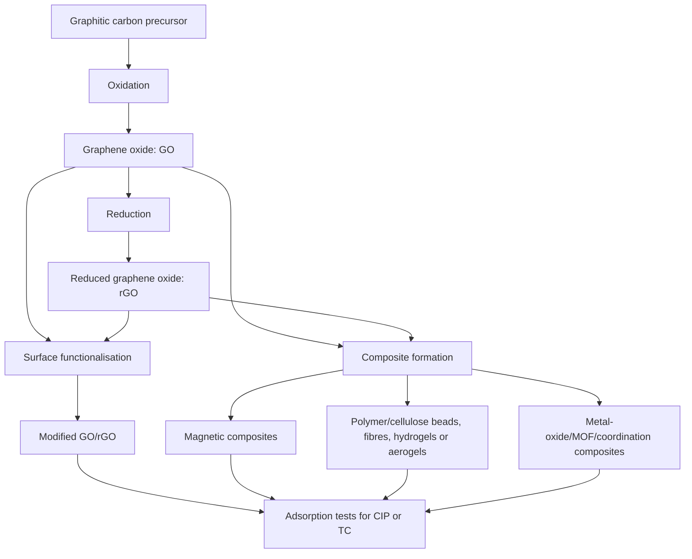
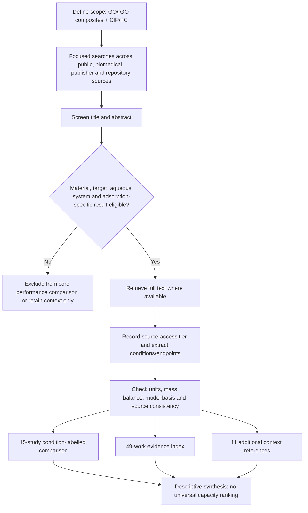
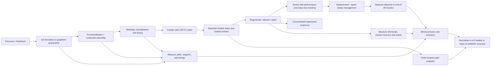
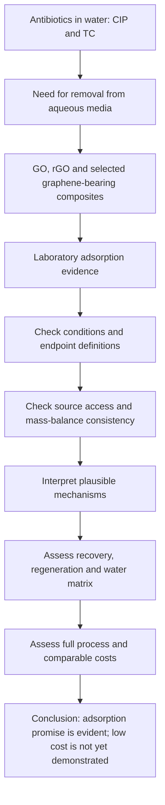

# Comprehensive Study Guide and Seminar-Defence Workbook

## Assessing the Low-Cost Potential of Non-Conventional Engineered Adsorbents for Ciprofloxacin and Tetracycline Removal from Aqueous Media

**Companion to:** `SEMESTER_MANUSCRIPT_V2_ACS_60REF_CASSI_FINAL.docx`  
**Audience:** A beginner learning the subject from the ground up, then preparing to present and defend the manuscript.  
**Purpose:** Explain the science, the review method, the data, the figures, the calculations, the qualifications and the conclusions in plain language without making the paper sound more certain than it is.

> **The one sentence to remember:** The manuscript finds that graphene oxide (GO), reduced graphene oxide (rGO) and selected graphene-based composites can adsorb ciprofloxacin (CIP) and tetracycline (TC), but the evidence does **not** yet prove that these materials are consistently low-cost or ready for practical water treatment.

---

## How to use this guide

Read the guide in order the first time. Chapters 1–5 build the scientific foundations; Chapters 6–10 explain how the manuscript was assembled and what it found; Chapters 11–14 prepare you for the seminar and viva. Do not begin by memorising capacity values. First understand what each measurement means, then learn which study produced it and why the manuscript sometimes qualifies or withholds it.  
**Check yourself:** Why is it safer to understand the measurement before memorising the number? What is the central conclusion you should be able to state without looking at the manuscript?

Every teaching paragraph is followed by one or more **check-yourself questions**. Answer them aloud in your own words. Questions marked **Defence** are phrased like questions a supervisor or examiner might ask. If you cannot answer a question, return to the paragraph immediately above it rather than memorising a sentence mechanically.  
**Check yourself:** What should you do when you cannot explain an answer in your own words? Why is reciting a memorised value not the same as understanding it?

The guide follows the final manuscript's terminology and its evidence qualifications. In particular, it distinguishes measured uptake, mass-balance-derived uptake, kinetic-model outputs, isotherm-fit capacities, removal percentages and column results. These are related, but they are not interchangeable. The guide does not silently repair inconsistencies found in the papers reviewed.  
**Check yourself:** Name the six kinds of result that the review keeps separate. Why would silently correcting a source discrepancy weaken a scientific review?

### The map of the manuscript

| Manuscript part | What it does | What you must be able to explain |
|---|---|---|
| Abstract | Gives the purpose, scope, evidence approach and conclusion | What the paper does and does not establish |
| 1. Introduction | Explains antibiotic adsorption, target chemistry and the affordability gap | Why CIP and TC; why adsorption; why GO/rGO; why cost matters |
| 2. Scope and methods | Defines eligibility, searches, selection, extraction and assessment | Why this is a focused narrative evidence synthesis, not a systematic review |
| 3. Results and discussion | Compares performance, composites, mixtures, matrix tests and costs | Why values cannot be placed on one capacity leaderboard |
| 4. Mechanistic interpretation | Discusses candidate molecular interactions and transport | What evidence supports each mechanism and what remains hypothetical |
| 5. Practical feasibility | Examines preparation, recovery, regeneration, water matrices and cost | Why magnetic recovery or waste feedstock does not automatically mean low cost |
| 6. Conclusions | States what the evidence supports and what future studies should report | The paper's cautious, evidence-led conclusion |
| Table 2 | Compares 15 studies using condition-labelled experiments and multiple endpoints | How to read each table panel without mixing measurements |
| Table 3 | Indexes all 49 selected works and records source/evidence qualifications | Why breadth of literature is not the same as equal evidence quality |

**Check yourself:** Which section contains the main answer to the research question? Which tables help you understand all 49 selected works, and which table is the condition-labelled comparison subset?

---

## Chemistry from absolute zero — read this before Chapter 1

This foundation chapter assumes that you have never studied adsorption mechanisms before. Its purpose is to make the words used later in the manuscript understandable. Do not rush through it: when an examiner asks about π–π association, hydrogen bonding or electrostatic attraction, you should be able to explain the idea using ordinary language first, and then connect it to the antibiotic and the adsorbent.

**Check yourself:** Can you explain why this foundation chapter comes before the study-by-study discussion? Which three words in the title of this section tell you that it is designed for a beginner?

### F.1 Atoms, electrons and molecules

All ordinary matter is made of atoms. An atom has a small, dense nucleus containing protons and neutrons, with electrons occupying regions around the nucleus called orbitals. An orbital is a mathematical description of where an electron is likely to be found; it is not a tiny planet travelling on a fixed circular track. The outer, or valence, electrons are especially important in chemistry because they determine how atoms bond and interact.  
**Check yourself:** What are the three main subatomic particles? Which particles are in the nucleus? Why are valence electrons important when two atoms form a bond?

A **molecule** is a group of atoms held together by chemical bonds. Water, H₂O, is a small molecule: one oxygen atom is bonded to two hydrogen atoms. Ciprofloxacin and tetracycline are much larger molecules with many carbon, hydrogen, nitrogen and oxygen atoms. Their shapes, bonds, chargeable groups and electron distributions help determine how they behave in water and near a solid surface.  
**Check yourself:** What makes a collection of bonded atoms a molecule? Which elements occur in CIP and TC? Why does molecular structure matter for adsorption?

A **chemical bond** is an arrangement that holds atoms together. In a covalent bond, atoms share electron density. In an ionic interaction, oppositely charged ions attract one another. There are also weaker intermolecular forces between separate molecules or between a molecule and a surface. Adsorption commonly involves several such non-covalent interactions at once; the antibiotic does not necessarily form a new covalent bond to the adsorbent.  
**Check yourself:** What is the difference between a covalent bond and an attraction between two separate molecules? Does every adsorption event require a new chemical bond to form?

### F.2 Single, double and triple bonds: the starting point for π chemistry

A **single covalent bond** between two atoms is usually a sigma (σ) bond. Its electron density is concentrated along the line joining the two nuclei. A **double bond** consists of one sigma bond and one pi (π) bond. A **triple bond** contains one sigma bond and two pi bonds. The sigma bond provides the main connection along the internuclear axis; the pi bond adds electron density in regions on either side of that axis.  
**Check yourself:** What type of bond is present in every ordinary double bond? What additional bond is added when a single bond becomes a double bond? What does the π symbol refer to?

In a simple picture of a carbon–carbon double bond, the π electron density lies above and below the plane containing the two carbon nuclei. It is useful to picture a cloud of electron density rather than a solid bar or a separate little object. In molecules with several alternating single and double bonds, neighbouring p orbitals can overlap and allow some π electron density to be spread across several atoms. This spreading is called **delocalisation**.  
**Check yourself:** Where is the π electron density located relative to a double bond? What does delocalisation mean? Why is it more accurate to picture electron density than to imagine a rigid physical loop?

### F.3 What are aromatic rings and conjugated systems?

An **aromatic ring** is a special cyclic, conjugated arrangement of atoms with delocalised π electrons. Benzene is the standard introductory example. It contains six carbon atoms in a hexagonal ring; its six π electrons are delocalised around the ring rather than belonging to three completely isolated double bonds. In structural drawings, benzene is often shown as a hexagon with alternating double bonds or with a circle inside. Both drawings represent the delocalised aromatic system.  
**Check yourself:** What is an aromatic ring? How many carbon atoms are in benzene? What does the circle inside a benzene hexagon represent?

A **conjugated system** has adjacent p orbitals that can overlap, allowing π electrons to be delocalised across more than one bond or atom. A molecule can contain conjugated regions without every part of it being aromatic. Aromaticity is a more specific electronic property; do not use the words *aromatic* and *conjugated* as perfect synonyms. CIP and TC contain extended ring systems with conjugated regions that can participate in interactions with carbon-based surfaces.  
**Check yourself:** How is conjugation related to π-electron delocalisation? Why is every aromatic system conjugated, while not every conjugated system is necessarily aromatic? Why does this matter for CIP and TC?

Graphene contains a broad, connected network of sp²-bonded carbon atoms. Each carbon forms three sigma bonds in a roughly trigonal planar arrangement and contributes a p orbital to the extended π-electron system. The resulting material has delocalised π electrons across its graphitic domains. A large graphene sheet can therefore be thought of as an extended aromatic carbon surface, although an entire graphene sheet is not simply one ordinary benzene molecule.  
**Check yourself:** What does sp² mean in this context? How many sigma bonds does each ideal graphene carbon form? Why should you not describe a graphene sheet as one giant benzene molecule?

### F.4 So, what exactly are π–π interactions?

**π–π interactions** (often called π–π stacking or π–π association) are non-covalent attractions or favourable associations between regions containing delocalised π electrons, commonly aromatic rings. In this manuscript, the idea is that an aromatic or conjugated region of CIP or TC can associate with an sp²-rich region of GO/rGO. The interaction is not a new π bond joining the antibiotic to graphene. It is an intermolecular association arising from a combination of electronic effects, including electrostatic contributions and London dispersion forces.  
**Check yourself:** Define π–π interaction in one sentence. Does it create a new covalent bond between CIP and graphene? Which parts of the antibiotic and the adsorbent can participate?

There is more than one possible geometry. In a face-to-face arrangement, two aromatic surfaces lie approximately parallel; in a parallel-displaced arrangement, one ring is shifted sideways relative to the other; in an edge-to-face arrangement, the edge of one aromatic system points toward the face of another. Researchers sometimes use the word *stacking* as a convenient umbrella term, but the actual geometry depends on molecular structure, substituents, solvent and surface.  
**Check yourself:** Name two possible geometries of aromatic association. Does “π–π stacking” always mean two perfectly flat rings directly on top of each other?

A simple mental picture is a flat, carbon-rich graphene patch approaching a flat aromatic region of an antibiotic. Their electron distributions can interact favourably, so the molecule may spend more time near that surface than it would in the surrounding water. This is a useful conceptual model, not a photograph of the molecule on the surface. A real molecule may tilt, rotate, interact through only part of its ring system, or make several contacts at once.  
**Check yourself:** What is the simple mental picture of π–π association on graphene? Why should you not assume the antibiotic lies perfectly flat across the surface?

Why can this matter for the manuscript? Graphene and rGO retain larger sp²-rich regions than heavily oxidised GO in many preparations. CIP and TC have conjugated ring systems. This makes π–π association chemically plausible. However, GO also has oxygen-containing groups; the antibiotic is charged or partly charged depending on pH; and water, ions and other solutes compete for the surface. Thus π–π association is one candidate contribution, not an automatic explanation for every high removal percentage.  
**Check yourself:** Why is π–π association plausible for CIP/TC on GO/rGO? What other factors mean that it cannot automatically be declared the dominant mechanism?

### F.5 Hydrogen bonding: the interaction involving O, N and H

A **hydrogen bond** is an attractive, directional interaction involving a hydrogen atom that is covalently bonded to an electronegative atom—commonly oxygen or nitrogen—and a lone pair on another electronegative atom. The first group is called the hydrogen-bond donor; the atom providing the lone pair is called the hydrogen-bond acceptor. In simplified notation, one may write O–H···O or N–H···O. The dotted line represents the hydrogen bond; it is not the same as the ordinary covalent O–H or N–H bond.  
**Check yourself:** What is a hydrogen-bond donor? What is an acceptor? In O–H···O, which O–H is covalent and which dotted interaction is the hydrogen bond?

GO has surface groups such as hydroxyl (–OH), carboxyl (–COOH/–COO⁻ depending on pH) and epoxide groups. CIP and TC contain oxygen and nitrogen atoms, and some forms contain N–H or O–H groups. These groups can provide hydrogen-bond donors or acceptors depending on their exact protonation and chemical environment. Hydrogen bonding can therefore help an antibiotic associate with an oxygenated GO surface or with a functionalised composite.  
**Check yourself:** Name three oxygen-containing groups found on GO. Which atoms in antibiotics can participate in hydrogen bonding? Why does the exact protonation state matter?

Water itself forms extensive hydrogen bonds. An antibiotic and a GO surface are both surrounded by water molecules in an aqueous experiment. For a hydrogen bond to form between the antibiotic and the surface, some interactions with surrounding water must be reorganised or displaced. Therefore, seeing an –OH group on GO and an oxygen atom on an antibiotic makes hydrogen bonding possible, but does not by itself prove that this interaction dominates adsorption.  
**Check yourself:** Why does water complicate hydrogen bonding at an adsorbent surface? Why is the presence of donor and acceptor groups evidence of possibility rather than proof of dominance?

### F.6 Electrostatic attraction and repulsion: what charge has to do with adsorption

An **electric charge** can be positive or negative. Opposite charges attract; like charges repel. An ionic or polar group on an antibiotic may interact with charged groups on an adsorbent surface. This is an electrostatic interaction. The direction and strength of the effect depend on the charge of the antibiotic at that pH, the charge of the surface, the distance between them and the surrounding solution.  
**Check yourself:** What happens between opposite charges? What happens between like charges? Why must you know the charge of both the antibiotic and the adsorbent before predicting electrostatic attraction?

Many molecules have groups that can gain or lose a hydrogen ion (H⁺), which is called a **proton** in acid–base chemistry. When a group gains H⁺ it is protonated; when it loses H⁺ it is deprotonated. A carboxylic acid group can be written as –COOH when protonated and –COO⁻ when deprotonated. An amine may be neutral as –NH₂ and positively charged when protonated as –NH₃⁺. These changes affect the molecule's overall charge and its local interaction sites.  
**Check yourself:** What is protonation? What is deprotonation? How does –COOH differ in charge from –COO⁻? How can an amine become positively charged?

**pH** describes how acidic or basic a solution is. A lower pH means a greater hydrogen-ion activity; a higher pH means a lower hydrogen-ion activity. Changing pH can change the protonation state of CIP and TC and can also change the protonation of GO's surface groups. So pH can affect both sides of the adsorption interaction simultaneously.  
**Check yourself:** What does lower pH mean in terms of H⁺? Which two participants in the adsorption system can have their charge changed by pH?

A **pKa** is a characteristic value for an ionisable group and describes the pH region in which its protonated and deprotonated forms are present in comparable amounts. For a simple acidic group HA ⇌ H⁺ + A⁻, when pH is one unit above its pKa, the deprotonated form is favoured by about ten to one; when pH is one unit below pKa, the protonated form is favoured by about ten to one. This is an approximate teaching rule for one simple ionisation step. CIP and TC have multiple ionisable groups, so their full speciation can be more complicated.  
**Check yourself:** What does pKa tell you? If pH is about one unit above the pKa of a simple acid, which form is favoured? Why should you not apply a one-step rule blindly to a multi-ionisable antibiotic?

Some molecules can have both a positive and a negative charge at different sites while having an overall net charge of zero. Such a form is called a **zwitterion**. Net charge zero does not mean that the molecule has no charged regions; the positive and negative sites may still interact locally with surfaces, ions and water. Antibiotics with both acidic and basic groups can show cationic, zwitterionic and anionic forms as pH changes.  
**Check yourself:** What is a zwitterion? Does net charge zero mean the molecule has no positive or negative region? Why is this distinction important for adsorption?

The adsorbent surface also has a charge state. The **point of zero charge (pHₚzc)** is the pH at which the measured net surface charge is approximately zero under the particular measurement conditions. Below or above pHₚzc, the surface may tend toward positive or negative net charge, respectively, depending on the material and definition used. The exact surface can still contain different local groups and patches, so pHₚzc is a helpful guide rather than a complete map of every site.  
**Check yourself:** What is pHₚzc? What does it help you infer? Why does one pHₚzc value not mean every atom on the surface has the same charge?

This gives a practical way to reason about electrostatics. If an antibiotic form is positively charged and a surface is net negative, attraction may be favourable. If both are net negative, repulsion may be possible. But the prediction is only a starting hypothesis: local charges, hydrogen bonding, aromatic association, ionic screening and competition can alter the outcome. The manuscript therefore interprets pH trends alongside material-specific evidence rather than using pH alone to declare a mechanism.  
**Check yourself:** What is the simplest predicted interaction between a cationic antibiotic and a negatively charged surface? Name three reasons the real adsorption result may be more complicated.

### F.7 Salts, ions and ionic strength: why water is not chemically empty

Pure water in a laboratory bottle is not the same as natural wastewater. Water may contain dissolved salts, metal ions, bicarbonate, chloride, sulfate, calcium, magnesium, dissolved organic matter and other compounds. These components can compete for sites, change pH, alter the surface charge environment, or associate with the antibiotic. They can therefore increase or decrease measured adsorption.  
**Check yourself:** Name four kinds of components that may be present in wastewater besides the target antibiotic. How could they affect an adsorption experiment?

**Ionic strength** is a measure of the total concentration of ions in solution, weighted by their charges. Dissolved ions create an ionic atmosphere around charged molecules and surfaces. This can screen electrostatic interactions: the apparent attraction or repulsion between two charged partners may become weaker over distance because other ions partially shield their charges. Specific ions can also compete for sites or form bridges, so salt effects are not always a simple universal decrease.  
**Check yourself:** What is ionic strength at a conceptual level? What does charge screening mean? Why could calcium or magnesium have effects beyond merely increasing the salt concentration?

**Natural organic matter (NOM)** includes diverse organic substances from soils, plants, microbes and decaying biological material. Humic substances are one familiar fraction. NOM may coat an adsorbent, block access to sites, compete for adsorption, or associate with antibiotics in solution. This is why a result from a simple antibiotic-in-water solution cannot automatically predict performance in real wastewater.  
**Check yourself:** What is NOM? Give two ways NOM might alter adsorption. Why is a simulated matrix test not automatically the same thing as testing actual wastewater?

### F.8 Other common interactions: van der Waals, hydrophobic effects and coordination

**Van der Waals forces** are a broad family of non-covalent interactions between atoms and molecules. One important contribution is London dispersion: momentary fluctuations in electron density can create temporary dipoles that induce correlated dipoles nearby. Dispersion occurs between all atoms and molecules, although its importance varies. It contributes to the attractive association between large, easily polarised surfaces and molecules, including aromatic systems.  
**Check yourself:** What is a temporary dipole? Do dispersion forces occur only between aromatic molecules? Why can they matter for a large graphene surface?

The **hydrophobic effect** describes the tendency of non-polar surfaces or molecular regions to associate in water because this can reduce the amount of ordered water that must surround them. It is not best understood as a special strong bond between two hydrophobic groups; it is strongly related to how water behaves around non-polar regions. Aromatic regions of antibiotics may contribute to such effects near graphitic surfaces, but the molecule's charged and polar groups also matter.  
**Check yourself:** What does hydrophobic mean? Why is the hydrophobic effect not simply a new covalent bond or a conventional strong attraction between two non-polar groups?

A **metal coordination interaction** occurs when a metal ion accepts electron density from a ligand atom, commonly an atom with a lone pair such as oxygen or nitrogen. A **cation bridge** is a related idea in which a positively charged ion can associate with negatively charged groups on two different species, potentially linking them. These interactions may be relevant to some metal-containing composites or multicomponent water systems, but they must be supported by the specific study rather than assumed because a metal is present.  
**Check yourself:** What is a ligand? Which atoms can provide lone pairs for coordination? What would it mean for a calcium or iron ion to bridge an antibiotic and a surface?

Be careful with calcium-alginate materials. Calcium ions can cross-link alginate chains into a gel-like network; this is often described using the “egg-box” model. That explains how the bead or hydrogel is held together. It does not, without additional evidence, prove that calcium directly binds the antibiotic to GO. Structural cross-linking of the adsorbent and adsorption of the pollutant are different claims.  
**Check yourself:** What does calcium do in calcium-alginate gel formation? Why is that not automatically evidence for a calcium bridge between TC and graphene?

### F.9 Physical adsorption and chemical adsorption

**Physisorption** (physical adsorption) is adsorption dominated by non-covalent forces such as dispersion, electrostatic interactions and hydrogen bonding. It often has a degree of reversibility because the adsorbed molecule is not necessarily joined to the surface by a new strong chemical bond. This does not mean every physical adsorption process is instantly reversible; the real behaviour depends on the system and conditions.  
**Check yourself:** What kinds of forces can contribute to physisorption? Does physical adsorption always mean that desorption is effortless?

**Chemisorption** (chemical adsorption) involves stronger, more specific chemical interactions, such as formation of a chemical bond or coordination-type attachment to a surface. The boundary between physical and chemical contributions can be complex in real materials. A high adsorption capacity, a good pseudo-second-order kinetic fit, or a change in one spectrum does not by itself prove chemisorption. A mechanistic claim should use multiple independent lines of evidence.  
**Check yourself:** How does chemisorption differ from physisorption? Why does a pseudo-second-order fit not automatically prove chemical bond formation?

GO/rGO adsorption systems may involve mixed contributions. An antibiotic can experience π-associated interactions with graphitic regions, hydrogen bonding with oxygenated groups, electrostatic effects depending on charge, dispersion forces and physical retention within accessible structures. Different contributions may matter at different pH values or in different composites. This mixed picture is why the manuscript uses wording such as “candidate mechanisms” and “may contribute” instead of assigning one universal mechanism.  
**Check yourself:** Give three mechanisms that may operate at the same time. Why is a multi-mechanism explanation more realistic than forcing every result into a single category?

### F.10 What makes an adsorbent surface useful?

**Surface area** is the amount of surface available per unit mass, often reported in square metres per gram (m²/g). A larger accessible surface area can provide more places for molecules to interact. But a high BET surface area does not automatically guarantee high antibiotic adsorption: the surface must be accessible to the molecule, chemically compatible, and available in the water conditions of the experiment. Some measured micropore area may not be readily accessible to a relatively bulky antibiotic.  
**Check yourself:** What unit is commonly used for specific surface area? Why is high surface area alone not a sufficient predictor of adsorption performance?

**Pores** are openings or spaces within a solid. They are commonly classified by width as micropores (below 2 nm), mesopores (2–50 nm) and macropores (above 50 nm). These are conventional size categories. Pores may provide internal surface area and pathways to adsorption sites, but narrow pores can exclude large molecules or slow their transport. An antibiotic's size, shape, hydration shell and orientation all affect accessibility.  
**Check yourself:** What are the conventional pore-size ranges for micro-, meso- and macropores? Why might a very narrow pore not be useful for a hydrated antibiotic molecule?

A surface may have several kinds of **functional groups**. A functional group is a recognizable arrangement of atoms that gives part of a molecule or material characteristic chemical behaviour. On GO, common examples are hydroxyl, carboxyl and epoxide groups. On modified graphene materials, additional sulfonate, amine, nitrogen-containing or other groups may be introduced. These groups alter hydrophilicity, acidity/basicity, surface charge and possible interactions.  
**Check yourself:** Define functional group. Name three GO functional groups and two types of added groups used in modified materials in the manuscript.

**Wettability** describes how readily a liquid spreads over or contacts a surface. Oxygen-rich GO is generally more hydrophilic than highly graphitic carbon because oxygenated groups interact favourably with water. More graphitic rGO regions can be less hydrophilic. This affects how the material disperses, how water accesses its surface and how it behaves during separation. Good dispersion can improve contact in a flask, but very fine dispersed particles may be difficult to recover after treatment.  
**Check yourself:** What is the difference between hydrophilic and hydrophobic? Why can easier dispersion be both an advantage during adsorption and a challenge during recovery?

### F.11 How does the antibiotic get to the adsorption site?

**Mass transfer** means movement of a substance from one place to another. Before an antibiotic can bind to a site deep inside a particle or network, it may need to travel from the well-mixed bulk water to the outside of the adsorbent, cross a thin liquid layer near the surface, and then move through pores or a polymer network. These transport steps can limit how quickly adsorption appears to occur.  
**Check yourself:** What does mass transfer mean? Why can a molecule be attracted to a surface but still take time to reach an adsorption site?

The **external film** is the thin liquid boundary layer near the solid surface. A molecule must cross it to reach the adsorbent. Faster mixing often makes this layer thinner and can improve transport, although excessive mixing may create other practical issues. The next step may be diffusion through pores or a network inside the particle, often called intraparticle diffusion. Particle size, pore structure and tortuosity influence this step.  
**Check yourself:** What is the external film? How can stirring affect it? What is intraparticle diffusion, and which material properties can influence it?

A simple way to remember the sequence is: bulk solution → liquid film → accessible surface or pore → adsorption site. The sequence is useful for understanding why contact time, mixing and particle size are reported in the manuscript. It also explains why a kinetic curve is not just a property of the chemical bond: observed speed can be influenced by transport and experimental design.  
**Check yourself:** Recite the transport sequence in order. Why should a kinetic model not be interpreted as a direct photograph of the molecular mechanism?

### F.12 How do scientists examine the material and its interactions?

**FTIR spectroscopy** measures how a sample absorbs infrared radiation associated with molecular vibrations. Different bonds and functional groups can produce characteristic absorption bands. Comparing spectra before and after adsorption may show shifts or changes that are consistent with a changed chemical environment. FTIR helps identify functional groups, but a band shift alone does not tell you the exact percentage contribution of one mechanism.  
**Check yourself:** What physical phenomenon does FTIR measure? What can a before/after FTIR comparison suggest? What can it not quantify by itself?

**X-ray photoelectron spectroscopy (XPS)** uses X-rays to measure the energies of electrons emitted from a material's surface. It helps identify which elements are present near the surface and the chemical environments of those elements. For nitrogen-doped carbon, XPS may distinguish types of nitrogen environments, but identifying pyridinic, pyrrolic or graphitic nitrogen does not by itself reveal one unique antibiotic-binding geometry.  
**Check yourself:** What kind of information does XPS provide? Why is it called a surface-sensitive technique? Why does a nitrogen peak not by itself prove a particular CIP binding configuration?

**Scanning electron microscopy (SEM)** produces images of surface morphology using an electron beam. It can show whether a material looks sheet-like, aggregated, fibrous, bead-like or porous at the observed scale. SEM images do not directly measure molecular binding energy or prove that an antibiotic occupies a particular site.  
**Check yourself:** What does SEM help you see? Why can an SEM image of a porous aerogel not alone prove the pore-filling mechanism?

**BET analysis** is a method commonly used to estimate specific surface area from gas adsorption data. Pore-size analysis may be reported alongside it. These measurements help describe the physical texture of a material, but gas-accessible surface area under measurement conditions is not always identical to the surface that hydrated antibiotic molecules can access in water.  
**Check yourself:** What property does BET commonly estimate? Why might BET surface area differ from the effective adsorption area available to an antibiotic in water?

**Zeta potential** is an electrokinetic measure related to the electrical potential near the slipping plane of particles dispersed in a liquid. It is often used as an indicator of colloidal surface-charge behaviour and dispersion stability. It is not identical to a direct measurement of the charge on every surface group, but it can help interpret how pH changes the behaviour of a dispersed adsorbent.  
**Check yourself:** What is zeta potential used to assess? Why should it not be described as the exact charge of every atom on the surface?

**Density functional theory (DFT)** is a computational quantum-chemistry approach used to calculate electronic structure and compare possible molecular configurations or interaction energies within a chosen model. It can help test whether a proposed arrangement is theoretically plausible. However, a calculation on a simplified model does not automatically reproduce the full complexity of an aqueous experiment containing ions, water, surface defects and multiple competing molecules.  
**Check yourself:** What does DFT calculate at a broad level? What can a favourable calculated interaction support? Why is it not equivalent to direct experimental proof in wastewater?

### F.13 Bringing the basic chemistry back to CIP, TC and GO/rGO

CIP and TC are different antibiotics, but both contain ring systems and heteroatoms. Ring systems create regions with characteristic shapes and electron distributions; heteroatoms such as nitrogen and oxygen can carry lone pairs, become protonated or participate in hydrogen bonding and coordination. Their ionisable groups mean that pH can alter charge and hydration. The exact balance of these features is different for CIP and TC, so a result for one cannot simply be transferred to the other.  
**Check yourself:** What are heteroatoms in an organic molecule? Name two common heteroatoms in CIP and TC. Why should their adsorption behaviours be compared rather than assumed to be identical?

GO presents both graphitic regions and oxygen-containing functional groups. rGO often has more restored sp² character than GO, while still retaining some oxygen groups. A graphene-based composite adds other components—such as alginate, cellulose, PVA, carboxymethyl cellulose or Fe₃O₄—that can alter structure, dispersion, strength, accessibility or separation. Each component may have a different purpose; not every component is itself the main antibiotic-binding site.  
**Check yourself:** What two broad surface features coexist on GO? What can rGO change? In a composite, why must you distinguish the adsorption function from the structural or separation function?

Use the following as a mechanism checklist rather than a claim that all mechanisms occur in every study:

| Candidate contribution | Beginner's explanation | What to look for in a study |
|---|---|---|
| π–π association | Aromatic/conjugated regions associate with graphitic regions | Ring structures, sp² domains, molecular modelling or complementary spectroscopy |
| Electrostatic effect | Charged antibiotic and charged surface attract or repel | Antibiotic speciation, pH, pHₚzc, zeta potential, salt effects |
| Hydrogen bonding | An O–H or N–H donor interacts with an O/N acceptor | Available donor/acceptor groups and compatible spectroscopic evidence |
| Dispersion / van der Waals | Fluctuating electron distributions create weak attractions | Close contact between molecule and surface; often part of a combined interaction |
| Hydrophobic / solvophobic effect | Non-polar regions associate in water as water is reorganised | Molecular polarity, solvent conditions and surface wettability |
| Coordination / cation bridging | Metal ions may link or coordinate to suitable molecular groups | Metal identity, speciation and direct supporting evidence |
| Pore filling / confinement | Molecules enter accessible pores or networks | Pore dimensions, molecular size, pore accessibility and transport evidence |

**Check yourself:** Pick any two rows and explain them without using jargon. Which evidence would you need before claiming that one contribution dominates in a specific study?

### F.14 A quick mental model to use during the seminar

~~~mermaid
flowchart TD
    A[Antibiotic molecule in water] --> B[Its structure and charge]
    B --> B1[Conjugated / aromatic ring regions]
    B --> B2[O and N atoms; donor / acceptor sites]
    B --> B3[Ionisable groups; charge changes with pH]
    C[GO / rGO / composite surface] --> C1[sp2 graphitic domains]
    C --> C2[Oxygenated or added functional groups]
    C --> C3[Surface charge and accessible pores]
    B1 --> D[Possible surface associations]
    C1 --> D
    B2 --> E[Hydrogen bonding / coordination possibilities]
    C2 --> E
    B3 --> F[Electrostatic attraction or repulsion]
    C3 --> F
    D --> G[Observed adsorption depends on all contributions]
    E --> G
    F --> G
    H[Water, salts and natural organic matter] --> G
    I[Mixing, particle size and pore transport] --> G
~~~

The central reasoning is that molecular structure tells you which interactions are possible; pH and water composition determine which charge states and competitors are present; the material's surface chemistry and pore structure determine which sites are available; and transport determines how quickly the antibiotic reaches those sites. The observed adsorption result is the combined outcome of these factors, not a direct measurement of one isolated force.  
**Check yourself:** Explain the complete chain from molecular structure to observed adsorption. Why is it unsafe to interpret a removal percentage as proof of a single molecular mechanism?

# 1. Understand the research problem before the chemistry

## 1.1 What problem is the paper trying to address?

Antibiotics are medicines used to treat bacterial infections. After use, residues can enter wastewater and aquatic environments through human and animal excretion, pharmaceutical activities and other release pathways. Conventional wastewater processes are not designed to remove every trace organic compound equally well. The manuscript therefore examines adsorption as a possible separation step for two antibiotics—ciprofloxacin and tetracycline—in water.  
**Check yourself:** What is an antibiotic residue? Why might a wastewater plant need a polishing step after its main treatment process?

The word *aqueous* simply means that water is the liquid medium. An aqueous adsorption experiment usually starts with a known amount of antibiotic dissolved in water, adds a solid adsorbent, allows contact for a specified time, and measures how much antibiotic remains in solution. The decrease in dissolved concentration is used to estimate how much has transferred to the solid.  
**Check yourself:** What does “aqueous solution” mean? In a simple batch experiment, what are the liquid phase and the solid phase?

The review is not asking whether graphene materials can remove every pollutant. It has a narrow target: selected graphene oxide, reduced graphene oxide and graphene-bearing composites used for CIP and/or TC adsorption from aqueous media. The narrow scope makes it possible to discuss these two antibiotics and the engineering trade-offs of these materials in a focused way.  
**Check yourself:** Which two antibiotics are central to the manuscript? Which material family is included, and why would broadening the paper to all pollutants make its central comparison less focused?

## 1.2 What is adsorption?

**Adsorption** is the accumulation of molecules or ions from a gas or liquid at the surface of a solid or liquid. In this review, antibiotic molecules in water are the *adsorbate* (the species being captured), and GO/rGO or a composite is the *adsorbent* (the material doing the capturing). Adsorption occurs at accessible surfaces, functional groups, pores, interfaces and other accessible regions of the solid.  
**Check yourself:** Define adsorption, adsorbate and adsorbent. In the paper's experiments, which substance is the adsorbate and which is the adsorbent?

Do not confuse **adsorption** with **absorption**. Adsorption is surface- or interface-associated accumulation; absorption is uptake into the bulk of another phase. A porous composite may allow molecules to enter pores, but the process studied is still described as adsorption when the uptake is associated with the solid's accessible surfaces and pore structure.  
**Check yourself:** What is the simplest difference between adsorption and absorption? Why does a porous adsorbent not automatically turn an adsorption experiment into an absorption process?

Most importantly, adsorption is not the same as **degradation**. Adsorption transfers the antibiotic from water onto a solid; it does not, by itself, destroy the antibiotic molecule. If the loaded adsorbent is not recovered and managed, the contaminant has moved phases rather than disappeared from the whole treatment system. Degradation requires evidence of chemical transformation or breakdown, and mineralization is a stronger claim involving conversion toward inorganic end products.  
**Check yourself:** If the water concentration falls by 95%, can you say that 95% of the antibiotic has been destroyed? Where may the missing antibiotic mass be? What further evidence would be needed to claim degradation or mineralization?

This distinction determines the paper's practical argument. A material is not useful merely because it removes antibiotic from water in one flask. A treatment process must also separate the loaded solid, prevent loss of sorbent particles, regenerate or replace the adsorbent, handle concentrated regenerant and manage spent material.  
**Check yourself:** What steps must follow adsorption in a real treatment process? Why is “high removal” an incomplete measure of treatment success?

## 1.3 Batch treatment versus flow-through treatment

A **batch** experiment places a fixed quantity of water and a fixed mass of adsorbent together in a vessel. The experimenter controls the initial concentration, adsorbent dose, pH, temperature, mixing and contact time. Samples are taken over time or after equilibrium. Most of the comparisons in the manuscript are batch experiments.  
**Check yourself:** What is a batch adsorption experiment? Which variables must be reported so that another researcher can interpret or reproduce it?

A **flow-through** system continuously passes water through or across a bed or membrane containing the adsorbent. The water does not all have the same contact history: the bed may initially remove the solute efficiently, then become progressively loaded until the outlet concentration begins to rise. This behaviour is described by a breakthrough curve.  
**Check yourself:** How does a flow-through system differ from a batch flask? What does “breakthrough” mean in a packed bed?

A **permeable reactive barrier (PRB)** is a reactive zone placed in the path of contaminated groundwater. Water flows through the barrier, where a reactive or sorptive medium captures contaminants. The Zhao et al. study in this manuscript is relevant because it discusses a graphene–alginate hydrogel bead material in a groundwater PRB configuration. Its numerical breakthrough and cost details, however, were not independently accessible, so it cannot be used as a fully verified quantitative process comparison.  
**Check yourself:** What is a PRB? Why is an application-oriented PRB study valuable, and why should its unavailable breakthrough data not be invented or assumed?

## 1.4 Why select ciprofloxacin and tetracycline?

Ciprofloxacin (CIP) is a fluoroquinolone antibiotic. Tetracycline (TC) is a tetracycline-class antibiotic. They are chemically different molecules, with different structures, ionisable groups and environmental interactions. The review uses them as two specific target compounds, not as interchangeable representatives of all antibiotics.  
**Check yourself:** Which antibiotic class does CIP belong to? Which class does TC belong to? Why should a result for norfloxacin or ofloxacin not be relabelled as a CIP result?

Both CIP and TC can exist in different charge states depending on pH. Their ionisable groups may gain or lose protons as solution pH changes. Consequently, the molecule's net charge, local charge distribution and tendency to interact with a surface can change with pH. The manuscript uses a CIP-on-clay example with pKa values near 6.1 and 8.7 to illustrate speciation; this clay study is context only, not evidence for graphene adsorption.  
**Check yourself:** What is ionisation/speciation? Why can the same antibiotic interact differently with the same adsorbent at different pH values? Why is the clay example not counted as a graphene adsorption result?

Tetracycline also interacts with solution components such as dissolved organic matter and electrolyte cations. The manuscript cites a humic-acid study to demonstrate that TC association with dissolved organic matter is pH- and electrolyte-dependent. Humic acid in that study is not a GO adsorbent; it is a solution-chemistry example showing that water contains more than just the target antibiotic.  
**Check yourself:** What is natural organic matter (NOM)? Why can dissolved humic substances affect adsorption experiments? Why should the humic-acid study not be placed in the graphene-composite performance table?

The review treats CIP and TC separately throughout. CIP is not pooled with norfloxacin or ofloxacin. TC is not pooled with doxycycline, oxytetracycline, chlortetracycline or demeclocycline. A paper may examine several antibiotics, but only a result that can be assigned specifically to CIP or TC is allowed into that target's comparison. If a result represents the total uptake of a mixture, it must remain labelled as a mixture result.  
**Check yourself:** Name at least three compounds that must not be pooled with CIP or TC. What is the difference between a target-specific uptake and a total-mixture uptake?

---

# 2. Understand the adsorbent materials

## 2.1 Graphene, graphene oxide and reduced graphene oxide

**Graphene** is a sheet-like carbon material whose carbon atoms form a two-dimensional hexagonal network. Large regions of the sheet contain sp²-bonded carbon and delocalised π electrons. Those aromatic graphenic domains can interact with conjugated molecules, which is one reason graphene-derived surfaces are studied for antibiotic adsorption.  
**Check yourself:** What does “sp² carbon domain” mean at a basic level? Why might a flat aromatic carbon surface interact with an antibiotic containing conjugated rings?

**Graphene oxide (GO)** is produced by oxidising graphite or another graphitic precursor. The oxidation introduces oxygen-containing groups such as hydroxyl, carboxyl and epoxide groups, disrupts some of the continuous sp² carbon network, and generally makes the material more chemically functional and more dispersible in water than pristine graphene. These groups can provide sites for hydrogen bonding and acid–base interactions, while residual aromatic domains may still contribute to π–π association.  
**Check yourself:** What does oxidation add to graphene? Name three oxygen-containing functionalities discussed in the paper. How can GO's oxygen groups help adsorption and also alter its aromatic surface?

**Reduced graphene oxide (rGO)** is made by removing some oxygen-containing functionality from GO through a reduction step. Reduction can restore more graphitic character and increase the fraction of sp² carbon domains, but it does not usually produce a perfect pristine graphene sheet. The amount and type of residual oxygen groups depend on the reduction route. Thus, GO and rGO may present different balances of aromatic domains, polar groups, surface charge and dispersibility.  
**Check yourself:** What is reduced during GO-to-rGO conversion? Why should you not describe rGO as automatically identical to pristine graphene?

There is no universal rule that GO must adsorb better than rGO or vice versa. Performance depends on the antibiotic, pH, surface chemistry, accessible area, dose, preparation route and solution matrix. More oxygen groups may provide polar interaction sites, while more graphitic domains may strengthen aromatic association. The material's practical value also depends on whether it can be recovered and reused.  
**Check yourself:** Why is “GO is always better than rGO” not a scientifically defensible statement? What properties might pull performance in opposite directions?

## 2.2 Surface functionalisation and composite materials

A **functionalised** graphene material has been chemically modified to introduce or alter specific surface groups. The manuscript includes sulfonated GO (SGO), nitrogen-doped rGO (N-rGO), amine- or phosphorus-functionalised GO and other chemically modified materials. Functionalisation can change charge, hydrophilicity, accessible binding groups and interactions with the target molecule. It can also require extra reagents, solvent washing, neutralisation and energy.  
**Check yourself:** What is functionalisation? Give two examples from the manuscript. Why should a functionalisation step be discussed both as a possible adsorption benefit and as a production burden?

A **composite** combines graphene-derived material with another component to create a material with more than one function. Examples include GO with calcium alginate, cellulose, carboxymethylcellulose (CMC), poly(vinyl alcohol) (PVA), metal oxides, magnetic iron oxide, metal–organic frameworks (MOFs), or coordination compounds. A composite may improve mechanical form, dispersion, pore architecture, selectivity or recovery, but the extra component also adds manufacturing steps and may change the material's mass-normalised capacity.  
**Check yourself:** What is a composite adsorbent? Name four components combined with GO/rGO in the manuscript. Why can adding a polymer or magnetic phase help handling but complicate cost comparison?

**Magnetic composites** commonly incorporate magnetite or another magnetic phase, such as Fe₃O₄, into a graphene-based material. After adsorption, an external magnet can help separate the solid from water. This is an operational advantage over collecting fine suspended particles by filtration or centrifugation. However, the magnetic component does not automatically increase the antibiotic's intrinsic molecular affinity for the graphene surface, and magnetic recovery does not eliminate the need for desorption, washing, regeneration or spent-media handling.  
**Check yourself:** What does the magnetic phase do? Does easy magnetic separation prove stronger adsorption? What additional process steps still remain after magnetic recovery?

**Polymer- and cellulose-supported composites** can turn sheets or particles into fibres, beads, hydrogels or aerogels. Immobilisation can reduce handling problems caused by freely dispersed nanosheets and can make the adsorbent easier to retrieve. Cellulose may create a porous network; alginate can form a cross-linked gel; CMC and PVA can provide polymer structure. These architectures can improve practical form while adding cross-linking, washing, curing, drying or freeze-drying requirements.  
**Check yourself:** What does immobilisation mean? What is the intended role of alginate or cellulose in a composite? Why might freeze-drying be a hidden process cost?

**Metal-oxide and MOF-containing composites** combine graphene with metal oxides or porous coordination frameworks. Their design may add active sites, change surface charge, create pores or provide magnetic response. Yet a larger fitted capacity for a multicomponent material cannot be attributed to graphene alone unless the study separates the contributions of its components. More ingredients also mean more precursor chemicals, synthesis stages and possible leaching questions.  
**Check yourself:** Why is it difficult to say which component caused a composite's performance? What additional controls would help isolate the contribution of GO, the oxide and the MOF?

### A simple material-family diagram

**Check yourself:** Trace the path from graphite to GO and from GO to rGO. At which stage can magnetic, polymer/cellulose or metal-containing components be introduced?

---

# 3. The solution chemistry you must understand

## 3.1 pH, pKa, speciation and surface charge

**pH** measures how acidic or basic a solution is. A pH change can alter both the antibiotic's charge state and the charge of the adsorbent surface. Therefore, a result measured at pH 4 cannot automatically be compared with one at pH 7, even when the material and antibiotic names are the same.  
**Check yourself:** What does pH describe? Why is pH not a minor experimental detail in antibiotic adsorption?

A **pKa** is associated with the tendency of an ionisable group to lose a proton. When pH is below or above a relevant pKa, the relative proportions of protonated and deprotonated forms change. Antibiotics with several ionisable groups can have more than one relevant pKa and can exist in cationic, zwitterionic or anionic forms depending on conditions. The manuscript cites CIP pKa values near 6.1 and 8.7 as a mechanistic illustration; it does not use those values as a direct measurement of adsorption on GO.  
**Check yourself:** Explain pKa in plain language. What happens to the proportions of protonated and deprotonated forms as pH changes relative to pKa? Why can a molecule have more than one pKa?

The **point of zero charge (PZC or pHₚzc)** is the pH at which the net surface charge of a material is approximately zero under the measurement conditions. Below or above this point, the surface may carry a net positive or negative charge, respectively, although the real surface can contain multiple different sites. The PZC helps interpret whether electrostatic attraction or repulsion is plausible at a given pH; it does not independently reveal the whole adsorption mechanism.  
**Check yourself:** What is pHₚzc? What can it suggest about the surface charge above and below that point? Why does it not, on its own, prove electrostatic binding?

The manuscript reports a PZC near pH 2.0 for the battery-derived GO study and approximately 2.5 for the sulfonated-GO/CIP study. These are material- and method-specific results, not universal values for all GO or SGO. Do not transfer a PZC measured for one formulation to another formulation without evidence.  
**Check yourself:** Which two studies report PZC values in the manuscript? Why is it unsafe to apply one study's PZC to every graphene oxide material?

## 3.2 Ionic strength, competing ions and natural organic matter

**Ionic strength** reflects the total concentration and charge of dissolved ions. Salts can screen electrostatic interactions, compete for sites or alter aggregation and dispersion. In some systems, ions may also bridge between molecules and surfaces. The direction and size of the effect depend on the material, antibiotic, ion identity and test conditions; the review therefore avoids claiming that salts always suppress adsorption.  
**Check yourself:** What is ionic strength? Give two possible ways dissolved ions could influence adsorption. Why is it not safe to say that all salts have the same effect?

**Natural organic matter (NOM)** includes dissolved organic substances found in natural waters, such as humic-like materials. NOM can compete for adsorbent sites, coat surfaces, interact with antibiotics in solution or sometimes change apparent adsorption behaviour. A synthetic-water experiment containing one added ion or a known amount of humic acid is useful for controlled mechanistic testing, but it is not the same as a validated test in real wastewater.  
**Check yourself:** What is NOM? How could NOM affect adsorption? What is the difference between a simulated matrix test and a real-wastewater trial?

A **single-solute** experiment contains one target compound in the test solution. A **multicomponent** experiment contains multiple target compounds or other solutes. In a mixture, compounds may compete for the same sites, interact with one another, or have different affinities. A mixture-level uptake must not be labelled as the uptake of CIP or TC alone unless the study measures and calculates each compound separately.  
**Check yourself:** Define single-solute and multicomponent adsorption. Why is total uptake from a four-antibiotic mixture not automatically the uptake of TC?

## 3.3 Why laboratory water is not automatically real water

**Deionised water** is purified water with most dissolved ions removed. **Synthetic water** is prepared by the researcher with known solutes. **Spiked natural water** is a real source of water to which a known quantity of antibiotic is added. **Real wastewater** is a complex sample with its own native dissolved organic matter, salts, suspended matter and other contaminants. These are different levels of realism and should be reported accurately.  
**Check yourself:** Distinguish deionised water, synthetic water, spiked natural water and real wastewater. Which one is the strongest direct test of practical treatment under local wastewater conditions?

Prefiltration also matters. The GO–TOPO:LevA membrane study tested municipal wastewater that had first been passed through a 0.45 μm polyethersulfone (PES) filter and then deliberately spiked. This is meaningful matrix evidence, but it is not identical to treating untreated municipal wastewater. The pretreatment step must be included when describing the application.  
**Check yourself:** What does 0.45 μm prefiltration do conceptually? Why must a seminar description say that the wastewater was prefiltered and spiked?

---

# 4. The calculations: the most important quantitative foundation

## 4.1 Know what the symbols mean

Adsorption papers often use concentration, volume, mass and time symbols. In this guide, `C₀` is the initial dissolved concentration, `Cₑ` is the concentration remaining at equilibrium, `Cₜ` is the concentration remaining at a specified time `t`, `V` is solution volume, `m` is adsorbent mass, `qₑ` is equilibrium uptake, and `qₜ` is uptake at time `t`. Concentration is commonly reported in mg/L, volume in L, adsorbent mass in g and uptake in mg/g.  
**Check yourself:** Define C₀, Cₑ, Cₜ, V, m, qₑ and qₜ. What units must be used consistently when calculating q in mg/g?

The most common mass-balance expression for equilibrium uptake is:

\[
q_e = \frac{(C_0-C_e)V}{m}
\]

It calculates the decrease in dissolved antibiotic mass, `(C₀ − Cₑ)V`, and divides it by the mass of adsorbent. If C is in mg/L, V is in L and m is in g, the result is mg of antibiotic per g of adsorbent (mg/g).  
**Check yourself:** Why is the concentration difference multiplied by volume? Why is the result divided by adsorbent mass? Show how the units reduce to mg/g.

For a time-specific sample, use:

\[
q_t = \frac{(C_0-C_t)V}{m}
\]

This is the amount taken up by the solid at time `t`, under the assumptions of the batch mass balance. At equilibrium, `Cₜ` approaches `Cₑ` and `qₜ` approaches `qₑ`. A kinetic experiment measures how uptake changes with time; an equilibrium experiment measures the final relationship once the system has approached equilibrium.  
**Check yourself:** How does qₜ differ from qₑ? What happens to qₜ as the system approaches equilibrium?

Percentage removal is calculated as:

\[
\%\,\mathrm{Removal}=\frac{C_0-C_e}{C_0}\times100
\]

Removal tells you what fraction of the initial dissolved concentration disappeared from the liquid phase. It does not by itself tell you how many milligrams were adsorbed per gram of adsorbent, because the latter also depends on the adsorbent dose.  
**Check yourself:** What does percentage removal measure? Can two experiments have the same removal percentage but different qₑ values? Explain why.

## 4.2 The feed-mass ceiling: a powerful error check

The maximum uptake that can possibly be achieved in a closed batch is limited by the amount of antibiotic initially present. Even if the adsorbent captured every molecule, the uptake could not exceed the initial antibiotic mass divided by the adsorbent mass:

\[
q_{\mathrm{feed\ ceiling}}=\frac{C_0V}{m}
\]

If dose is given as `D = m/V` in g/L, the same limit becomes:

\[
q_{\mathrm{feed\ ceiling}}=\frac{C_0}{D}
\]

For C₀ in mg/L and D in g/L, this gives mg/g. This check is essential: a reported measured uptake greater than the entire mass of antibiotic initially supplied is physically impossible unless the stated concentration, volume, dose, unit or calculation basis is incomplete or wrong. A fitted isotherm parameter can exceed a particular test's feed ceiling because it is an extrapolated model parameter; it must not be presented as the observed uptake in that flask.  
**Check yourself:** Derive the feed ceiling from the initial solute mass. What does a value above the feed ceiling tell you about a reported experimental uptake? Why is a fitted maximum capacity different?

### Worked example A — the battery-derived GO/CIP discrepancy

The Yasmin et al. study reports 99.0% CIP removal from a 2 mg/L feed, with a stated GO dose of 20 mg/L and a 40 mL solution volume. Convert the dose: 20 mg/L = 0.020 g/L. In 40 mL, the GO mass is `0.020 g/L × 0.040 L = 0.0008 g`. The initial CIP mass is `2 mg/L × 0.040 L = 0.080 mg`; 99% removal corresponds to 0.0792 mg adsorbed. Thus, the implied uptake is `0.0792 mg / 0.0008 g = 99 mg/g`.  
**Check yourself:** How many grams of GO are in 40 mL at 20 mg/L? How much CIP is initially present? How do you obtain 99 mg/g from the 99% removal result?

The same study's kinetic table reports an experimental uptake of 78.82 mg/g and a pseudo-second-order-fitted uptake of 79.36 mg/g. On the same stated 40 mL / 20 mg/L basis, 78.82 mg/g would correspond to about 78.82% removal, not 99%. A weighed mass near 1.0 mg (about 25 mg/L in 40 mL) could make the 99% result consistent with an uptake near 79 mg/g, but the exact mass used in each kinetic flask is not stated. The paper also has a 20 mg/L versus 20 g/L discrepancy in its Conclusion. The review records these conflicts rather than silently changing the dose.  
**Check yourself:** What are the three values that cannot be reconciled on the stated basis? What additional primary information would resolve the discrepancy? Why is it unacceptable for the reviewer to simply replace 20 mg/L with 25 mg/L?

### Worked example B — the CMC-functionalised magnetic GO/TC result

Dipannita et al. report 96.04% TC removal at C₀ = 2 mg/L and an adsorbent dose of 0.1 g/L. The feed-ceiling uptake is `2 / 0.1 = 20 mg/g`. At 96.04% removal, the derived uptake is `20 × 0.9604 = 19.208 mg/g`. The review rounds this to approximately 19.21 mg/g and labels it as **derived from mass balance**, not as a directly quoted measurement.  
**Check yourself:** Why is the feed ceiling 20 mg/g? Calculate the derived uptake for 96.04% removal. Why must the answer be labelled “derived”?

### Worked example C — check units before comparing

A dose of 20 mg/L is not the same as 20 g/L. Since 1 g = 1000 mg, 20 g/L is 1000 times larger than 20 mg/L. Likewise, 200 μg/L = 0.2 mg/L, and 10 μg/L = 0.010 mg/L. Unit conversion is not cosmetic: it changes the initial mass available for adsorption and can reveal impossible uptake values.  
**Check yourself:** Convert 20 mg/L to g/L; 20 g/L to mg/L; 200 μg/L to mg/L; and 10 μg/L to mg/L. What happens to the feed-mass ceiling if a dose is mistakenly reported in g/L instead of mg/L?

## 4.3 Five endpoints that must never be mixed

1. **Observed experimental uptake** is the uptake calculated from measured concentration changes or reported directly from an experiment. It belongs to a particular feed, dose, pH, temperature, volume and contact time.  
**Check yourself:** What makes an uptake “observed”? Which experimental conditions should accompany it?

2. **Mass-balance-derived uptake** is calculated from reported removal and conditions using the mass-balance equation. It is a transparent consistency check, but it is not an independently measured table value unless the source itself reports it as such.  
**Check yourself:** How is a derived qₑ different from a directly tabulated qₑ? Why is the label important?

3. **Kinetic-model-fitted uptake** is a parameter estimated when a model is fitted to a time-course dataset. It may describe a fitted equilibrium uptake in that kinetic run, but it remains a model output. It is not automatically identical to a directly observed equilibrium point.  
**Check yourself:** What data are used for kinetic fitting? Why should a fitted qₑ be identified as model-derived?

4. **Isotherm-fitted capacity** (often denoted `qmax` or `qₘ`) is a maximum-capacity parameter estimated from an equilibrium model fitted across a concentration series. It is a model parameter, often extrapolated beyond the directly measured points. It is not the amount captured in a separate low-concentration removal experiment.  
**Check yourself:** What is an adsorption isotherm? What does qmax represent in a fitted model, and why might it differ greatly from the uptake measured in a low-concentration test?

5. **Removal percentage and column/breakthrough results** describe different outcomes. Removal percentage is the fraction of dissolved concentration removed in a test. Column results describe performance during flow, often as a function of time or bed volumes. Neither can be converted into an isotherm capacity without the missing mass-balance and model information.  
**Check yourself:** Why is a 99% removal result not a qmax? Why is a breakthrough result not interchangeable with a batch equilibrium uptake?

## 4.4 Read the experimental conditions as a connected set

**Initial concentration (C₀)** determines how much antibiotic is available and the concentration gradient that drives transfer to the adsorbent. At low C₀, the feed may contain very little total antibiotic, so even a small amount of adsorbent can produce a high mass-normalised uptake ceiling constraint. At high C₀, more antibiotic is available and the apparent uptake may be much larger, but the test may no longer represent trace-level environmental water.  
**Check yourself:** Why can a high-concentration isotherm produce a large qmax? Why is that not proof of good treatment at trace concentrations?

**Adsorbent dose** is the mass of adsorbent per solution volume, commonly g/L or mg/L. Higher doses can increase the number of available sites and often increase percentage removal, but they can also lower uptake per gram because the available antibiotic mass is shared across more adsorbent. A treatment system must consider both removal and how much adsorbent is required.  
**Check yourself:** What is the difference between 0.1 g/L and 10 g/L? Why might increasing dose improve removal percentage while reducing q per gram?

**Contact time** tells you how long the antibiotic and adsorbent are allowed to interact. Some studies report rapid initial uptake followed by a slower approach to equilibrium. A 20-minute test and a 72-hour test cannot be treated as equivalent process designs, even if both report high eventual removal.  
**Check yourself:** Why is contact time important in water-treatment design? What is the practical difference between achieving adsorption in seconds and requiring several days?

**Temperature** can influence diffusion, solution chemistry, adsorption equilibrium and the fitted model parameters. A fitted isotherm capacity measured at 50 °C should not be paired with a removal result measured at 25 °C as though they came from the same test. The manuscript repeatedly flags this problem.  
**Check yourself:** Why is the temperature label necessary for every reported capacity? Identify one study in the manuscript where the fitted qmax and removal result belong to different temperatures.

**pH, mixing, matrix and volume** also matter. pH changes charge/speciation; stirring affects external mass transfer; matrix components compete or interact; and volume is required for a correct mass balance. If a paper does not report a volume, the reviewer may be unable to verify whether a very high uptake is physically possible.  
**Check yourself:** Which of these variables changes molecular/surface charge? Which affects transport? Which is required for a mass-balance calculation?

---

# 5. Isotherms, kinetics and optimisation: understand what the models can and cannot say

## 5.1 Adsorption isotherms

An **adsorption isotherm** describes the relationship between the amount adsorbed at equilibrium (`qₑ`) and the residual concentration in solution (`Cₑ`) at a specified temperature. It is built from equilibrium measurements across a range of concentrations. A fitted isotherm helps summarise the data and estimate parameters, but the model's assumptions and fit quality must be examined.  
**Check yourself:** What is plotted or related in an adsorption isotherm? Why is a single concentration point insufficient to construct a full equilibrium isotherm?

The **Langmuir model** is commonly interpreted using idealised assumptions of a finite number of equivalent adsorption sites and monolayer coverage. Its fitted maximum parameter is often written `qmax` or `qₘ`. The model is useful, but a good Langmuir fit does not prove that a real heterogeneous graphene composite has a perfectly uniform surface or that a literal monolayer has formed.  
**Check yourself:** What are the basic Langmuir assumptions? What does qmax mean? Why does a Langmuir fit not prove a perfectly homogeneous monolayer?

The **Freundlich model** is an empirical relationship often used for heterogeneous adsorption surfaces and non-uniform site energies. It does not provide the same finite monolayer maximum parameter as Langmuir. A material may fit Freundlich better than Langmuir, even if the authors emphasise the Langmuir-derived number in the abstract or conclusion. The manuscript flags such cases rather than privileging the largest number.  
**Check yourself:** What type of surface behaviour is Freundlich commonly used to describe? Why should the best-fitting model be reported rather than automatically selecting the model with the more impressive qmax?

The **Sips model** combines features associated with Langmuir and Freundlich-type behaviour and can represent heterogeneous adsorption while approaching a finite maximum under suitable parameter values. The **Hill model** is another empirical model that can represent cooperative or non-ideal binding behaviour. In the CMC/GO beads study, the Hill model fit better than the linear Langmuir model used for the author's cost illustration; this mismatch is one reason the cost figure is qualified.  
**Check yourself:** Why might a researcher compare Sips, Langmuir, Freundlich and Hill models? What is the specific concern when a study calculates cost using a model that is not its best-fitting model?

The **Dubinin–Radushkevich (D–R) model** provides other fitted parameters sometimes used to discuss adsorption energy or pore-filling behaviour. Its derived energy parameter is not a direct spectroscopic measurement of a chemical bond. The manuscript treats D–R outputs as model parameters and does not use them as proof of a particular bond mechanism.  
**Check yourself:** Why is a D–R energy parameter not the same as a measured bond energy? What general rule applies to all model-derived isotherm parameters?

A model should be judged using the fit statistics, residual behaviour, the data range and whether its assumptions make sense for the system. A higher `R²` alone is not a full scientific argument. Nonlinear and linear fitting can produce different parameter estimates, and model choice can materially change a capacity estimate.  
**Check yourself:** Why is R² not enough to choose a model? Why can linear and nonlinear fitting return different qmax values?

## 5.2 Adsorption kinetics

**Kinetics** concerns how fast adsorption occurs and how uptake changes with time. A kinetic experiment records concentration or uptake at multiple time points. It helps identify how quickly a material approaches an apparent equilibrium and whether a proposed treatment contact time is practical.  
**Check yourself:** What question does a kinetic experiment answer? How is that different from an isotherm experiment?

The **pseudo-first-order (PFO)** model and **pseudo-second-order (PSO)** model are common empirical kinetic models. They fit time-course data using different rate expressions. Their fitted equilibrium uptake and rate constants are parameters derived from the model, not direct observations at every time point. Both models can describe data under some conditions, but the model label alone does not establish the molecular mechanism.  
**Check yourself:** What do PFO and PSO stand for? What type of data do they fit? Why should their fitted qₑ values not be described as directly measured capacities?

A PSO model may fit an adsorption time series very well, but **a PSO fit alone does not prove chemisorption**. The model is a mathematical description of the observed time dependence; it does not, by itself, identify the chemical bond or the rate-limiting mechanism. Chemical-bond claims require independent supporting evidence.  
**Check yourself:** This is a key defence question: Does PSO prove chemisorption? Give the correct answer and explain what additional evidence would be needed.

The **intraparticle-diffusion** model is used to examine whether diffusion within pores or particles contributes to uptake. Multiple linear regions can indicate that more than one process is operating, such as rapid external-surface adsorption followed by slower diffusion into pores. A multilinear plot is consistent with multiple transport stages; it does not identify one universal mechanism for every material.  
**Check yourself:** What is intraparticle diffusion? What might multiple linear regions in a diffusion plot suggest? Does such a plot prove that pore diffusion is the only rate-controlling step?

## 5.3 Response surface methodology and optimisation

**Response surface methodology (RSM)** is a statistical design-and-optimisation approach used to study the effect of several experimental variables and their interactions on a response, such as percentage removal. A central composite design (CCD) is one common experimental design within RSM. RSM can identify an optimum within the tested design space, but that optimum is not automatically a universal optimum for other water matrices, scales or feed concentrations.  
**Check yourself:** What is RSM used for? What is a central composite design? Why should an RSM optimum be treated as condition-specific?

A predicted optimum should ideally be checked with a validation experiment. The measured result can be compared with the model's prediction. Even if validation is successful, practical conclusions still require the dose, volume, time, water matrix, energy use and process boundary. An optimised laboratory removal percentage does not automatically prove cost-effectiveness or field readiness.  
**Check yourself:** What is the purpose of an RSM validation run? Why does a validated optimum not prove that a material is low-cost or suitable for a full-scale plant?

## 5.4 Column and breakthrough measurements

In a column experiment, the outlet concentration is monitored as contaminated water flows through a packed adsorbent bed. A breakthrough curve often plots the ratio `C/C₀` against time or treated bed volumes. At first, `C/C₀` may be low because the bed captures much of the incoming pollutant; as adsorption sites become occupied, the outlet concentration rises. Column performance depends on bed mass, geometry, flow rate, influent concentration, contact time and water chemistry.  
**Check yourself:** What does C/C₀ represent? Why does a column eventually break through? Which design variables affect breakthrough?

Do not compare a batch qmax and a column breakthrough time as if they were the same endpoint. Column data are important for application, but their interpretation requires a complete flow protocol, bed geometry, concentration history and mass balance. In the Zhao et al. PRB case, the paper describes the application but the numerical breakthrough outputs were not accessible; in the chitin/GO case, the stated packing mass and bed volume imply a physically implausible density, so dynamic model outputs remain on hold.  
**Check yourself:** Why can a batch capacity not replace column breakthrough data? What two specific column-related evidence limitations are identified in the manuscript?

---

# 6. How the literature review was performed

## 6.1 Why define a scope first?

A literature review can become unmanageable if it tries to include every antibiotic, every adsorbent and every water-treatment process. This manuscript sets an explicit material boundary: GO, rGO, modified GO/rGO, magnetic graphene-based adsorbents, and selected graphene–polymer/cellulose, immobilised and graphene–metal composites. It then sets an explicit target boundary: CIP and TC only.  
**Check yourself:** Why does a review need eligibility criteria before it starts screening papers? What are the exact material and antibiotic boundaries used here?

A material is not eligible merely because it is a carbon adsorbent. Standalone carbon nanotubes, activated carbon, biochar, clay, chitosan, alginate and polymers without a graphene component are outside the core material scope. Activated carbon may appear as a benchmark only when the graphene result is separately identified. A clay or humic-acid study may explain solution chemistry, but it is not a graphene adsorbent in the core comparison.  
**Check yourself:** Is activated carbon a core material in this review? Under what condition can it appear? Why are clay and humic-acid papers cited at all?

The review includes a composite only when the adsorption contribution can be separated from catalytic or oxidative removal. A composite that removes an antibiotic through photocatalysis, Fenton-like chemistry, oxidation or another degradation process cannot be treated as an adsorption-only material unless the adsorption contribution is isolated. This is necessary because adsorption and degradation answer different scientific questions.  
**Check yourself:** Why are degradation-dominated studies not automatically included as adsorption evidence? What would a researcher need to separate adsorption from catalytic transformation?

## 6.2 Search approach and sources

The review used focused combinations of graphene oxide/reduced graphene oxide names, antibiotic names, and adsorption-related terms such as adsorption, removal, equilibrium, kinetics, regeneration and real-water treatment. It also ran targeted searches for magnetic GO/Co-MOF materials, ZrO₂–Fe₃O₄/GO composites and GO/[Ni(DMG)]ₙ composites. The specific query strings are recorded in Table 1A.  
**Check yourself:** What three types of search concept were combined? Which targeted material searches were added beyond the broad GO/rGO searches?

Sources included public-web searches, PubMed and PubMed Central, publisher platforms such as RSC Publishing, Frontiers and ScienceDirect, and available institutional or author repositories. Scopus and Web of Science were not searched. The absence of a fixed date or language restriction does not make the search exhaustive; it only describes the limits that were or were not imposed.  
**Check yourself:** Which source channels were used? Which two major bibliographic databases were not searched? Why does “no date limit” not mean “complete coverage”?

The authors describe the approach as a **focused literature search and narrative evidence synthesis**. It was not a completed systematic review. A systematic review normally needs a reproducible exhaustive search protocol, database coverage, explicit record counts and formal screening/accounting procedures. The manuscript does not claim those things. Figure 2 is a conceptual flow of how the focused search and evidence were organised; it is not a numerical PRISMA diagram, and it does not supply fabricated counts of records screened or excluded.  
**Check yourself:** Why is the manuscript called a narrative evidence synthesis? Is Figure 2 a PRISMA flowchart with screened/excluded record counts? What must you say if an examiner asks why PRISMA counts are absent?

## 6.3 What was selected?

The manuscript discusses **49 selected works**. Of these, 46 are empirical primary studies and three are sources used for theoretical, review or scope-related context. In addition, **11 contextual references** support background on antibiotic adsorption, solution chemistry, graphene production and treatment-cost assessment. Thus, the manuscript's reference list contains 60 works in total, but the 60 are not 60 equivalent experimental comparisons.  
**Check yourself:** How many selected works are discussed? How many of those are empirical primary studies? How many further context references are added, and how many references are in total?

The 15 studies in Table 2 are the condition-labelled comparison subset, not a claim that only 15 papers matter. The wider Table 3 index records all 49 selected works and describes what each can legitimately support. Some have complete full texts; others are available only as abstracts, previews, indexed excerpts or repository copies. The quantitative weight assigned to each result depends on what was actually accessible and verified.  
**Check yourself:** Why does Table 2 focus on 15 studies while Table 3 covers 49 works? Does every selected work contribute a condition-complete numerical value to the main comparison?

### Search-to-evidence flow

**Check yourself:** At which stage do you decide whether a result is adsorption-specific? At which stage do you record source-access quality? Why are the 15-study comparison and 49-work evidence register separate outputs?

## 6.4 What information was extracted?

For each study, the review attempted to record material composition and synthesis, target antibiotic, water matrix, initial concentration, dose, solution volume, pH, contact/equilibrium time, temperature, competing solutes, experimental uptake, kinetic and isotherm parameters, mechanistic observations, regeneration/reuse and cost-related information. When possible, the source page, section, table, figure or equation was recorded. Missing information was left as missing rather than filled by guesswork.  
**Check yourself:** Name at least eight fields extracted from each study. Why is recording solution volume as well as dose especially important for checking qₑ?

The evidence was evaluated along separate dimensions: whether the result was measured or model-fitted; whether the concentration/dose/volume basis was physically consistent; whether the source was a complete paper or only an abstract/preview; whether the water matrix was synthetic or real; and whether reuse/cost claims could be independently checked. This is why the manuscript sometimes presents a number while refusing to use it in a ranking. Reporting a value and endorsing it as comparable are two different decisions.  
**Check yourself:** What is the difference between recording a number and treating it as a reliable comparator? Give two reasons a reported value might be kept in the text but excluded from ranking.

## 6.5 Evidence-access tiers

A **full-text tier** means the relevant article text, methods and results could be examined, and sometimes supporting information was also checked. This generally permits a stronger audit of experimental conditions and numerical calculations, although it does not guarantee that the paper itself is error-free.  
**Check yourself:** Does full-text access guarantee that the original study is correct? What additional checks are still needed?

An **abstract/preview/indexed tier** means only some of the source was available. The review can report what the accessible source actually says, but it may not be able to verify the complete conditions, exact units, model-fit statistics, figure mapping, supporting information or cost worksheet. Such results should be labelled accordingly and often remain qualitative or provisional.  
**Check yourself:** What kinds of details are most likely to be missing from an abstract-only study? Why should an abstract value not be given the same confidence as a value checked against the Methods, tables and supporting information?

A **repository or accepted-manuscript tier** can provide valuable full text, but source provenance must be retained. If the publisher version or supporting information was not accessible, the guide must say which version was checked and what remains uncertain. An author manuscript can differ from the final published article in layout or later corrections.  
**Check yourself:** Why record where a repository copy came from? What is the risk of treating a third-party manuscript mirror as identical to the final publisher version without checking?

---

# 7. Results: the 15-study condition-labelled comparison

## 7.1 How to read Table 2

Table 2 is not a “top 15 adsorbents” list. It is designed to keep study identity, conditions, experimental endpoints, fitted-model outputs, regeneration, water-matrix validation, preparation and cost in separate panels. The manuscript states that the comparison covers 15 primary studies, 19 experimental/test conditions and 28 separately identified endpoints. One study can contribute multiple experiments, and one experiment can have multiple endpoints.  
**Check yourself:** How many unique studies, conditions and endpoints are described in Table 2? Why are these three counts different?

Table 2A identifies the study, target and adsorbent. Table 2B lists the experimental conditions. Table 2C reports observed/source-reported endpoints. Table 2D contains fitted isotherm outputs, and Table 2E contains kinetic-model outputs. Table 2F(a) and 2F(b) cover recovery and cycle performance; Table 2G covers water matrix; Table 2H covers precursor and preparation; Table 2I covers price/cost evidence. “NR” means not reported or not obtainable from the available article.  
**Check yourself:** Which table panel contains kinetic parameters? Which contains regeneration method? Which contains water-matrix evidence? What does NR mean?

### Case 1 — Zhu et al. (2018): GO/calcium-alginate fibres for TC

The study uses graphene oxide incorporated into calcium-alginate fibres. Its reported equilibrium experiments include an observed TC uptake of 17.6 mg/g at 10 mg/L and 65.4 mg/g at 60 mg/L, each with a dose of 0.50 g/L at 25 °C for five hours. A separate pH experiment reports 56.8% maximum removal at pH 6 with a 50 mg/L feed; that percentage is not the same experiment as the two uptake results.  
**Check yourself:** What were the two initial concentrations and observed uptakes? Which condition belongs to the separate pH/removal experiment?

The fitted Langmuir qmax is 131.57 mg/g, but the Freundlich R² is reported as 0.9986 compared with 0.9938 for Langmuir. The qmax is therefore a model parameter, not a measured uptake at 10 or 60 mg/L. Since the authors' preferred fit is not unambiguously the Langmuir model, the manuscript does not present 131.57 mg/g as a definitive practical capacity. The process also involves making and freeze-drying fibres, while no complete yield, energy or cost inventory is reported.  
**Check yourself:** Why does the review qualify the Langmuir qmax? What were the reported R² values? What preparation burden is associated with the fibre format?

### Case 2 — Yasmin et al. (2024): waste Zn–C battery-derived GO for CIP

This study is important because it uses carbon recovered from spent zinc–carbon batteries as a precursor for GO. Under the reported removal condition, C₀ = 2 mg/L, GO dose = 20 mg/L, pH 5.7, 30 °C and 20 minutes, the authors report 99% CIP removal. The mass-balance calculation on the stated 40 mL volume implies approximately 99 mg/g uptake. This is a derived value, not a separate direct measurement.  
**Check yourself:** What is interesting about the precursor? What are the optimum/reported conditions and removal percentage? What is the difference between 99% removal and 99 mg/g uptake?

The kinetic table separately reports experimental qₑ = 78.82 mg/g and PSO-fitted qₑ = 79.36 mg/g. These do not reconcile with 99% removal if the stated 20 mg/L dose and 40 mL volume refer to the same flask. The conclusion also says 20 g/L, whereas the abstract, Methods, figure captions and Results give 20 mg/L. The review keeps these contradictions visible. Seven methanol regeneration cycles are reported, with 92% removal at cycle seven, but this is not the same as a cycle-resolved capacity-retention calculation.  
**Check yourself:** State the mass-balance inconsistency. Which dose is contradictory in the Conclusion? Why is 92% removal after reuse not automatically 92% qmax retention?

### Case 3 — Shaha et al. (2025): sulfonated GO for CIP

Sulfonated graphene oxide is tested at 50 μmol/L CIP, dose 0.20 g/L, pH 4, 25 °C and 240 minutes. The experimental uptake is 237.12 μmol/g, approximately 78.6 mg/g. The text also reports 96.53% removal, but the listed dose and uptake imply about 94.85% by mass balance. The Langmuir qmax of 1000 μmol/g (331.35 mg/g) is an isotherm-fit parameter, not the experimental uptake.  
**Check yourself:** What is the observed uptake in both μmol/g and approximate mg/g? How does it compare with the fitted qmax? What inconsistency remains between uptake and removal?

The paper uses a separate higher-concentration isotherm series, so the feed-ceiling calculation for the kinetic series must not be applied to the isotherm maximum. This is an important lesson in comparing conditions: different tests within one paper may use different initial concentration ranges. The study also uses DMF plus 1 M HCl for desorption and reports five-cycle retention, which must be balanced against solvent and acid handling.  
**Check yourself:** Why can the kinetic feed ceiling not be applied to the isotherm series? What chemicals are used for regeneration, and what cost implications follow?

### Case 4 — Dang et al. (2025): magnetic GO/fibrillated-cellulose composite for TC

This material combines graphene oxide with fibrillated cellulose and a magnetic phase. The reported TC uptake is 93.36 ± 3.85 mg/g at C₀ = 70 mg/L and 0.50 g/L dose, with pH 5 and a reported contact period of 960 minutes. The temperature corresponding to that specific uptake was not confirmed in the available extraction, so the result should not enter a strictly temperature-matched ranking.  
**Check yourself:** What components make up the composite? What are the reported C₀, dose, pH and contact time? Which condition is missing or unconfirmed?

The Sips fitted qmax is 130.11 mg/g and the Langmuir value is 107.06 mg/g. These are separate fitted outputs. Magnetic separation is reported, and removal falls from 88.33% to 75.38% over five cycles. The preparation includes acid/alkali processing and 48 hours of freeze-drying; product yield and energy are not quantified.  
**Check yourself:** What are the two fitted capacities? What happens to removal over five cycles? Why does freeze-drying matter to a low-cost claim?

### Case 5 — Dipannita et al. (2025): CMC-functionalised magnetic GO for TC

This study uses waste lithium-ion battery graphite as a precursor, then prepares GO and functionalises it with Fe₃O₄ and carboxymethylcellulose (CMC). At C₀ = 2 mg/L, dose 0.10 g/L, pH 5, 25 °C and 25 minutes, the authors report 96.04% TC removal. The review calculates the corresponding uptake as 19.208 mg/g from mass balance; it is not quoted as a direct observed capacity.  
**Check yourself:** What waste precursor is used? What are the experimental conditions? How do you derive 19.208 mg/g from the removal percentage?

The linear Langmuir qmax is 54.73 mg/g and the nonlinear value is 48.47 mg/g, both fitted at 50 °C. They cannot be paired with the 25 °C, 25-minute removal result as though they came from the same condition. Ten methanol regeneration cycles are described, and removal remains about 92% after ten cycles; that is a removal result, not proof of 92% capacity retention.  
**Check yourself:** At what temperature were the isotherm fits obtained? Why is the model output not directly comparable with the 25 °C removal test? What exactly does the reuse result measure?

### Case 6 — Zhu et al. (2015): graphene versus granular activated carbon for CIP

This study provides a conventional activated-carbon benchmark alongside graphene. The publisher/PubMed abstract says graphene approached equilibrium in about three minutes and reports a Langmuir-fitted value of 323 mg/g. It also indicates that ionic strength, natural organic matter and tested water sources had less pronounced adverse effects on graphene than on granular activated carbon.  
**Check yourself:** What role does granular activated carbon play in this paper? What does the approximately three-minute result tell you?

The accessible abstract does not disclose complete conditions, numerical effect sizes, full isotherm range or verified reuse data. Therefore, the 323 mg/g value is not used in the condition-matched capacity ranking. The authors also note that graphene must be separated and recovered for practical treatment.  
**Check yourself:** Why is the 323 mg/g value qualified? What practical limitation remains even when equilibrium is rapid?

### Case 7 — Hossain et al. (2026): GO/PVA/calcium-alginate beads for CIP

The bead composite combines GO with poly(vinyl alcohol) and calcium alginate. A test at C₀ = 40 mg/L, dose 10 g/L, 298 K and 150 minutes reports 89.82% CIP removal. The corresponding uptake from mass balance is 3.5928 mg/g, and the feed ceiling is 4.0 mg/g. The study separately reports a maximum observed uptake from a concentration sweep; do not pair that separate result with the removal test as though it were one experiment.  
**Check yourself:** What is the composite made from? What is the feed ceiling at 40 mg/L and 10 g/L? What does the 89.82% removal imply about qₑ?

The paper gives a bead price range of USD 10–30/kg, but the cost scenario assumes 0.1 g/L while an important experiment uses 10 g/L—a 100-fold dose discrepancy. The methods also refer to both 50 and 55 mL. Thus, the price is worth reporting as an author estimate, but the treatment-cost calculation is not independently reproducible. Four to five reuse cycles are claimed, yet a matched cycle-level mass balance is unavailable.  
**Check yourself:** What is the 100-fold dose mismatch? Why is USD/kg of beads not the same as USD per cubic metre treated or USD per mass of CIP removed?

### Case 8 — Shaha et al. (2026): sulfonated GO in CIP-containing fluoroquinolone mixtures

This study examines binary, ternary and quaternary fluoroquinolone (FQ) mixtures. The total-mixture observed uptakes are 81.70, 79.90 and 78.92 mg/g for the binary, ternary and quaternary mixtures, respectively. Langmuir fit parameters are 370.37, 357.14 and 333.33 mg/g. These are mixture-level values, not CIP-only uptake or CIP-only qmax.  
**Check yourself:** What do the binary, ternary and quaternary labels mean? Why cannot the reported uptake be assigned to CIP alone?

The authors state that real wastewater was not tested, despite an abstract statement suggesting wastewater suitability. Regeneration uses DMF plus 1 M HCl, and performance retention after five cycles is reported above 92% at mixture level. Solvent recovery, acid neutralisation and waste handling are not costed.  
**Check yourself:** What is the real-water qualification? Which regeneration chemicals are used? What is missing from the economic assessment?

### Case 9 — Li et al. (2025): PGOT@GEL hydrogel for CIP

This engineered hydrogel combines phosphorus-doped GO, triethylenetetramine grafting and gel functionalisation. The study reports a Langmuir-fitted qmax of 821.24 mg/g. A separate response-surface validation reports measured uptake of 807.54 mg/g against a predicted 800.60 mg/g at C₀ = 296.52 mg/L, pH 6.70, 298.88 K and 5.08 mg adsorbent.  
**Check yourself:** What does the “measured versus predicted” comparison tell you? What does the 821.24 mg/g value represent? Why are the high concentration and small adsorbent mass important?

The solution volume needed to independently check the response-surface validation is not available in the main article, and the supporting information could not be reviewed. At the stated concentration and mass, the experiment would need at least about 13.84 mL to supply the amount of CIP implied by the reported uptake. A separate pH experiment reports 96.12% removal at pH 7. The paper also conflicts between “real water” and “simulated real wastewater” labels. Thus, the high result is promising but retains a mass-balance and matrix qualification.  
**Check yourself:** Why does the missing volume matter? What is the minimum-volume check? What conflict exists in the water-matrix description?

### Case 10 — Ding et al. (2026): rotating-field Fe₃O₄/rGO for TCH and OFL

The study reports more than 96% removal for tetracycline hydrochloride (TCH) and ofloxacin (OFL), each under separate optimum conditions. The feed is 30 mg/L, dose is 1.0 g/L and excitation current is 2 A; the optimum pH is 5 for TCH and 7 for OFL. A rotating magnetic field (RMF) is proposed to help rotate particles and improve external mass transfer.  
**Check yourself:** Which two antibiotics were tested? Why must their results remain separate? What is the proposed role of the rotating magnetic field?

The full text and supporting information were not available. The current value of 2 A is not an energy measurement: energy assessment would need at least voltage, power, frequency/field strength, operating duration and energy per volume treated. The article reports above 87% efficiency after four cycles in the accessible preview, but this does not demonstrate a lower-cost treatment process.  
**Check yourself:** Why is 2 A not enough to calculate energy use? What additional information should the authors report to make an energy comparison possible?

### Case 11 — Hossain et al. (2024): GO-supported Co–Fe magnetic nanocomposite for tetracyclines

The material is made from waste dry-cell graphite-derived GO supported with Co–Fe magnetic components. TC is tested within a four-tetracycline mixture containing CTC, OTC and DTC. Reported TC removal varies between 94.1%, 93.91% and 93.94% across the abstract, Results and Conclusion. The test conditions are C₀ = 0.2 mg/L TC, dose 0.15 g/L, pH 7, 25 °C, 250 rpm and 30 seconds.  
**Check yourself:** What other tetracyclines were present? Why are there three reported removal percentages? Why must the result be called multicomponent?

The derived TC uptake is approximately 1.25 mg/g, consistent with the small amount of antibiotic available at the low feed concentration. The Langmuir qmax = 64.10 mg/g at 50 °C is a separate fitted result, not the 25 °C, 30-second removal uptake. Magnetic separation and methanol treatment are used for reuse, but the article does not provide a TC-only cycle series or full cost inventory.  
**Check yourself:** Why should 64.10 mg/g not be paired with the 94% removal result? What limitation affects the reuse evidence?

### Case 12 — Zhao et al. (2018): graphene–alginate hydrogel beads in a CIP PRB

This study examines sodium-alginate/GO hydrogel beads in a permeable reactive barrier for ciprofloxacin-contaminated groundwater. The application is flow-through rather than only a conventional batch test. The accessible sources report approximately 72 hours to equilibrium and a maximum capacity of 100 mg/g at pH 7; the abstract and indexed conclusion disagree about whether the maximum is associated with Freundlich or Langmuir.  
**Check yourself:** What is the application setting? What is a PRB? What model-attribution inconsistency is recorded?

The authors state that PRB lifetime and cost were calculated, but the numerical assumptions, cost outcome, column conditions and breakthrough tables could not be independently verified. The paper therefore supports discussion of a groundwater treatment concept, not a quantitative cost comparison or a trusted column-performance ranking.  
**Check yourself:** Why is this study still useful to the review? What cannot be claimed without accessible numerical breakthrough and cost data?

### Case 13 — Zhang and Wu (2022): nitrogen-doped rGO for trace-level antibiotics

This study is important because it examines trace-level antibiotic feeds, single- and mixed-solute systems, and controlled additions of ions and humic acid. For TC, the Methods describe 80 mL of 10 μg/L feed, corresponding to 0.8 μg TC, plus 20 mL of N-rGO dispersion containing 0.01 mg sorbent. The resulting feed-ceiling uptake is 80 mg/g, but Table 1 reports 90.21 mg/g. Figure 2c has a further concentration/dose inconsistency.  
**Check yourself:** Why is this study particularly relevant to trace-level treatment? Calculate the feed mass: 10 μg/L × 0.080 L. Why does the 80 mg/g ceiling matter?

The TC Langmuir qmax of 662.25 mg/g is a fitted output and remains separate from the feed-limited experimental result. Humic acid at 10 mg/L reduced uptake by up to 30% in the simulated matrix tests. The reported maximum decline of no more than 25% over eight cycles applies to the general antibiotic set, not to a verified TC-only retention series. No actual field wastewater trial was performed.  
**Check yourself:** What effect did humic acid have? Why is the 662.25 mg/g fit not an observed trace-level capacity? Which results are simulated rather than real-water tests?

### Case 14 — Yao et al. (2017): graphene–cellulose nanofibril aerogel for TC

The CNF/GO aerogel has an interconnected porous structure and is screened against 21 antibiotics. The study reports 82.1% TC removal, but the figure caption does not specify the exact TC concentration, pH or dose associated with that point. The general method mentions 8 mg aerogel in 40 mL, overnight incubation at 25 °C and a broad concentration range, but those general conditions should not be assigned to the specific 82.1% result without confirmation.  
**Check yourself:** What does CNF mean? Why is the precise condition behind the 82.1% result uncertain? Why should general method conditions not be automatically assigned to one plotted result?

The study reports 78.9% TC removal after ten cycles. It also reports a PSO-fitted qₑ of 84.8 mg/g and a Langmuir-fitted qmax of 454.6 mg/g; both are model outputs. Regeneration uses 5 wt.% NaOH for five hours, followed by washing and freeze-drying. The article does not provide a monetary cost or energy inventory.  
**Check yourself:** What are the ten-cycle removal values? Which quantities are fitted? What regeneration and drying steps may affect cost?

### Case 15 — Peng et al. (2016): graphene in a seven-antibiotic mixture

This study tests graphene with seven antibiotics, each at 200 μg/L, at pH 7 and 298 K, using a 1.0 g/L dose and approximately 2.5 hours of contact. TC is one component of the mixture. The mean equilibrium uptake in the main text is averaged across all seven compounds, so it is not a TC-specific result.  
**Check yourself:** How many antibiotics were present? What was the concentration of each? Why is the overall mean uptake not a TC-specific value?

The official Supporting Information gives a TC-specific experimental kinetic uptake of 200.2202 μg/g, with the feed ceiling at 200 μg/g. The result is about 0.11% above the stated ceiling, a small but real mass-balance flag. The manuscript preserves it rather than changing it to a value below 100% removal. The biochar comparator in that article is excluded from the graphene-based core comparison.  
**Check yourself:** What is the TC-specific uptake and the maximum feed-limited value? How large is the discrepancy? Why are the biochar results excluded?

---

# 8. What the wider evidence base adds

## 8.1 Why the other selected studies matter

The 15 studies in Chapter 7 give the most condition-labelled comparison in the manuscript, but the wider 49-work evidence register shows how broad the material design space is. It includes early GO baselines, magnetic GO/rGO, functionalised GO, polymer/cellulose formats, MOF and metal-oxide hybrids, theory-only work, review context and one GO-like carbon material that is deliberately kept outside the core material scope.  
**Check yourself:** Why is the wider evidence register necessary if the main numerical comparison already focuses on 15 studies? What does it add besides more capacity numbers?

A selected paper may be valuable even if it cannot supply a number for ranking. It may demonstrate a useful material architecture, a trace-level test, a real-water matrix, a regeneration route, a mechanistic probe or a practical flow-through configuration. The review's job is to state exactly what that paper supports, rather than force every paper into the same quantitative comparison.  
**Check yourself:** Give three examples of useful evidence that is not a directly comparable qmax value. Why can an abstract-only study still be discussed in a review?

## 8.2 The 49 selected works — full evidence map

The table below follows the selected-reference index in the manuscript. “Core comparison” means the work contributes to the condition-labelled set described in Chapter 7. “Context/extended evidence” means the study informs the discussion but does not offer a fully harmonised core comparison. The reference number is the number used in the manuscript bibliography.  
**Check yourself:** What is the difference between the manuscript's study-index number and its bibliography reference number? Why is it useful to preserve both?

| Selected-work no. | Study (manuscript ref.) | Target and material | Main contribution and qualification |
|---:|---|---|---|
| 1 | Ghadim et al. (2013) [22] | TC; GO | Early GO baseline. Temperature-dependent Langmuir values are fitted outputs; the reported temperature trend and the paper's endothermic interpretation are not fully consistent. |
| 2 | Rostamian & Behnejad (2018) [24] | CIP/TC; GO nanosheets | CIP value of 173.4 mg/g is abstract-level fitted/model-reported; no numerical TC-specific result is available in the accessible source. |
| 3 | Yadav et al. (2018) [25] | CIP; GO | Compares fluoroquinolones. CIP, norfloxacin and ofloxacin must remain separate; the manuscript keeps observed and fitted endpoints distinct. |
| 4 | Zhu et al. (2018) [6] | TC; GO/calcium-alginate fibres | Full-text core case. Observed uptake, separate pH-removal result and Langmuir/Freundlich fit must not be conflated. |
| 5 | Yu et al. (2017) [28] | TC; magnetic GO sponge | Abstract reports 473 mg/g, but endpoint type and matched conditions are unknown; not ranked. |
| 6 | Li et al. (2018) [29] | CIP/TC; DTPA-functionalised magnetic GO | 294.12 mg/g TC and 111.73 mg/g CIP are PSO-fitted qₑ, not observed uptake; supporting information was unavailable. |
| 7 | Bao et al. (2018) [30] | TC; MnFe₂O₄-decorated rGO | Full text supports about 41 mg/g condition-specific uptake; the much larger Langmuir value is a separate extrapolated fit, and Freundlich fits better. |
| 8 | Miao et al. (2019) [31] | TC-HCl; magnetic GO | Accessible source did not expose a verified numerical TC capacity; a value found only in secondary literature is not promoted to primary evidence. |
| 9 | Da Silva Bruckmann et al. (2024) [26] | CIP; GO | Compares aqueous solution and fresh synthetic urine; preview does not clearly establish whether headline maxima are observed uptake or a particular fitted saturation parameter. |
| 10 | Yasmin et al. (2024) [13] | CIP; battery-derived GO | Core case. Reports 99% removal but has a dose/mass-balance discrepancy and a 20 mg/L versus 20 g/L conclusion conflict. |
| 11 | Saya et al. (2023) [32] | CIP; magnetic guar-gum-grafted GO | 555.56 mg/g is a Langmuir fit in a third-party mirrored table; dose description and fit-statistics wording are inconsistent. |
| 12 | Alishiri et al. (2023) [43] | CIP; ultrasound-assisted magnetic GO | Validated RSM optimum and removal results in tap, river, lake and wastewater samples are reported; high dose and unreported ultrasound energy limit cost interpretation. |
| 13 | Nguyen et al. (2024) [54] | CIP/TC; theoretical rGO models | DFT-only molecular models; calculated interaction energies are not measured adsorption capacities and no aqueous batch experiment was performed. |
| 14 | Da Silva Bruckmann et al. (2022) [33] | TC; magnetic GO/Fe₃O₄ | Abstract reports a maximum 531.93 mg/g, but accessible text does not identify observed versus fitted uptake or permit a mass-balance check. |
| 15 | Sikri et al. (2025) [44] | CIP; GO/layered-double-hydroxide | Reports 84.84% removal, but several uptake values conflict with the feed-mass ceiling; Freundlich is preferred and reuse removal declines sharply. |
| 16 | Shaha et al. (2025) [5] | CIP; sulfonated GO | Core case. Experimental uptake, removal and Langmuir qmax show a residual mass-balance consistency flag. |
| 17 | Dang et al. (2025) [7] | TC; magnetic GO/fibrillated cellulose | Core case. Useful composite uptake and magnetic/reuse evidence; temperature for the condition-specific result is not confirmed and energy/yield are unreported. |
| 18 | Dipannita et al. (2025) [8] | TC; CMC-functionalised magnetic GO/Fe₃O₄ | Core case. Waste lithium-battery graphite precursor; 96.04% removal; mass-balance-derived qₑ and 50 °C fitted qmax must stay separate. |
| 19 | Lily et al. (2026) [34] | TC; EDTA-functionalised magnetic GO | Condition-labelled 93.23% removal at low feed concentration; derived uptake is about 1.865 mg/g; kinetic outputs exceed feed limits and are excluded from ranking. |
| 20 | Zhu et al. (2015) [15] | CIP; graphene (GAC benchmark) | Core case. Rapid equilibrium and qualitative matrix comparison; detailed conditions and numeric matrix effects are unavailable. GAC is benchmark, not a graphene adsorbent. |
| 21 | Yang et al. (2017) [35] | TC; thiourea-dioxide-reduced magnetic GO | 1233 mg/g is an abstract-level Langmuir fit at 313 K, not observed uptake; held out of capacity ranking. |
| 22 | Minale et al. (2020) [53] | Tetracyclines; review | Secondary review used for context; it supplies no independent primary adsorption measurement in this evidence register. |
| 23 | Padmaja & Sri Chandana (2024) [37] | CIP; GO and GO–TiO₂ | Conference-proceedings study with 20-minute removal values of 34% for GO and 31.5% for GO–TiO₂; source-reported capacity/kinetic fits are inconsistent with the time course. |
| 24 | Gao et al. (2012) [23] | TC; GO | Abstract-level theoretical Langmuir capacity of 313 mg/g; exact conditions unavailable and the abstract/highlights conflict on the second-best isotherm model. |
| 25 | Wang et al. (2016) [36] | CIP; magnetic graphene–polymer | Abstract-level Langmuir fit of 282.9 mg/g; about 72% capacity retained after four uses, not 72% removal. Full experimental detail was inaccessible. |
| 26 | Fei et al. (2016) [38] | CIP; GO–alginate hydrogel/aerogel | Batch fits and kinetic uptake come from an accepted-manuscript copy hosted outside the publisher; fitted qmax must not be called observed uptake. |
| 27 | Choi & Choi (2022) [39] | CIP; polyacrylamide-functionalised GO/alginate beads | A Langmuir fit is reported but observed uptake/removal is not identified; the stated 55 mL contact volume in a 50 mL tube is a methodological concern. |
| 28 | Wu et al. (2013) [40] | CIP; GO/calcium-alginate fibres | Abstract gives 78.9% removal at 2 g/L and a separate 39.06 mg/g capacity; the source does not prove they are the same experiment. |
| 29 | Hossain et al. (2026) [10] | CIP; GO/PVA/calcium-alginate beads | Core case. Author-reported price is undermined by a 100-fold dose mismatch; the observed, derived and fitted capacities are different endpoints. |
| 30 | Ceylan & Hızal (2026) [45] | CIP; GO/[Ni(DMG)]ₙ coordination composite | Comparative Langmuir fits of 117–159 mg/g are model-derived; authors report Freundlich and Temkin fit better, while conditions/formulation mapping are unavailable. |
| 31 | Shaha et al. (2026) [20] | CIP-containing FQ mixtures; SGO | Core case. Binary/ternary/quaternary capacities are total-mixture values, not CIP-only; authors state real wastewater was not tested. |
| 32 | Li et al. (2025) [9] | CIP; PGOT@GEL 3-D GO hydrogel | Core case. High RSM validation uptake is reported, but solution volume needed for independent mass-balance verification is unavailable; water-matrix labels conflict. |
| 33 | Ding et al. (2026) [19] | TCH/OFL; rotating-field Fe₃O₄/rGO | Core case. Preview reports >96% removal for separate TCH and OFL optima; energy metrics and full data are unavailable. |
| 34 | Hossain et al. (2024) [18] | TC/CTC/OTC/DTC; GO-supported Co–Fe magnetic composite | Core case. TC is in a four-tetracycline mixture; removal values differ slightly across sections and fitted qmax is at a different temperature. |
| 35 | Ghahremani et al. (2025) [55] | CIP; onion-peel graphitic carbon nanosheets | Empirical study discussed separately, but its material is described as GO-like carbon nanosheets rather than analytically verified GO/rGO; not part of the core material comparison. |
| 36 | Zhao et al. (2018) [21] | CIP; graphene–alginate hydrogel PRB | Core case. Application-oriented groundwater PRB; model attribution conflicts and numerical breakthrough/cost estimates could not be verified. |
| 37 | Zhang & Wu (2022) [14] | TC among six antibiotics; N-rGO | Core case. Trace-level and simulated competition tests; reported TC uptake exceeds the feed ceiling and is held from ranking. |
| 38 | Yao et al. (2017) [16] | TC among 21 antibiotics; CNF/GO aerogel | Core case. Reports 82.1% screening removal and ten-cycle reuse, but the exact conditions for the plotted result are missing; fitted capacities are not observed. |
| 39 | Peng et al. (2016) [17] | TC within a seven-drug mixture; graphene | Core case. Official SI gives TC-specific uptake slightly above the feed ceiling; main-text average is across all seven antibiotics. Biochar results are excluded. |
| 40 | González et al. (2018) [41] | CIP; immobilised graphene–polymer/chitin composite | Batch fits are available, but a 100 g column packing mass in a roughly 1.18-volume bed is physically implausible; dynamic column model outputs are quarantined. |
| 41 | Chen et al. (2015) [27] | CIP; GO (SMX is a separate co-target) | Langmuir fit is reported, but Freundlich fits better; detailed conditions partly came from a non-publisher manuscript copy. Keep kinetic and isotherm fits separate. |
| 42 | Nazraz et al. (2019) [42] | CIP; GO/MgO/chitosan (NOR separate) | Abstract-level Langmuir output; panel mapping and operating conditions are unavailable. Norfloxacin is a separate analyte and must not be pooled with CIP. |
| 43 | Jahan et al. (2026) [46] | TC; magnetic GO/Co-MOF | 98% TC removal and ten-cycle reuse are reported, but fitted PSO/Langmuir values exceed feed ceilings under the reported conditions and a figure-caption concentration conflicts with Methods. |
| 44 | Tekle Tegie et al. (2026) [47] | CIP; ZrO₂–Fe₃O₄/GO | RSM and pharmaceutical-effluent examples are included, but the source's stated removal for the effluent does not match the concentration change (76.0% by arithmetic, not 90.75%). |
| 45 | Amin et al. (2026) [48] | TC; magnetic GO/MOF/alginate hydrogel | Strong RSM and river-water example; Sips fits better than Langmuir; river-water starting/spike concentration is not stated; cycle efficiencies are not capacity retention. |
| 46 | Panda et al. (2026) [49] | CIP; rGO/Pr₆O₁₁ composite | Full-text case with observed uptake at multiple feeds and 85.8% capacity retention after four cycles; tap-water comparison is not wastewater validation and cost inventory is absent. |
| 47 | Chen et al. (2022) [50] | TC; copper-alginate/GO/MOF-525 beads | Removal is reported, but concentration units, dose and volume are inconsistent; low-dose uptake is excluded from rankings. No reuse, real-water or cost evidence. |
| 48 | Lemaoui et al. (2026) [51] | TC; GO/deep-eutectic-solvent membrane adsorber | Important prefiltered, spiked municipal-wastewater and membrane/regeneration example. Active-layer USD/m² is not full treatment cost per m³; powder-batch value and cycle results carry qualifications. |
| 49 | Saheed et al. (2026) [52] | TC; citric-acid-crosslinked CMC/GO beads | Full-text case. Hill model fits better than Langmuir, but author cost estimate uses linear Langmuir and a feed scenario above the experimental range; acid concentration conflicts between Methods and Results. |

**Check yourself:** Pick five studies from this index and explain (1) the target, (2) the material, (3) what result they contribute, and (4) the main limitation. Which studies are theory-only, review-only or outside the core GO/rGO scope?

## 8.3 The 11 additional contextual references

The 11 additional references are not extra adsorbent-performance records. They provide the conceptual and process background that lets the paper discuss antibiotic adsorption, water chemistry, cost boundaries and end-of-life treatment. They are references 1–4, 11–12 and 56–60 in the manuscript bibliography.  
**Check yourself:** Why does the paper need references that are not primary GO/rGO adsorption experiments? Which reference-number groups correspond to the 11 additional context sources?

| Ref. | Context role in the manuscript | What it helps explain |
|---:|---|---|
| 1 | Review of adsorptive antibiotic removal | Adsorption as a water-treatment process and the need to consider regeneration and spent media |
| 2 | Review of carbon nanomaterials for co-removal | Effects of pH, ions, NOM and competing contaminants |
| 3 | CIP–Ca-montmorillonite chemistry | CIP pKa/speciation and cation-exchange as a mechanistic illustration, not a graphene result |
| 4 | TC–humic-acid association | pH- and electrolyte-dependent interaction with dissolved organic matter |
| 11 | Cost review of magnetic nanoadsorbents | Why cost studies use inconsistent denominators and often focus only on adsorbent preparation |
| 12 | Life-cycle cost comparison | Why treatment configuration and functional unit matter for cost per volume treated |
| 56 | Activity-based costing of rGO routes | How changing the number of synthesis steps changes estimated material-production cost |
| 57 | Life-cycle assessment of GO/rGO synthesis | Production energy as a component of environmental/process burden |
| 58 | Life-cycle assessment of N-doped rGO | Route dependence, electricity demand and solvent recovery |
| 59 | Hydrothermal treatment of loaded biochar | Why spent adsorbent and adsorbed pharmaceutical fate must be considered; not directly transferable to GO/rGO |
| 60 | Pilot PAC/ceramic microfiltration cost study | A process-scale reference point, not a direct CIP/TC graphene cost comparator |

**Check yourself:** Which contextual references support the solution-chemistry argument? Which support the economics argument? Why must the biochar end-of-life result not be transferred directly to graphene composites?

---

# 9. Mechanisms: how might CIP and TC interact with GO/rGO?

## 9.1 Start with the evidence, not a single favourite mechanism

The manuscript proposes a multi-mechanism picture. Plausible contributions include π–π association, pH-dependent electrostatic attraction or repulsion, hydrogen bonding and polar interactions, metal coordination or cation-mediated effects in selected composites, and transport into accessible pores or interlayer regions. Several mechanisms can act at the same time, and their relative importance can change with antibiotic, surface chemistry and water conditions.  
**Check yourself:** Name the main candidate interactions. Why does the manuscript avoid saying that one mechanism dominates in every GO/rGO system?

### Mechanism map

```mermaid
flowchart LR
    A[CIP or TC in water] --> B[Solution chemistry]
    B --> B1[pH and antibiotic speciation]
    B --> B2[Competing ions / ionic strength]
    B --> B3[NOM and co-solutes]
    C[Graphene-based surface] --> C1[sp2 aromatic domains]
    C --> C2[O-containing groups on GO]
    C --> C3[N-containing or other functional groups]
    C --> C4[Metal / magnetic / composite interfaces]
    C --> C5[Accessible pores and networks]
    B1 --> D[Adsorption affinity and transport]
    B2 --> D
    B3 --> D
    C1 --> D
    C2 --> D
    C3 --> D
    C4 --> D
    C5 --> D
    D --> E[Candidate mechanisms]
    E --> E1[pi-pi association]
    E --> E2[Electrostatic effects]
    E --> E3[Hydrogen bonding / polar interactions]
    E --> E4[Coordination / cation-mediated effects]
    E --> E5[Surface association / pore filling]
    D --> F[Mass-transfer steps]
    F --> F1[External film transfer]
    F --> F2[Surface association]
    F --> F3[Intraparticle / pore diffusion]
    E --> G[Observed change in aqueous concentration]
    F --> G
    G --> H[Sorbate remains on solid until desorbed, transformed or managed]
```

**Check yourself:** Trace how pH can affect adsorption through both the antibiotic and the surface. What is the difference between a molecular interaction and a mass-transfer step?

## 9.2 π–π association

Graphene-derived materials contain sp² aromatic domains, while CIP and TC contain conjugated ring systems. Their electron-rich aromatic regions can interact through π–π association. This is a plausible explanation for adsorption on graphenic surfaces, and several studies in the manuscript discuss it. The multi-antibiotic graphene study also combines DFT calculations with fluorescence quenching using FITC as a structural surrogate.  
**Check yourself:** What parts of graphene and the antibiotics make π–π association plausible? What methods were used in the multi-antibiotic graphene paper to support this idea?

A surrogate probe such as FITC is not the same as directly imaging tetracycline binding. A calculated adsorption energy is also not the same as a measured adsorption energy in real water. These results can support plausibility, but they do not exclude hydrogen bonding, hydrophobic effects, electrostatics or pore filling.  
**Check yourself:** Why is FITC called a surrogate? What can DFT show, and what can it not prove about the real aqueous adsorption experiment?

## 9.3 Electrostatic interactions

Electrostatic attraction or repulsion depends on the charge state of the antibiotic and the charge of the adsorbent surface. pH changes antibiotic speciation and can move the surface above or below its point of zero charge. Dissolved salts can screen electrostatic interactions, while specific ions may compete or form bridges. Therefore, electrostatic behaviour is conditional, not a fixed property of the material name.  
**Check yourself:** What two charge systems must be considered? How can pH and salt concentration change an electrostatic interaction?

The battery-derived GO study reports a PZC near pH 2.0 and a removal maximum around pH 5.7; the SGO/CIP study reports a PZC near 2.5. The N-rGO study shows that humic acid at 10 mg/L reduced uptake by up to 30% in simulated matrix tests. These results illustrate that pH, ions and NOM need to be considered together. They do not give a universal electrostatic mechanism for all the materials.  
**Check yourself:** Which studies provide the PZC examples? What does the N-rGO study report about humic acid? Why does that not count as a real-wastewater validation?

## 9.4 Hydrogen bonding and surface functionality

GO contains oxygenated groups such as hydroxyl, carboxyl and epoxide functionalities. Functionalised composites can add further oxygen- or nitrogen-containing groups. These sites can participate in hydrogen bonding, acid–base interactions and other polar interactions with CIP or TC. Changes in FTIR or XPS spectra before and after adsorption are consistent with changes in the chemical environment of these groups.  
**Check yourself:** Name the GO oxygen functionalities discussed. What do FTIR and XPS tell you at a broad level? Why are spectral changes relevant to interaction hypotheses?

A shift in an FTIR band or a change in an XPS signal does not directly measure the energy or percentage contribution of one specific bond. XPS can identify nitrogen environments such as pyridinic, pyrrolic and graphitic nitrogen, but that does not by itself prove one unique antibiotic-binding geometry. The review therefore uses spectroscopy as complementary evidence rather than definitive proof of a single mechanism.  
**Check yourself:** Why is a spectral shift not a bond-energy measurement? What does nitrogen speciation in XPS tell you, and what does it not prove?

## 9.5 Metal coordination, cation bridging and composite architecture

Some metal-containing composites may permit coordination or cation-mediated interactions, but a metal or calcium component should not be assigned a direct antibiotic-binding role unless the study demonstrates it. For example, calcium “egg-box” cross-linking in alginate primarily explains how the polymer network forms and gains structural integrity. It is not evidence that calcium necessarily bridges CIP to GO.  
**Check yourself:** What does calcium “egg-box” cross-linking explain in alginate? Why would it be an overclaim to say it proves calcium bridges CIP to graphene?

Adding Fe₃O₄ often serves a magnetic-separation function. That is a process-handling advantage, not automatically stronger molecular affinity. Similarly, a porous cellulose aerogel may support accessible networks and physical retention, but microscopy of a porous structure does not alone quantify the energetic contribution of pore filling.  
**Check yourself:** Distinguish the role of Fe₃O₄ from the role of GO's adsorption surface. What evidence would be needed to quantify the contribution of pore filling?

## 9.6 Mass transfer: getting the antibiotic to a site

Even when a surface site has affinity for an antibiotic, the molecule must reach that site. It may first move from the bulk solution to the external surface through a liquid boundary layer (external-film transfer), then associate with the surface, and possibly diffuse into internal pores or networks (intraparticle diffusion). Stirring, particle size, pore accessibility, viscosity and composite architecture can affect these steps.  
**Check yourself:** Name the three broad transport steps. Which one is influenced by mixing? Which one is influenced by pore structure?

The SGO multicomponent study reports multilinear intraparticle-diffusion behaviour, consistent with more than one transport stage. The CNF/GO aerogel has an interconnected porous structure, which may help access and retention. These are useful transport interpretations, but they do not show that pore diffusion is the only rate-limiting step or that a mixture result is CIP-specific.  
**Check yourself:** What does a multilinear intraparticle-diffusion plot suggest? Why must mixture data remain mixture data even when the mechanism discussion is useful?

## 9.7 The evidence hierarchy for mechanisms

Mechanistic claims should be supported by converging evidence. Controlled pH, ion and competition experiments show how the system responds when a variable changes. FTIR/XPS and surface characterisation show changes in chemical environment. Microscopy shows morphology or material association. Kinetic/isotherm fits describe mathematical behaviour. DFT/MD calculations test molecular plausibility under model assumptions. These evidence types answer different questions and should not be treated as interchangeable proof.  
**Check yourself:** What can pH/competition experiments show? What can spectroscopy show? What can computation show? What does a kinetic fit show?

The strongest overall conclusion in this manuscript is that multiple interactions are plausible and condition-dependent. The evidence is not strong enough to state that π–π interactions, electrostatics, hydrogen bonding or pore filling is the universal dominant mechanism for every CIP/TC–GO/rGO material.  
**Check yourself:** Formulate the manuscript's mechanism conclusion in two sentences. What would be an example of an unjustifiably strong mechanistic claim?

---

# 10. Practical feasibility: when does a promising adsorbent become a useful treatment material?

## 10.1 Follow the whole process, not only the adsorption flask

The manuscript treats low-cost potential as a whole-process question. A material may use inexpensive or waste-derived carbon, but it still has to be prepared, washed, functionalised, formed into a useful structure, contacted with water, separated, regenerated and eventually replaced or disposed of. Cost and practical feasibility must include all of these stages.  
**Check yourself:** List the process stages from precursor to end-of-life. Why does a cheap starting material not guarantee a cheap adsorbent?

### Process-boundary diagram

**Check yourself:** Which process stages generate costs before the adsorbent touches water? Which arise after adsorption? What two functional units should a fair cost comparison use?

## 10.2 Preparation and fabrication costs

GO synthesis and functionalisation can require strong acids, oxidants, reducing agents, metal salts, solvents, repeated washing, neutralisation, centrifugation, drying and sometimes freeze-drying. The battery-derived GO route begins with acid pretreatment and modified-Hummers oxidation; SGO adds sulfonation and solvent washing; PGOT@GEL adds phosphorus doping, amine grafting and hydrogel functionalisation. Each step adds material, labour, water, energy, yield loss and waste streams.  
**Check yourself:** Which preparation steps are associated with battery-derived GO? Which are associated with SGO and PGOT@GEL? Why should every extra step appear in a cost inventory?

Immobilised formats can be easier to handle but can be more energy-intensive to make. GO/calcium-alginate fibres require polymer formation and freeze-drying. CNF/GO aerogels use ultrasonication, freezing and 48 hours of vacuum freeze-drying. GO/PVA/calcium-alginate beads require heating, sonication and curing; CMC/GO beads require oxidation, repeated washing, sonication, cross-linking, hardening and drying. A process-cost claim that ignores these stages is incomplete.  
**Check yourself:** Give three fabrication operations that may raise the cost of an aerogel or bead. Why could a material with easier handling still be more expensive to manufacture?

A waste-derived precursor may reduce the cost of the starting carbon, but it does not account for purification, impurity removal, oxidation chemicals, washing, product yield, solvent recovery, waste disposal or quality control. The paper therefore asks for cost per usable mass of adsorbent rather than assuming that “waste-derived” means “free”.  
**Check yourself:** What is the difference between waste feedstock cost and cost of finished adsorbent? Name at least four expenses that can remain even when the precursor is waste.

The manuscript cites adjacent production-cost work showing that an activity-based estimate for rGO changed from €248.64/g for an eight-step route to €19.48/g for a three-step route. It also cites life-cycle assessments with estimated energy of about 25 kJ/g for GO and 61 kJ/g for rGO in a laboratory-scale assessment. These figures show route and energy sensitivity; they are not costs per cubic metre of CIP/TC water treated.  
**Check yourself:** What do the €248.64/g and €19.48/g estimates compare? What do the kJ/g values measure? Why are neither directly comparable with USD/m³ of treated water?

## 10.3 Separation and recovery

After adsorption, the loaded solid must be separated from the treated water. Fine GO/rGO particles may require filtration, centrifugation or immobilisation. Magnetic composites can be collected with an external magnet. This may simplify separation, but the review still asks for recovery efficiency, residual particle concentration, adsorbent loss and any metal or organic leaching.  
**Check yourself:** What are three ways to separate adsorbent from water? What does magnetic separation improve? Which recovery-quality measurements are still needed?

A strong adsorbent that cannot be recovered can be impractical. Lost particles require replacement and may themselves become a secondary contaminant. Therefore, the mass of adsorbent introduced, recovered, regenerated, lost and replaced should be measured over repeated cycles. The manuscript treats recovery and adsorption as connected but distinct performance questions.  
**Check yourself:** Why is adsorbent loss an economic and environmental concern? What should be included in a cycle-by-cycle adsorbent mass balance?

## 10.4 Regeneration, desorption and reuse

**Desorption** is the release of adsorbed antibiotic from the solid into a regenerant solution. **Regeneration** is the treatment of the adsorbent to restore its capacity for reuse. The two are related but not identical: desorption measures release of the pollutant, while regeneration should demonstrate that the material can perform again. Regeneration can require methanol, DMF, acid, alkali or other washing steps.  
**Check yourself:** Define desorption and regeneration. Why does a high desorption efficiency not automatically prove that the adsorbent has regained its original adsorption capacity?

The selected studies use different regeneration systems: methanol for several magnetic GO studies, DMF plus 1 M HCl for SGO, 5 wt.% NaOH for CNF/GO aerogel, 0.01 M HCl for one GO/MOF/alginate material, and ethanol–water followed by acid washing for the rGO/Pr₆O₁₁ composite. These conditions are not interchangeable and may create different solvent recovery, corrosion, neutralisation and waste-treatment burdens.  
**Check yourself:** Name four regeneration media used in the manuscript. Why is regeneration chemistry part of the treatment cost rather than a minor laboratory detail?

Do not confuse three reuse metrics: (1) **removal percentage** in a cycle, (2) **desorption efficiency**—how much of the adsorbed antibiotic is released, and (3) **capacity retention**—how much adsorption capacity remains relative to the initial capacity. A paper reporting 92% removal after seven cycles has not necessarily demonstrated 92% qmax retention.  
**Check yourself:** Define removal percentage, desorption efficiency and capacity retention. Which of these three is the strongest direct measure of retained adsorption capacity?

The manuscript flags multiple examples where cycle data use different metrics or lack mass balance. Yasmin reports 92% removal at cycle seven, Dang's removal falls from 88.33% to 75.38% over five cycles, Jahan's TC removal falls from 98% to 91% over ten cycles, and Panda reports 85.8% capacity retention after four cycles. These are different metrics and test conditions; they should not be ranked as though they were all capacity-retention percentages.  
**Check yourself:** Which study reports capacity retention explicitly? Which report removal over reuse cycles? Why should the results not be pooled?

## 10.5 Real-water and operational validation

Real-water testing is limited and heterogeneous. Many studies use single-solute synthetic water; some use mixtures, simulated interference from ions or humic acid, spiked natural water, prefiltered and spiked municipal wastewater, or a groundwater PRB. The most relevant application evidence must be described with its exact pretreatment, spiking and matrix details.  
**Check yourself:** Why does the paper say real-water evidence is limited? Which study tests prefiltered, spiked municipal wastewater? Which describes a groundwater PRB?

The Lemaoui et al. membrane study gives a relatively detailed matrix example: municipal wastewater is prefiltered through 0.45 μm PES, then deliberately spiked. The study reports single-solute and four-drug tests separately, low-concentration removal tests, and six NaOH regeneration cycles. This is an important application-oriented result, but its active-layer cost in USD/m² is not the same as full-module cost per m³ treated.  
**Check yourself:** What pretreatment was used? Which different test configurations were reported? Why is USD/m² not interchangeable with USD/m³?

Other water-matrix examples carry qualifications. Alishiri et al. reports removal in tap, river, lake and wastewater samples but uses a high composite dose of 36.7 g/L and has a replicate-count discrepancy. Amin et al. reports 89.34% removal in river water but does not state the initial TC spike/baseline. Panda et al. compares tap water with deionised water; that is not a wastewater trial. The GO/Zr-modified magnetic composite reports 76.0% removal by concentration arithmetic for an effluent sample, not the 90.75% stated in the source.  
**Check yourself:** Which water-matrix examples are present? What are the specific limitations for Alishiri, Amin, Panda and Tekle Tegie?

## 10.6 The cost denominator problem

A cost figure is meaningful only when its **boundary** and **functional unit** are defined. Cost per kilogram of adsorbent describes material price. Cost per cubic metre treated describes a treatment output. Cost per kilogram or gram of antibiotic removed describes contaminant-removal efficiency relative to cost. These measures cannot be equated without knowing the dose, capacity, reuse life, treatment endpoint and all process inputs.  
**Check yourself:** Distinguish USD/kg adsorbent, USD/m³ water treated and USD/g antibiotic removed. Why can one material price not answer all three questions?

The GO/PVA/calcium-alginate bead paper reports USD 10–30/kg of beads, but the cost scenario assumes 0.1 g/L while a key experimental condition uses 10 g/L. This is a 100-fold mismatch. It also has different stated solution volumes (50 and 55 mL) and does not supply a complete, traceable lifetime-cost worksheet. Thus, the price is an author-reported estimate, not a reproducible treatment cost.  
**Check yourself:** What is the 100-fold mismatch? Why is a bead purchase price not a full cost per volume treated?

The CMC/GO bead paper reports an author estimate of USD 1.95 per gram of TC removed. However, the calculation uses a linear Langmuir qmax even though the Hill model gives the better fit, and its illustrative scenario uses 1 g TC/L, above the maximum experimental initial concentration of 250 mg/L. Itemised prices, price year, product yield and a full calculation worksheet could not be independently recovered. The manuscript therefore treats this as an author estimate with unresolved assumptions.  
**Check yourself:** Which model fits best in this study? Which model is used in the cost calculation? Why is the 1 g/L illustration outside the experimentally tested feed range?

Lemaoui et al. estimates the active membrane layer at USD 2.5–6.8/m². That can inform material-layer economics, but it is not the financial cost of a complete treatment module per cubic metre treated. Similarly, the adjacent life-cycle cost estimate of USD 1.73 ± 0.09/m³ for a graphene-oxide foam configuration and EUR 0.21/m³ for a pilot powdered-activated-carbon/ceramic-microfiltration process are not direct CIP/TC comparisons: they have different treatment trains, targets, scale assumptions and cost boundaries.  
**Check yourself:** Why is an active-layer price per square metre not a treatment cost per cubic metre? Why are the two adjacent system-level cost values not a direct comparison with the GO/rGO studies?

### The cost-evidence checklist

| Cost question | What must be reported? |
|---|---|
| Feedstock and yield | Precursor source, purchase or collection cost, product yield, batch-to-batch variability |
| Chemicals | Quantities and prices of acids, oxidants, salts, reducing agents, polymers and solvents |
| Water and washing | Wash-water volume, neutralisation demand, wastewater generated |
| Energy | Power, operating time, drying/freeze-drying demand, scale-up energy per kg material |
| Recovery | Filtration or magnet energy, recovery efficiency, adsorbent loss and replacement rate |
| Regeneration | Chemical dose, solvent recovery, cycle count, capacity retention and spent regenerant treatment |
| End of life | Spent adsorbent disposal or treatment, contaminant fate and leaching |
| Denominator | Cost per m³ treated and/or cost per mass of CIP/TC removed, with currency and price year |

**Check yourself:** Which cost fields are most often missing in the reviewed studies? What is the minimum denominator needed for comparing treatment processes?

## 10.7 The paper's conclusion on low cost

The evidence supports **adsorption promise**, not a demonstrated universal low-cost advantage. The studies show that selected GO/rGO materials can capture CIP or TC under laboratory conditions, and some composites can improve recovery or offer matrix/flow-through examples. But most do not report product yields, full reagent/energy inventories, regenerant recovery, adsorbent loss or comparable cost per volume treated or mass removed.  
**Check yourself:** What does the evidence support? What does it not yet demonstrate? Why is the phrase “low-cost potential” more accurate than “low-cost adsorbent” in this manuscript?

The key message is not that graphene adsorbents are uneconomical; the key message is that the present studies do not provide enough comparable evidence to decide whether they are economical in practical treatment. Missing cost data are not proof of high cost, but they are also not proof of low cost. The scientifically defensible conclusion is “not yet demonstrated”.  
**Check yourself:** Explain the difference between “not demonstrated to be low-cost” and “proven to be expensive”. Which phrase best describes the manuscript's finding?

---

# 11. Understand the five figures in the manuscript

The five figures are not decorative. Together they explain the scientific boundary of the review, how evidence was gathered, what “low-cost” must include, which mechanisms may be responsible for uptake, and how practical feasibility should be judged. During your seminar, use each figure to make one clear argument rather than reading every label aloud.  
**Check yourself:** What is the main job of each of the five figures? Which figure would you use to explain the review method, and which would you use to explain the low-cost question?

## Figure 1 — Scope and eligibility of the material classes

Figure 1 shows the material scope: graphene oxide (GO), reduced graphene oxide (rGO), and selected graphene-bearing composites that are relevant to CIP or TC adsorption. It helps distinguish the central material family from other carbon materials that may be mentioned for context but are not automatically equivalent to GO/rGO. A material must be described accurately: graphene, GO, rGO, carbon nanosheets, biochar and activated carbon are not interchangeable labels.  
**Check yourself:** Which material families are in the core scope? Why should activated carbon or a generic carbon nanosheet not automatically be called GO or rGO?

The figure is also a reminder that a composite is not just “GO with another name”. A GO/alginate fibre, GO/PVA/alginate bead, magnetic GO/cellulose composite, or GO-supported metal material has more than one functional component. The polymer may provide shape and mechanical handling; the magnetic phase may aid recovery; GO may provide surface chemistry and graphitic domains. These contributions should not be confused.  
**Check yourself:** Give two examples of graphene-bearing composites in the paper. What role might the polymer or magnetic phase play, and why is that role different from adsorption affinity?

## Figure 2 — Focused search and evidence organisation

Figure 2 explains the literature-search and evidence-organisation pathway. The search began with the review's material and antibiotic scope, then identified candidate publications through publisher and biomedical-index records and accessible repositories. Records were screened for relevance, checked at different access levels, and information was extracted into a structured evidence set. The paper does not claim that every record had an accessible full-text PDF.  
**Check yourself:** What was searched for? Which source types were used? What is the difference between finding a record and verifying every numerical result in its full text?

The figure must not be mistaken for a PRISMA flow diagram of a fully registered systematic review. The manuscript explicitly calls itself a narrative evidence synthesis. Its search was focused and traceable, but it does not establish exhaustive retrieval of every potentially relevant paper or all systematic-review safeguards.  
**Check yourself:** Why is this not a completed systematic review? What can a focused narrative search do well, and what can it not claim?

## Figure 3 — Process boundary from precursor to treatment and recovery

Figure 3 expands the meaning of low cost from the price of a starting material to the whole treatment sequence. The boundary begins with precursor collection or purchase and proceeds through synthesis, washing, neutralisation, shaping or immobilisation, drying, treatment, solid–liquid separation, regeneration, reuse and end-of-life handling. Costs and environmental burdens can enter at every stage.  
**Check yourself:** Trace the process from precursor to spent adsorbent. Name at least six stages beyond the initial adsorption contact step that can affect cost.

The figure explains why a waste-derived precursor is not automatically a low-cost finished adsorbent. A waste carbon source may be cheap, while purification, oxidation chemicals, cross-linkers, washing water, drying energy, solvent recovery, quality control and disposal remain costly. A defensible comparison requires product yield and a common treatment-related functional unit.  
**Check yourself:** What does “waste-derived” tell you, and what does it not tell you? Which information is needed to calculate the cost of a usable kilogram of adsorbent?

## Figure 4 — Candidate adsorption mechanisms

Figure 4 is a conceptual map of interactions that may contribute to adsorption: π–π association between graphitic domains and aromatic parts of the antibiotic; electrostatic attraction or repulsion that changes with pH and surface charge; hydrogen bonding involving oxygen- or nitrogen-containing groups; and pore accessibility or transport through the material. It is a map of plausible mechanisms, not a direct measurement of the proportion attributable to each one.  
**Check yourself:** Name the four broad interaction or transport categories. Which one is especially sensitive to pH and charge? Which involves aromatic graphitic domains?

The diagram should be explained with careful verbs: “may contribute”, “is consistent with”, or “has been proposed”. Avoid saying that one mechanism is proven merely because the material has a relevant functional group or because a kinetic model fits. Independent evidence such as surface-charge measurements, spectroscopy before and after adsorption, controlled pH studies, ionic-strength tests and selective blocking experiments would strengthen mechanistic attribution.  
**Check yourself:** Why is the presence of a carboxyl group not, by itself, proof of hydrogen bonding with CIP or TC? What experiments could help distinguish mechanisms?

## Figure 5 — Four dimensions of practical or low-cost potential

Figure 5 brings the paper's feasibility dimensions together. A useful way to remember them is **material, process, performance and economics**. Material means precursor and product identity, yield and consistency. Process means synthesis, washing, separation and regeneration. Performance means reliable uptake under relevant concentrations and water matrices. Economics means transparent costs per meaningful treatment output.  
**Check yourself:** What are the four dimensions? Give one measurable variable for each dimension.

A material can perform well in one dimension and poorly in another. High batch uptake does not guarantee easy recovery; magnetic separation does not prove low energy use; cheap precursor does not prove cheap synthesis; and reuse claims do not establish capacity retention if only removal percentage was measured. Figure 5 therefore encourages a balanced assessment rather than a single-number ranking.  
**Check yourself:** Give an example in which one feasibility dimension looks favourable but another remains uncertain. Why is an overall judgement better than choosing the highest qmax?

## Master map: how the whole paper reasons

The master map is the logic of the manuscript in one sequence: the environmental problem motivates adsorption research, but laboratory performance must be checked before it is translated into practical claims. Mechanism, recovery, matrix effects and cost are evaluated after the measured result has been understood.  
**Check yourself:** Why does the evaluation pass through conditions and mass balance before discussing low-cost feasibility? What evidence would be needed to move from “laboratory promise” to “practical low-cost treatment”?

---

# 12. Scientific limitations and how to defend them

A limitation is not something to hide. In a review, identifying where data are incomplete, non-comparable or internally inconsistent is part of the scientific contribution. Your task in the seminar is to state what is known, what is uncertain, why that uncertainty matters, and what evidence would resolve it. Do not silently repair a source by choosing the number that looks most convenient.  
**Check yourself:** What four-part structure can you use to explain any limitation? Why is openly reporting uncertainty stronger than presenting a false precision?

## 12.1 The source-access ladder

Not every article could be inspected at the same depth. A full-text source permits detailed checking of methods, equations, tables and supporting information. A publisher preview or indexed full-text fragment may verify only part of the study. An abstract may confirm the target material and headline result but usually cannot support every experimental condition. Bibliographic metadata confirms that a publication exists, not that its numerical claims have been audited.  
**Check yourself:** Rank full text, supporting information, publisher preview, abstract and bibliographic record by how much detail each can usually verify. What should you avoid claiming when only an abstract is available?

A source-access qualification should remain attached to the exact claim it affects. For example, a paper can be relevant to the material scope while its exact field strength, experimental dose or reuse endpoint remains unavailable. Do not convert “not independently verified” into “false”; equally, do not treat it as fully confirmed.  
**Check yourself:** What is the difference between “unverified”, “contradictory” and “disproved”? Give an example of a value that should be reported as unavailable rather than guessed.

## 12.2 Major quantitative qualifications to know cold

**Yasmin et al. (2024), waste-battery-derived GO for CIP.** The headline result is 99% CIP removal at a low initial concentration and short contact time. However, the stated experimental dose, solution volume and the experimental kinetic uptake do not reconcile cleanly: using 40 mL, 2 mg/L and 20 mg/L adsorbent gives a finite-feed uptake ceiling of approximately 99 mg/g, whereas the kinetic table gives an experimental qₑ of 78.82 mg/g and a fitted PSO qₑ of 79.36 mg/g. A dose of 25 mg/L could help reconcile the kinetic value with a different removal fraction, while another part of the paper states 20 g/L. The manuscript preserves the 99% removal as a source-reported result but does not silently force it into a consistent uptake value.  
**Check yourself:** What was the stated removal? What variables were in tension? What is the approximate feed ceiling using 40 mL, 2 mg/L and 20 mg/L dose? Why does the paper retain the reported percentage but qualify the derived uptake?

**Zhu et al. (2018), GO/calcium-alginate fibres for TC.** The observed uptake at an initial concentration of 10 mg/L is 17.6 mg/g, and at 60 mg/L it is 65.4 mg/g; a Langmuir fit gives a qmax of 131.57 mg/g. The Freundlich fit has a slightly higher reported R² than the Langmuir fit. The high fitted qmax is therefore not a directly observed uptake at every experimental condition, and the fit preference should not be ignored.  
**Check yourself:** Which values are experimental uptakes and which is a fitted qmax? Which model has the higher R²? Why is it incorrect to describe 131.57 mg/g as the uptake measured in every experiment?

**Shaha et al. (2025), SGO for CIP.** The study reports an experimental uptake of 237.12 μmol/g under one stated set of conditions and a Langmuir fitted qmax of 1000 μmol/g. A separate isotherm concentration series supports the fitted capacity; the fit must not be read as the amount actually adsorbed in the single lower-concentration kinetic or removal run. The manuscript keeps the reported units and explains the different roles of the endpoints.  
**Check yourself:** Convert 237.12 μmol/g and 1000 μmol/g to approximate mg/g using the CIP molar mass of 331.35 g/mol. Why is the larger number a fitted parameter rather than the direct result of the listed single-concentration run?

**Li et al. (2025), PGOT@GEL hydrogel for CIP.** The study gives a high fitted qmax and a measured validation uptake close to the model-predicted value. But the solution volume is missing from the reported optimum condition. At 296.52 mg/L feed concentration and 5.08 mg adsorbent, the measured uptake of 807.54 mg/g would require at least approximately 13.84 mL of solution to satisfy the feed mass balance. The paper also contains a distinction between simulated and real wastewater language that must be treated carefully.  
**Check yourself:** Why does solution volume matter in the mass balance? How is the minimum required volume estimated? Does agreement between predicted and measured uptake establish field performance?

**Zhang and Wu (2022), N-rGO for trace TC.** The paper reports 90.21 mg/g while the described feed contains only 0.8 μg TC and 0.01 mg adsorbent, corresponding to a maximum feed-based uptake of 80 mg/g. The reported value therefore exceeds the finite amount of TC available in that described run. The study also gives a much larger TC fitted Langmuir qmax, but a different 1265.82 mg/g value belongs to CLI, not TC. Humic acid reduces uptake in the simulated matrix; real wastewater is not tested.  
**Check yourself:** Calculate the 80 mg/g ceiling from 0.8 μg TC and 0.01 mg N-rGO. Why must the CLI value not be assigned to TC? What was the reported humic-acid effect?

**Peng et al. (2016), graphene in a seven-antibiotic mixture.** The supporting-information TC uptake is 200.2202 μg/g against a feed-based ceiling of 200 μg/g. The difference is small (about 0.11%), but it is retained as a traceable flag rather than rounded away. The main-text average of 190.3 μg/g is for all seven antibiotics and is not a TC-specific uptake.  
**Check yourself:** What is the TC-specific result? What is the mass ceiling? Why is the main-text mean not a substitute for the TC-specific supporting-information result?

**Hossain et al. (2026), GO/PVA/calcium-alginate beads for CIP.** The study reports 89.82% removal at a dose of 10 g/L and derives 3.5928 mg/g under the listed 40 mg/L feed condition. Its cost illustration assumes 0.1 g/L, which is 100 times lower than the experimental dose. Therefore, the price estimate cannot be transferred directly into a treatment-cost claim without resolving the dose discrepancy and the full calculation boundary.  
**Check yourself:** What is the difference between 10 g/L and 0.1 g/L? By what factor do they differ? Why can that change the apparent amount of adsorbent needed and the cost estimate?

**Dipannita et al. (2025), CMC-functionalised magnetic GO for TC.** The reported 96.04% removal at 2 mg/L feed and 0.1 g/L dose corresponds to a mass-balance-derived uptake of 19.208 mg/g. The nonlinear Langmuir fit at 50°C is 48.47 mg/g, while the linear estimate is 54.73 mg/g. The fitted capacity is not identical to the uptake in the listed low-concentration run. Reuse was tracked by removal percentage, so it should not be called qmax retention.  
**Check yourself:** Derive 19.208 mg/g from 96.04%, 2 mg/L and 0.1 g/L. Why do the fitted capacity and observed uptake differ? What does the ten-cycle removal result measure?

**Ding et al. (2026), rotating-field Fe₃O₄/rGO.** The study reports high removal for tetracycline hydrochloride (TCH) and ofloxacin (OFL) using a rotating magnetic field. The field can support separation, but the available full-text detail is insufficient to quantify the field strength, frequency, voltage, electrical power or energy consumed. A statement that the system uses a 2 A current is not a complete energy or cost inventory. Also, OFL and TCH are not the same antibiotics as CIP and TC used in the main review.  
**Check yourself:** Why is 2 A insufficient to calculate energy? What additional electrical parameters are needed? Why must TCH and OFL results not be presented as direct CIP/TC results?

**Zhao et al. (2018), graphene–alginate hydrogel in a groundwater PRB.** The study reports a maximum capacity around 100 mg/g and a flow-through application context. The paper's model attribution is inconsistent in the available source descriptions, and the numerical breakthrough and PRB cost details are not fully verified. The study is useful as an application-oriented example but should not be turned into a fully quantified field-cost claim.  
**Check yourself:** What does the PRB context add beyond a batch flask? What is the reported capacity? Which two aspects are qualified?

## 12.3 How to answer when the examiner challenges a number

Use this defence pattern: (1) identify the value and its source; (2) define whether it is measured, derived or fitted; (3) show the equation or condition required to interpret it; (4) state the qualification without overstating it. For a mass-balance issue, calculate the total antibiotic initially present, compare it with the reported mass adsorbed, and ask whether the units, volume, dose and sampling basis match.  
**Check yourself:** What are the four steps in a numerical defence? If a reported uptake is greater than the feed ceiling, what are the first four things you should check?

Do not accuse an author of misconduct because two values disagree. Possible explanations include a typographical error, different experimental runs, a different solution volume or adsorbent mass, a unit conversion, a figure/table drawn from another test, or insufficient access to the supporting information. State only what the source allows you to establish.  
**Check yourself:** Name five ordinary reasons two reported values may disagree. Why should you avoid making an accusation that the data do not support?

## 12.4 What the manuscript cannot conclude

The paper does not prove that GO/rGO adsorbents are cheaper than activated carbon, that any one composite is universally best, that batch qmax predicts full-scale treatment, that a PSO fit proves chemisorption, or that a high removal percentage proves mineralisation. It does not establish the environmental safety of every spent adsorbent or the performance of every material in real wastewater.  
**Check yourself:** List five claims that would go beyond the evidence. Which of those are tempting to say when presenting a high adsorption percentage?

The paper also does not prove that GO/rGO is always expensive. Its finding is that the reviewed studies do not report enough comparable, complete process-cost data to demonstrate low-cost practical treatment. “Not demonstrated” describes the state of the evidence; it does not declare a universal negative about the technology.  
**Check yourself:** How would you explain this distinction in one sentence to an examiner? What experiment or economic analysis could change the conclusion?

---

# 13. Prepare to present the manuscript

A strong seminar should tell a coherent story: antibiotics are detected in water; adsorption is a promising capture method; graphene-based materials offer tunable surfaces; reported results are not directly comparable; mechanisms and practical recovery need careful interpretation; and the available evidence does not yet prove low-cost treatment. Your presentation should defend this logic rather than trying to memorise every number in Table 2.  
**Check yourself:** Can you state the entire argument in six steps without looking at the manuscript? Which step is the central contribution of the review?

## 13.1 Recommended 12-slide structure

| Slide | Suggested heading | What to show | What to say |
|---|---|---|---|
| 1 | Title and central question | Manuscript title; CIP and TC | “Can engineered graphene-based adsorbents remove these antibiotics, and is there evidence that they are genuinely low-cost?” |
| 2 | Why antibiotic removal matters | Simple water-to-treatment schematic | Explain persistence and why removing antibiotic residues from water matters; avoid implying adsorption destroys them. |
| 3 | Why adsorption and why GO/rGO? | Figure 1; simple GO/rGO schematic | Define adsorption, GO, rGO and composites. |
| 4 | Scope and review method | Figure 2; eligibility/search flow | Explain focused search, inclusion boundaries, source access and narrative synthesis. |
| 5 | How adsorption results are calculated | Equation panel | Define qₑ, qₜ, removal percentage and finite-feed ceiling. |
| 6 | What the 15-study comparison shows | Selected Table 2 rows/charts | Emphasise conditions, target identity and endpoint type; do not rank unlike studies. |
| 7 | Why the numbers need auditing | One mass-balance example | Explain measured vs fitted capacity and one carefully selected inconsistency. |
| 8 | How adsorption may occur | Figure 4 | Explain π–π, electrostatics, hydrogen bonding, pores and mass transfer as candidate contributions. |
| 9 | Recovery, reuse and water matrix | Figure 3; one magnetic and one immobilised example | Explain separation, regeneration, cycle metrics and real-water limitations. |
| 10 | Does “waste-derived” mean “low-cost”? | Figure 5; cost checklist | Walk through process costs and cost denominator. |
| 11 | Research gaps and priorities | Short list | State missing mass balances, real wastewater, adsorbent loss, regeneration balances and techno-economics. |
| 12 | Conclusions | Three take-home statements | Laboratory adsorption promise is real; comparability and practical cost are not established; better reporting is needed. |

**Check yourself:** What is the purpose of each slide? Which three slides carry the strongest evidence-based argument? Which slide should not be overloaded with every study's numerical details?

## 13.2 A three-minute opening script

“Antibiotics such as ciprofloxacin and tetracycline are important pharmaceutical compounds, but their residues can reach aquatic environments. Adsorption is one possible treatment approach: a solid surface captures the antibiotic from water. Graphene oxide and reduced graphene oxide are interesting because their surface chemistry and composite formats can be modified. However, a high removal percentage or a large fitted adsorption capacity does not by itself show that a material is practical or affordable. Experimental conditions differ between studies, and the mass of antibiotic available in the experiment places a strict limit on the uptake that can be physically measured. Recovery, regeneration, water-matrix effects, product yield, energy and chemical use also matter. This review therefore examines GO, rGO and selected graphene-bearing composites for ciprofloxacin and tetracycline removal, while separating experimental observations from fitted parameters and evaluating the evidence for practical low-cost potential. The main conclusion is that the materials show adsorption promise, but the available literature does not yet demonstrate consistently low-cost treatment under practical water-treatment conditions.”  
**Check yourself:** Which sentence defines adsorption? Which sentence states the research gap? Which sentence contains the conclusion? Can you deliver this opening without claiming that adsorption destroys antibiotics?

## 13.3 A 60-second conclusion script

“In conclusion, selected GO, rGO and graphene-bearing composites can remove ciprofloxacin and tetracycline from aqueous solutions under a range of laboratory conditions. Their performance is strongly dependent on initial concentration, adsorbent dose, pH, contact time, temperature and water matrix, so a universal ranking by capacity would be misleading. Proposed interactions include π–π association, electrostatic effects, hydrogen bonding and pore or mass-transfer contributions, but most studies do not isolate each mechanism quantitatively. Magnetic and immobilised formats may improve separation, while synthesis, washing, drying, regeneration and adsorbent loss introduce additional burdens. Most importantly, the literature does not yet provide sufficient product-yield, energy, chemical, recovery and comparable treatment-cost data to establish a general low-cost advantage. Future studies should report closed mass balances, validated real-wastewater tests, full regeneration and adsorbent-loss balances, and transparent costs per treated volume or mass of antibiotic removed.”  
**Check yourself:** Does your conclusion say “low-cost proven” or “low-cost not yet demonstrated”? Does it mention both adsorption performance and process economics? What are the four major future reporting priorities?

## 13.4 Delivery rules for tables and figures

When showing Table 2, do not read fifteen rows line by line. Choose two or three examples that illustrate distinct lessons: a strong measured result, a fitted parameter that must be distinguished from measured uptake, and an example where recovery or matrix evidence matters. Then point out that the full comparison table retains all conditions and source qualifications.  
**Check yourself:** Which three studies would you select to demonstrate those three lessons? Can you explain why each was selected without saying that it is universally the best?

When explaining a figure, start with the question it answers, then identify its main branches, then give one example from the manuscript. For example: “Figure 3 asks what must be counted in a low-cost process; it follows the material from precursor through synthesis and treatment to regeneration and end-of-life; the freeze-dried fibres and aerogels illustrate why drying energy cannot be ignored.”  
**Check yourself:** What three-step method can you use for explaining any diagram? Can you apply it to Figures 1, 3 and 5?

## 13.5 What to memorise and what to understand

Memorise the exact title, research aim, target antibiotics, core adsorbent family, review type, 49-plus-11 reference structure, 15-study comparison, main conclusion and key limitations. Understand the equations, feed ceiling, difference between measured and fitted outputs, pH effects, mechanism categories, regeneration metrics and cost denominator well enough to derive or explain them. You do not need to memorise every value if you can locate it accurately in the table and interpret it.  
**Check yourself:** Which facts should be recalled instantly? Which calculations should you be able to reproduce? Why is interpretation more valuable than memorising every qmax?

---

# 14. Seminar defence question bank with model answers

Use these as oral practice. First answer each question in your own words, then compare your answer with the model. Most answers should take 20–45 seconds; numerical answers may take longer because you should show the reasoning. If challenged, remain calm, define your terms, refer to the relevant table or source qualification, and do not claim more than the evidence supports.  
**Check yourself:** Can you answer the question before reading the model? Can you explain each answer in simpler language to a student who has not studied adsorption?

## A. Topic, rationale and scope

**1. What is your manuscript about?**  
It evaluates the adsorption evidence and low-cost potential of GO, rGO and selected graphene-bearing composites for removing ciprofloxacin and tetracycline from aqueous media. It considers experimental performance, mechanistic interpretation, recovery, regeneration, water matrices and process cost.  
**Practice:** State the topic in one sentence without using the word “green”.

**2. Why did you select ciprofloxacin and tetracycline?**  
They are two important antibiotic targets investigated in the reviewed graphene-based adsorption literature. Focusing on two named antibiotics allows a more controlled discussion than treating all pharmaceuticals or antibiotics as chemically identical. Their individual results still must not be pooled without accounting for differences in concentration, speciation and experimental conditions.  
**Practice:** What would be lost if you grouped every antibiotic together?

**3. Why focus on GO and rGO?**  
They combine graphitic domains with tunable surface chemistry. GO contains oxygen-bearing groups that can affect hydrophilicity, charge and interactions; rGO has fewer oxygen groups and greater restoration of sp² carbon domains. Both can be combined with magnetic particles, polymers and cellulose to change handling or surface behaviour.  
**Practice:** Explain one chemical difference between GO and rGO and one practical reason to make a composite.

**4. Is your paper a review of only waste-derived or green adsorbents?**  
No. The core theme is the low-cost potential of non-conventional engineered GO/rGO-based adsorbents for CIP and TC. Waste-derived precursors appear in some studies, but “green” is not the defining selection criterion. A waste-derived starting material still requires cost and process evaluation.  
**Practice:** Why is “waste-derived” not a synonym for “low-cost” or “environmentally benign”?

**5. What is the main research gap?**  
Many papers report high removal or capacity values, but fewer provide comparable conditions, validated mass balances, recovery and regeneration data, real-water tests, or complete cost information. Therefore, adsorption performance is easier to claim than practical low-cost feasibility is to demonstrate.  
**Practice:** Name three evidence gaps that prevent a practical cost conclusion.

**6. What is the central conclusion?**  
Selected GO/rGO materials show promise for CIP and TC adsorption, but the current evidence does not establish a consistent low-cost advantage for practical treatment. This is not proof that the materials are necessarily expensive; it is a conclusion about insufficient and non-comparable evidence.  
**Practice:** Say the conclusion without overstating it in either direction.

## B. Basic chemistry and adsorption

**7. What is adsorption?**  
Adsorption is the accumulation of molecules or ions from a fluid at the surface or accessible internal surface of a solid. In this paper, CIP or TC molecules move from water to accessible sites on a GO/rGO-based adsorbent.  
**Practice:** Identify the adsorbate, adsorbent and surrounding phase in one reviewed experiment.

**8. How is adsorption different from absorption?**  
Adsorption is surface-associated accumulation; absorption is uptake into the bulk volume of another phase. An adsorbent captures the antibiotic at its surface or pores; it is not accurate to call every uptake process absorption.  
**Practice:** Give one everyday analogy for each without confusing them.

**9. Does adsorption destroy an antibiotic?**  
Not necessarily. Adsorption transfers the antibiotic from water onto a solid. Unless the study separately demonstrates chemical transformation or mineralisation, a decrease in water concentration is not evidence that the molecule has been destroyed. The loaded solid must be regenerated or safely managed.  
**Practice:** Where may the antibiotic be after successful adsorption, and why does end-of-life management matter?

**10. What is the adsorbate and what is the adsorbent?**  
The adsorbate is the substance being taken up—CIP or TC. The adsorbent is the solid material providing the surface or sites—GO, rGO or a selected composite.  
**Practice:** In “CIP adsorbed on magnetic GO”, identify both roles.

**11. What is the difference between batch and column adsorption?**  
In a batch test, a known mass of solid is mixed with a known solution volume and the concentration is monitored over time. In a column, water flows through a packed or immobilised adsorbent bed and the effluent concentration changes with time or treated bed volumes. Column breakthrough behaviour cannot be treated as identical to batch equilibrium qmax.  
**Practice:** Which experiment produces a breakthrough curve? Which generally uses a shaken flask?

**12. What is a PRB?**  
A permeable reactive barrier is a treatment zone placed in the path of groundwater flow so contaminants are captured or transformed as water passes through the reactive medium. The Zhao et al. example is useful because it moves beyond a static batch flask, although complete numeric breakthrough and cost details are not fully verified in the review.  
**Practice:** How does a PRB differ from adding adsorbent to a flask?

## C. Materials and chemistry

**13. What is graphene oxide?**  
GO is an oxidised form of graphitic carbon containing oxygen-bearing groups such as hydroxyl, epoxide and carboxyl functionalities. These groups influence water dispersibility, surface charge and possible interactions with contaminants. GO is not chemically identical to pristine graphene.  
**Practice:** Name three oxygen-containing groups and one property they may influence.

**14. What is reduced graphene oxide?**  
rGO is produced by reducing GO, removing some oxygen-containing groups and partially restoring conjugated sp² carbon domains. It is not necessarily identical to pristine graphene because defects and residual oxygen may remain.  
**Practice:** Why is the phrase “partially restored” more accurate than “converted back perfectly”?

**15. Why add Fe₃O₄ or another magnetic phase?**  
A magnetic phase can help collect or separate the adsorbent after treatment with an external magnetic field. This primarily addresses handling and recovery; it does not automatically prove greater intrinsic adsorption affinity or lower total process cost.  
**Practice:** Which practical step can magnetism simplify, and which separate cost question remains?

**16. Why combine GO with alginate, PVA, CMC or cellulose?**  
Polymers and cellulose can form fibres, beads, hydrogels or other immobilised formats that are easier to handle than a fine dispersed powder. They can improve shaping or mechanical integrity, but cross-linking, washing and drying introduce additional preparation steps.  
**Practice:** Give one advantage and one potential cost burden of immobilisation.

**17. What does the point of zero charge mean?**  
The point of zero charge (PZC) is the pH at which the net surface charge of a material is approximately zero under the measurement conditions. Below or above it, the surface may be net positive or negative, but the exact behaviour depends on the material and solution. PZC is not itself the pKa of the antibiotic.  
**Practice:** Distinguish PZC from pKa in one sentence.

## D. Equations and calculations

**18. Write the equation for equilibrium adsorption capacity.**  
\[q_e=\frac{(C_0-C_e)V}{m}\]  
Here, qₑ is equilibrium uptake in mg/g; C₀ and Cₑ are initial and equilibrium concentrations in mg/L; V is solution volume in L; and m is adsorbent mass in g.  
**Practice:** What units must you use for V and m if qₑ is to be in mg/g?

**19. How do you calculate percentage removal?**  
\[\%\,\text{removal}=\frac{C_0-C_e}{C_0}\times100\]  
It represents the fraction of the initial aqueous concentration removed from the sampled water. It is not automatically the same as capacity because it does not include solution volume and adsorbent mass in its denominator.  
**Practice:** Why can two studies have the same removal percentage but very different qₑ values?

**20. What is the finite-feed or mass-balance ceiling?**  
The maximum possible uptake in a closed batch run cannot exceed the total antibiotic mass initially present divided by the adsorbent mass: \(q_{\mathrm{ceiling}}=C_0V/m\). If C₀ is in mg/L and the adsorbent dose is D in g/L, the same ceiling is \(C_0/D\) in mg/g. A reported experimental uptake above that ceiling indicates that at least one stated value or basis needs checking.  
**Practice:** What is the ceiling for 2 mg/L feed and 0.02 g/L adsorbent? Why is it an upper bound?

**21. What is the difference between qₑ, qₜ and qmax?**  
qₑ is uptake at equilibrium; qₜ is uptake at a specified time t; qmax or qₘ is generally a fitted isotherm parameter representing the model's estimated limiting capacity. They are not interchangeable.  
**Practice:** Which one comes from a time-specific measurement, and which is normally obtained by fitting an isotherm?

**22. Why can qmax exceed an experimental qₑ?**  
An isotherm fit uses data over a concentration range and estimates a model parameter. A particular low-concentration experiment may not approach saturation, so its measured qₑ can be far below the fitted limiting capacity. The fit still must be physically and statistically appropriate, and it should not violate the mass balance of the individual run when interpreted as an observed amount.  
**Practice:** Explain the difference between an extrapolated plateau and a measured point on the isotherm.

**23. What is the significance of units in adsorption papers?**  
A capacity may be reported in mg/g, μmol/g or μg/g. These units cannot be compared directly without conversion and correct identification of the target compound. A molar conversion must use the correct molecular mass for CIP, TC or the specific derivative.  
**Practice:** Why would you not convert a TCH result using the molar mass of CIP?

## E. Isotherms, kinetics and modelling

**24. What is an adsorption isotherm?**  
An isotherm relates equilibrium adsorbed amount to equilibrium solution concentration at a stated temperature and under the specified experimental system. It is used to describe equilibrium behaviour and estimate model parameters.  
**Practice:** What two quantities are related in an isotherm?

**25. What does the Langmuir model assume?**  
In its ideal form, it assumes equivalent adsorption sites, monolayer coverage and no lateral interaction between adsorbed molecules. Real composite surfaces may violate these assumptions, so a Langmuir fit is a model description, not proof that the surface is truly uniform.  
**Practice:** Name two Langmuir assumptions. Why is a good fit not proof of them?

**26. What does the Freundlich model represent?**  
Freundlich is an empirical model often used to represent adsorption on energetically heterogeneous surfaces. It does not provide the same finite monolayer capacity parameter as Langmuir.  
**Practice:** Why may a heterogeneous composite show Freundlich-like behaviour?

**27. What are Sips, Hill and D–R models used for?**  
They are alternative model forms used to describe different equilibrium patterns or surface/energy behaviour. Their parameters depend on model assumptions and fitting procedure. The best model is not selected by a single R² number alone; residuals, parameter plausibility, data range and nonlinear fitting quality also matter.  
**Practice:** Why should you compare residuals and parameter plausibility as well as R²?

**28. What is adsorption kinetics?**  
Kinetics describes how quickly uptake proceeds over time. It helps identify the time scale of approach to equilibrium and may point to stages of transport or interaction, but a kinetic fit alone does not uniquely reveal the molecular mechanism.  
**Practice:** Which experimental variable changes across a kinetic time series?

**29. Does a pseudo-second-order fit prove chemisorption?**  
No. A pseudo-second-order model may describe the shape of the uptake-time data, but a good fit alone does not demonstrate a specific chemical bond or electron-sharing mechanism. Other evidence is needed to identify the interaction.  
**Practice:** What additional observations would help support a chemisorption claim?

**30. What does intraparticle diffusion analysis tell you?**  
It tests whether diffusion into pores or internal regions may contribute to the uptake rate. Multiple linear regions can indicate more than one rate stage. A line not passing through the origin means intraparticle diffusion is not the sole rate-controlling step under that model interpretation.  
**Practice:** What might multiple regions in an intraparticle diffusion plot suggest?

**31. What is response surface methodology?**  
RSM is a statistical approach for optimising a response across several experimental factors and their interactions. Central composite design is one common design. An optimum is conditional on the factor ranges and experimental system used; it does not by itself establish industrial or cost feasibility.  
**Practice:** Name three factors that could be optimised and one validation step after the model predicts an optimum.

## F. Mechanisms and water chemistry

**32. What is π–π interaction?**  
It is an interaction between aromatic or conjugated electronic systems. Graphitic domains in GO/rGO may associate with aromatic portions of antibiotics, contributing to adsorption. The exact contribution depends on surface structure, speciation and solution conditions.  
**Practice:** Why are graphitic domains relevant to aromatic antibiotic structures?

**33. How does pH affect adsorption?**  
pH changes the protonation state and charge of both the antibiotic and adsorbent surface. This can strengthen attraction or produce repulsion and can alter hydrogen-bonding possibilities and solubility. Therefore, pH trends are conditional on the antibiotic, material and solution.  
**Practice:** Why can a pH optimum for one material not be transferred automatically to another?

**34. What are pKa and speciation?**  
A pKa is associated with an acid–base equilibrium. As pH changes relative to the relevant pKa values, different protonation states of a molecule become more abundant. CIP and TC can exist in different ionic forms, so pH influences their interactions with the material.  
**Practice:** What happens to a weak acid's deprotonated fraction as pH rises above its pKa?

**35. What is hydrogen bonding in this context?**  
Hydrogen bonding may occur between donor and acceptor groups on the antibiotic and oxygen- or nitrogen-containing surface groups. It is a plausible contribution where the chemical groups and solution conditions permit it, but it should not be asserted solely from a schematic.  
**Practice:** What type of evidence could indicate a change in functional-group environment after adsorption?

**36. How do salts and natural organic matter affect adsorption?**  
Dissolved ions and natural organic matter can compete for sites, screen electrostatic interactions, alter aggregation or interact with the adsorbent surface. Humic acid, for example, reduced TC uptake in the simulated matrix of the N-rGO study. Effects can depend on their concentration and composition.  
**Practice:** Why might a result in deionised water differ from a result in river water or wastewater?

## G. Practical use, recovery and cost

**37. Why is recovery important?**  
After treatment, the solid must be removed from water; otherwise residual adsorbent particles may remain. Recovery efficiency, particle loss, leaching and the cost of separation affect both environmental safety and operating economics.  
**Practice:** What could happen if nanoscale adsorbent is not separated completely?

**38. What is regeneration?**  
Regeneration restores an adsorbent for another use, typically after desorbing or otherwise removing the captured pollutant. It must be judged by retained performance, chemical demand, energy, solvent recovery and spent-regenerant management.  
**Practice:** What information should accompany a claim that an adsorbent is reusable for ten cycles?

**39. Why is removal percentage after reuse not the same as capacity retention?**  
Removal percentage depends on initial concentration, solution volume, adsorbent dose and conditions. Capacity retention compares the adsorption capacity in a later cycle with the initial capacity under comparable conditions. Without consistent mass-balance data, removal percentages cannot be converted into capacity retention.  
**Practice:** What formula could be used for capacity retention as a percentage?

**40. Does magnetic separation prove that a composite is low-cost?**  
No. It may reduce the difficulty of separating particles, but the magnetic phase has a synthesis cost, and the magnetic field or equipment may consume energy. Recovery efficiency, power demand, adsorbent loss and lifetime cost are still required.  
**Practice:** Name four measurements needed to evaluate a magnetic recovery process economically.

**41. Why does real wastewater matter?**  
Real wastewater contains mixtures of contaminants, salts, natural organic matter and other constituents that can compete for sites or alter material behaviour. Synthetic single-solute water is useful for controlled experiments but does not fully represent practical water.  
**Practice:** Name three matrix constituents that may change adsorption behaviour.

**42. Why is “cost per kg adsorbent” not enough?**  
It describes material price but not how much water can be treated, how often the solid can be reused, how much antibiotic is captured, or what separation and regeneration require. A treatment comparison should report a functional unit such as cost per cubic metre treated or per mass of antibiotic removed, with its assumptions.  
**Practice:** Which functional unit would help compare two full treatment processes? What inputs are needed to calculate it?

**43. What does the paper mean by “low-cost potential”?**  
It means the materials and routes may offer opportunities worth evaluating, for example through waste precursors or easier recovery formats, but a consistent low-cost benefit has not been established. It is an assessment of promise and evidence gaps, not a declaration that the technology is already cheap.  
**Practice:** Explain “potential” versus “demonstrated cost advantage”.

## H. Review method and evidence integrity

**44. How many references and selected works are discussed?**  
The manuscript discusses 49 selected works and 11 additional contextual references, making 60 references in the active bibliography. The 15-study condition-labelled comparison is a focused subset for detailed quantitative interpretation, not the full number of works discussed.  
**Practice:** Why are 49 selected works, 11 contextual references and 15 detailed comparison studies different counts?

**45. Why call this a narrative evidence synthesis?**  
The manuscript uses a focused, traceable search and structured extraction, but it does not claim all the protocol, exhaustive retrieval and formal bias-assessment requirements of a completed systematic review. The review type is stated transparently.  
**Practice:** What would need to be added before calling this a systematic review?

**46. Why do you distinguish source-access levels?**  
Because full text, supporting information, abstracts and indexed fragments allow different levels of verification. A headline result can be relevant even when an exact condition or calculation cannot be fully checked. The review states those limits instead of presenting all records as equally verified.  
**Practice:** If only the abstract is available, what level of claim is safe?

**47. Why are experimental uptake and isotherm qmax listed separately?**  
They answer different questions. Experimental uptake is tied to a particular run and its mass balance; qmax is usually estimated by fitting an isotherm across a concentration series. Combining them would make the comparison misleading.  
**Practice:** Give one example from the manuscript where a fitted capacity is much larger than the listed experimental uptake.

**48. Why not rank all 15 studies from highest to lowest qmax?**  
The studies differ in antibiotic, concentration range, dose, pH, temperature, contact time, water matrix, model, fitting method and evidence access. Some high values are fitted parameters, not directly observed values. A ranking would suggest comparability that the data do not support.  
**Practice:** Name five conditions or endpoint differences that make a universal ranking misleading.

**49. What are the main limitations of your review?**  
The evidence base is heterogeneous, access depth varies, real-water tests are limited, mechanistic contributions are often not isolated, and full process-cost information is missing in many studies. Some source values also have unresolved internal inconsistencies. The paper therefore avoids universal ranking or definitive cost claims.  
**Practice:** Choose the three limitations most important to the paper's conclusion and explain why.

**50. What should future researchers report?**  
They should provide complete initial and final mass balances, exact solution volume and adsorbent dose, validated real-wastewater performance, recovery and loss over cycles, regeneration chemical and energy balances, product yield and full process-cost denominators. These data would allow reproducible comparisons and meaningful techno-economic analysis.  
**Practice:** Which one reporting improvement would most directly prevent a mass-balance ambiguity? Which would most directly improve a cost comparison?

## I. Challenging examiner questions

**51. If GO adsorbs CIP so well, why not recommend immediate deployment?**  
Because batch removal alone does not establish performance in real water, safe separation, reproducible regeneration, process stability, scale-up or cost. Deployment requires integrated pilot testing and life-cycle or techno-economic evidence.  
**Practice:** What are three validation steps between a flask result and field deployment?

**52. Is the highest capacity always the best adsorbent?**  
No. Capacity is only one performance metric. Dose, feed concentration, kinetics, selectivity, matrix tolerance, recovery, cycle life, energy, chemical consumption, product yield and treatment cost all influence practical value.  
**Practice:** Name five factors other than qmax that affect material selection.

**53. Could a lower-capacity material be preferable?**  
Yes. A lower-capacity material may be cheaper to manufacture, easier to shape and recover, more stable, faster under relevant conditions, less prone to leaching, or more reusable. It could therefore provide lower total cost per volume treated. The comparison must be supported by matched tests and cost data.  
**Practice:** Give one realistic situation where handling might outweigh a modest capacity advantage.

**54. Does a higher R² mean the model is correct?**  
No. R² measures fit under a particular regression approach, but it does not prove the model assumptions. Residual pattern, parameter uncertainty, fitting method, data range and physical plausibility must also be considered.  
**Practice:** What would you inspect beyond R²?

**55. Can adsorption be described as a sustainable treatment?**  
It may be a useful capture step, but sustainability depends on the whole system, including precursor supply, synthesis chemicals, energy, water, separation, regeneration, waste and final fate of the antibiotic. Capturing a pollutant into a spent solid does not by itself resolve its ultimate fate.  
**Practice:** What happens to the antibiotic after adsorption, and what process should account for it?

**56. What is the single most important contribution of your review?**  
It evaluates the low-cost claim using a broader evidence boundary than removal or capacity alone. It keeps experimental and fitted endpoints separate, records study conditions and source qualifications, and identifies the process and cost data needed to judge practical feasibility.  
**Practice:** Explain in one minute how the paper goes beyond a simple adsorption-capacity comparison.

**57. What would change your conclusion?**  
Comparable studies showing reproducible mass-balanced performance in real wastewater, reliable adsorbent recovery and regeneration, low material loss, consistent product yield, and transparent full-system costs per treated volume or mass removed could demonstrate a genuine low-cost advantage.  
**Practice:** What evidence would persuade you that a particular GO/rGO composite is genuinely cost-competitive?

**58. Why not say the materials are expensive because the cost data are missing?**  
Missing data do not prove high cost; they indicate uncertainty. The correct conclusion is that low-cost performance has not been demonstrated with the available comparable evidence. Both a positive and a negative cost conclusion require data.  
**Practice:** Explain why absence of cost evidence is not evidence of high cost.

**59. Why does the review include contextual sources that are not direct CIP/TC adsorption studies?**  
Contextual sources help explain antibiotic occurrence, adsorption principles, production cost, energy demand, life-cycle impacts and end-of-life questions. They support interpretation but should not be treated as direct evidence of a GO/rGO material's CIP or TC removal performance.  
**Practice:** Give two examples of questions answered by contextual sources rather than the core adsorption studies.

**60. What is your final message to the examiner?**  
The materials are scientifically promising, but capacity data alone cannot establish practical low-cost treatment. To make that claim, researchers need comparable conditions, reliable mass balances, real-water validation, recovery and regeneration balances, and transparent process-level costs.  
**Practice:** Can you deliver this answer in 20 seconds, without exaggeration?

---

# 15. Final revision tools

## 15.1 The one-page memory sheet

| Topic | Remember this |
|---|---|
| Target antibiotics | Ciprofloxacin (CIP) and tetracycline (TC) |
| Main materials | GO, rGO and selected graphene-bearing composites |
| Main question | Do they adsorb CIP/TC, and is their practical low-cost potential demonstrated? |
| Review type | Focused narrative evidence synthesis; not a completed systematic review |
| Evidence set | 49 selected works + 11 contextual references = 60 references |
| Detailed comparison | 15 studies, condition-labelled across 19 test conditions and 28 endpoints |
| Key equation | \(q_e=(C_0-C_e)V/m\) |
| Removal | \(100(C_0-C_e)/C_0\) |
| Mass ceiling | \(q_{ceiling}=C_0V/m=C_0/D\) when dose D is in g/L |
| Isotherms | Langmuir, Freundlich, Sips, Hill, D–R; fitted models are not direct measurements |
| Kinetics | PFO, PSO and intraparticle diffusion; fit does not uniquely prove mechanism |
| Candidate mechanisms | π–π, pH-dependent electrostatics, hydrogen bonding, pore access and mass transfer |
| Recovery | Separation, adsorbent loss, residual particles and leaching must be measured |
| Reuse | Distinguish removal percentage, desorption efficiency and capacity retention |
| Practical cost | Include synthesis, yield, chemicals, water, energy, recovery, regeneration and disposal |
| Strong conclusion | Adsorption promise is supported; a consistent low-cost advantage is not yet demonstrated |
| Future evidence | Complete mass balance, real wastewater, cycle-wise loss/regeneration, transparent cost denominator |

**Check yourself:** Can you reproduce this table from memory? Which five rows are essential to answer most seminar questions?

## 15.2 Important distinctions that examiners may test

| Do not confuse | Correct distinction |
|---|---|
| Adsorption / degradation | Capture on a solid / chemical transformation or breakdown |
| Adsorption / absorption | Surface accumulation / uptake into the bulk of a phase |
| Adsorbate / adsorbent | CIP or TC / GO, rGO or composite solid |
| GO / rGO | More oxidised graphitic carbon / partially reduced GO |
| CIP / TC | Different antibiotic molecules with different chemistry and molar masses |
| qₜ / qₑ / qmax | Uptake at time t / equilibrium uptake / fitted limiting-capacity parameter |
| Removal / capacity | Fraction of water concentration removed / mass taken up per mass of adsorbent |
| Experimental / fitted | Directly measured or mass-balance-derived endpoint / model parameter |
| Isotherm / kinetics | Equilibrium concentration relation / time-dependent uptake |
| PSO fit / chemisorption proof | Mathematical fit / mechanistic claim needing independent evidence |
| PZC / pKa | Surface-charge reference pH / acid–base equilibrium constant of a species |
| Desorption / regeneration | Release from surface / restoration of useful adsorbent performance |
| Removal after reuse / capacity retention | Removal under a cycle condition / capacity relative to initial capacity |
| Magnetic separation / low cost | Easier collection / full process economics not automatically established |
| Waste precursor / cheap final product | Starting material may be low-cost / finished adsorbent cost still includes processing |
| Not demonstrated / disproved | Evidence is insufficient / evidence establishes the opposite |

**Check yourself:** Choose any five pairs and explain each distinction aloud. Which pair is easiest to accidentally confuse when discussing an adsorption paper?

## 15.3 Glossary

- **Adsorbate:** The molecule or ion taken up at a solid surface; here, CIP or TC.
- **Adsorbent:** The solid material that provides adsorption sites; here, GO, rGO or a composite.
- **Adsorption capacity (q):** Mass of adsorbate taken up per unit mass of adsorbent, commonly mg/g.
- **Aqueous medium:** Water or a water-based solution in which the antibiotic is present.
- **Breakthrough:** The point or region in a flow-through column where the contaminant begins to appear in the treated effluent at a specified level.
- **CIP:** Ciprofloxacin, a fluoroquinolone antibiotic.
- **CMC:** Carboxymethyl cellulose, a cellulose-derived polymer used to form or modify composite materials.
- **CNF:** Cellulose nanofibril.
- **CTC:** Chlortetracycline, a tetracycline-family antibiotic; not identical to TC.
- **Desorption:** Release of adsorbed molecules from the solid into a liquid or other regenerant.
- **DTC:** Doxycycline, a tetracycline-family antibiotic; not identical to TC.
- **Equilibrium concentration (Cₑ):** Concentration remaining in solution when the chosen equilibrium condition is reached.
- **Feed ceiling:** Maximum uptake possible from the finite initial contaminant mass in one closed experiment.
- **Fe₃O₄:** Magnetite, a magnetic iron oxide commonly used to help recover a composite.
- **Freundlich model:** An empirical adsorption isotherm often used for heterogeneous surfaces.
- **GAC:** Granular activated carbon.
- **GO:** Graphene oxide.
- **Hill model:** A nonlinear model sometimes used to describe cooperative or sigmoidal adsorption behaviour.
- **Isotherm:** Relationship between equilibrium solution concentration and equilibrium uptake at fixed temperature and system conditions.
- **Langmuir model:** Isotherm with idealised equivalent sites and monolayer coverage assumptions.
- **Mass balance:** Accounting for contaminant mass entering, remaining in solution, adsorbed, transformed or otherwise lost.
- **NOM:** Natural organic matter present in natural waters.
- **OFL:** Ofloxacin, a fluoroquinolone; not the same as CIP.
- **PFO / PSO:** Pseudo-first-order and pseudo-second-order kinetic models.
- **PVA:** Poly(vinyl alcohol), a polymer used in some composite beads or hydrogels.
- **PRB:** Permeable reactive barrier for treating groundwater as it flows through a reactive zone.
- **PZC:** Point of zero charge of a material surface.
- **qₑ:** Equilibrium adsorption uptake.
- **qₘ / qmax:** Fitted maximum or limiting adsorption capacity from an isotherm model.
- **qₜ:** Adsorption uptake at a specified time t.
- **rGO:** Reduced graphene oxide.
- **RSM:** Response surface methodology, a statistical optimisation approach.
- **SGO:** Sulfur-doped or sulfur-modified graphene oxide as described for the relevant study; do not assume every paper uses the same synthesis.
- **TCH:** Tetracycline hydrochloride, a salt form used in some experiments; identify the exact form and molecular-mass basis when converting.
- **TC:** Tetracycline.
- **Techno-economic analysis:** Evaluation combining technical performance with process economics and explicit cost boundaries.
- **Uptake:** Amount of contaminant transferred to the adsorbent under the stated calculation basis.

**Check yourself:** Can you define the 15 most important terms without reading? Which abbreviations refer to other antibiotic molecules and therefore should not be merged with CIP or TC?

## 15.4 A seven-session study plan

| Session | Study focus | What you should be able to do at the end |
|---|---|---|
| 1 | Research problem, scope, CIP/TC, adsorption basics | Explain the title, research aim and core terms in plain language |
| 2 | GO/rGO, composites, pH, pKa and PZC | Draw the material classes and explain why pH matters |
| 3 | Equations, mass balance and feed ceiling | Calculate qₑ, removal and the maximum feed-based uptake |
| 4 | Isotherms, kinetics and mechanisms | Explain Langmuir/Freundlich, PFO/PSO and why model fit is not mechanism proof |
| 5 | Fifteen-study comparison | Explain three contrasting studies and identify source qualifications |
| 6 | Recovery, regeneration, real water and cost | Explain why a high qmax does not establish low-cost feasibility |
| 7 | Method, figures, limitations and viva practice | Deliver the 3-minute introduction, 60-second conclusion and answer the defence bank |

**Check yourself:** Which session requires calculations? Which session prepares you to defend the central conclusion? Can you explain each session's learning outcome to another student?

## 15.5 Final self-test before the seminar

- [ ] I can explain the title and research question without reading.
- [ ] I can distinguish adsorption from degradation and absorption.
- [ ] I can define CIP, TC, GO, rGO, adsorbate and adsorbent.
- [ ] I can explain why pH affects both antibiotic speciation and surface charge.
- [ ] I can calculate qₑ, qₜ, percentage removal and the feed-based ceiling.
- [ ] I can distinguish measured uptake from fitted qmax.
- [ ] I can explain Langmuir and Freundlich assumptions and why R² alone is not enough.
- [ ] I can explain why a PSO fit does not prove chemisorption.
- [ ] I can describe π–π association, electrostatics, hydrogen bonding and transport as candidate contributions.
- [ ] I can describe at least three of the 15 detailed studies and their qualifications.
- [ ] I can state why the 49 selected works, 11 contextual references and 15 detailed comparison studies are different counts.
- [ ] I can explain why the manuscript is a narrative evidence synthesis and not a completed systematic review.
- [ ] I can describe separation, desorption, regeneration and capacity retention.
- [ ] I can explain the difference between a material price and treatment cost per functional unit.
- [ ] I can explain why the manuscript does not claim universal low-cost advantage.
- [ ] I can state three important limitations and four future research priorities.
- [ ] I can explain Figures 1–5 in my own words.
- [ ] I can deliver a clear opening and conclusion without exaggerating the evidence.

**Check yourself:** Which boxes are still difficult? Revise those sections first, then ask someone to select random questions from Chapter 14 and answer them without notes.

---

# 16. Final message to carry into the seminar

The most defensible way to present this manuscript is to separate **what the adsorbents can do in a laboratory experiment** from **what the literature has demonstrated about practical treatment economics**. The first is supported by many studies under their own conditions. The second remains uncertain because the studies are heterogeneous and frequently omit full process balances, real-water validation and comparable treatment costs.  
**Check yourself:** Can you state this distinction clearly in one sentence? Can you support it with one performance example and one missing-cost example?

You do not need to defend every source as perfect. You need to show that you understand what was measured, what was fitted, what can be compared, what cannot be compared, and what evidence would make the conclusion stronger. Scientific confidence comes from knowing the boundary of the evidence and explaining it accurately.  
**Check yourself:** What is one thing your review establishes, one thing it does not establish, and one experiment or analysis that could resolve the gap?

**The central line to remember:** *GO/rGO-based materials show promise for CIP and TC adsorption, but the available evidence does not yet demonstrate that they are consistently low-cost for practical water treatment.*